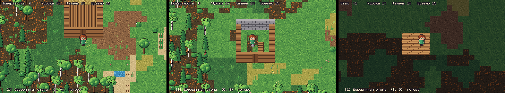
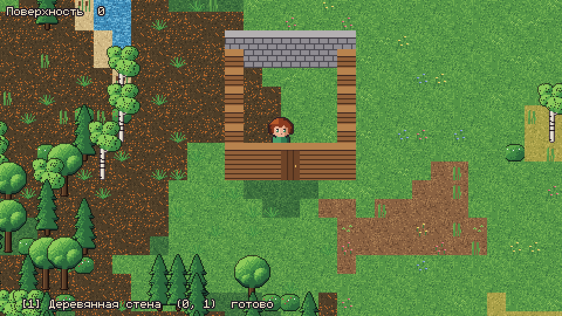

# Ход работы

Что сделано по плану из `docs/proposals/001-foundation/README.md` (раздел 6) и чем это проверено. «Сделано» значит: работает, сохраняется, проходит сеть в предусмотренном объёме и покрыто тестами — а не что направление закрыто.

Текущее состояние и сверка оставшихся планов (29.10.2026) — [STATUS.md](STATUS.md).
Числа тестов и описания выпусков ниже относятся к дате соответствующего этапа.

29.10.2026: завершено подключение железного меча: предмет и рецепт у кузницы,
обучение/торговля у кузнеца, иконка, RO- и LPC-слои, выбор в конструкторе.
По решению автора 29.10.2026 оставлено текущее движение `slash`.
Устройство конвейера и команды проверки — [art/PIPELINE.md](art/PIPELINE.md).

| Шаг | Состояние | Проверено |
|---|---|---|
| 1. Каркас | Сделано: Godot 4.7.2, headless-тесты, CI, ADR | CI на каждый push |
| 2. Контент | Сделано: пакеты, ID с пространством имён, зависимости, проверка ссылок, отпечаток; постройки, рецепты, планы тела, стили, навыки, характеристики, достижения, грунт, растения, биомы, генератор | Сценарий 18 (новое — только данными) |
| 3. Сохранения | Сделано: SQLite, бинарные чанки с палитрой, CBOR, миграции с бэкапом, поток записи, подтверждение после фиксации | Испытание ADR-0005, аварийное завершение 20–30 раундов, сценарии 17, 19 (частично) |
| 4. Переносимый персонаж | Сделано: ключи RSA-3072, профиль, подпись владельца, заверения серверов, проверка импорта | Сценарии 15, 16 |
| 5. Сервер и клиент | Сделано: протокол v1, вход по ключу, предсказание, дельта-снимки, чанки, запросы, переподключение, выделенный сервер, одиночная игра через тот же сервер | Сценарий 3; ENet на localhost; плохая сеть (потери, дубли, задержки) |
| 6. Поверхность | Сделано (первая версия): генератор по зерну и версии, биомы-данные, вода и берега, поляна у точки появления, генерация один раз, предзагрузка в отдельном потоке | Сценарий 4, сохранность при смене генератора |
| 7. Персонаж на экране | Сделано: вся графика из наборов LPC (ADR-0023, 0024, 0025, 20.10.2026) — люди слоями (4 направления, ходьба, бег, рубка, укол, выстрел; перекраска палитрами; редактор: пол, лицо, 6 причёсок, кожа, волосы, глаза), земля на сетке углов, постройки в этаж 64 px с дверью 56, деревья и растения, пещеры с рудой, копёр и ходы, звери (олень, заяц, волк, крыса, паук, слизни) теми же анимациями, иконки 32 px; размеры тел — данные (коллизия, попадания, рост, глаза); «Авторы» в меню | Тесты формата листов, направлений, анимаций, ударов, перекраски, размеров; снимки под Xvfb |
| 8. Предметы и взаимодействие | Сделано (первая очередь): постройка, разбор, передача, двери (открыть/закрыть, проход, нельзя закрыть на стоящем), предметы на земле (бросить/подобрать, видны всем), дальность действий, свой инвентарь у клиента | Гонки за предмет, атомарность пакета (перехват пакетов), аварийное завершение с бросками и подбором |
| Выгрузка чанков | Сделано: чанки и их предметы уходят из памяти, когда никому не нужны 60 с и ничего о них не ждёт записи на диск | Тесты на запись в пути, «воскрешение» подобранного, перезагрузку |
| 12. Нагрузочный стенд | Сделано (первая версия): выделенный сервер + 10/20 ботов по ENet, статистика тика по разделам и трафика | `docs/measurements/2026-10-14-load.md`, сценарий 20 |
| 9. Строительство | Сделано (первая очередь, ADR-0007): перекрытия, уровни зданий как локации в той же сетке XY, точный контур, этажность — настройка сервера, запрет снимать занятое перекрытие, слияние зданий, кровля, лестницы и переходы между уровнями, отрисовка покрытий со скрытием над комнатой игрока, поверхность под этажом. Нет: падение и прыжок с высоты, окна и бойницы, видимость и бой с крыш (шаг 10) | Сценарии 5, 6, 7; слияние; перезапуск; сквозной тест через сеть |
| 10–11 | Восприятие и память существ — сделаны (ADR-0018). Окна, бойницы и наружные позиции — сделаны (ADR-0015, 15.10.2026): видимость на плане с высотами препятствий, обзор между уровнями для существ и игроков. Бой — первая очередь сделана (ADR-0019): здоровье, оружие из данных, удар, стрелы, смерть, волки, звуки и отображение; стрельба между уровнями (с настила в улицу и обратно), прыжки с этажей с уроном от высоты. Подземный мир — первая очередь (ADR-0017): общие глубины по зерну, пещеры, ходы, жилы и самоцветы, копание киркой, природные входы (один у точки появления в каждом мире), шахты на глубину ниже, копёр с поверхности, ствол остаётся после разборки, темнота и факелы. Порядок дальше, согласован с автором 15.10.2026: (1) окна и бойницы с секторами, наружные позиции; (2) бой ближний и дальний; (3) стрельба между крышами и поверхностью, прыжки и падения; (4) подземный мир — общая геология X/Y/Z, горизонтальные раскопки, переходы между уровнями (ADR-0017). Архитектура подземелий — параллельно, если не мешает. Постоянно: производительность. 15.10.2026 пики тика устранены: 20 игроков — p99 51,7 → 27,4 мс; 20 игроков и 500 существ — 81 → 47,6 мс, дальше ровно 37–44. Подробности — `docs/measurements/2026-10-15-tick-peaks.md` | Стенды `bench_load` (ENet) и `bench_snapshots` (в процессе, по разделам тика) |

| Ремёсла | Сделано (первая очередь, ADR-0026, 20.10.2026): рецепты и станки — данные; верстак (доски, топор, кирка, копьё, лук, стрелы), печь (железо и медь в слитки), костёр (жареное мясо); окно ремёсел по K; еда лечит. Нет: времени работы, качества, навыков ремёсел, рецептов из слитков | `test_crafts`, `test_play` |

| Земледелие | Сделано (первая очередь, ADR-0027, 20.10.2026): мотыга, пашня, посев, рост по часам мира, сбор спелого; пшеница (семена с травы, хлеб в печи), морковь (семена с клевера); железные топор и кирка вдвое сильнее (`power`) | `test_fields`, `test_crafts`, `test_play` |

| Рыбалка | Сделано (первая очередь, ADR-0028, 20.10.2026): удочка (верстак: доска и шкура), ловля по удаче (ADR-0031): шанс заброса, плотва, окунь и редкая щука, клёв лучше на рассвете и закате, место вылавливается и восстанавливается; вода остаётся; рыба жарится на костре; заброс — анимация LPC tool_rod | `test_fishing`, `test_crafts`, `test_actions`, `test_lpc_sprite` |

| Одежда и доспехи | Сделано (первая очередь, ADR-0029, 20.10.2026): защита надетого снимается с каждого удара (людей, зверей, стрел), удар не меньше 1; слот «Доспех»; кожа из шкур, кожаный доспех (2), железный шлем (1) — слои LPC | `test_combat`, `test_crafts` |

| Животноводство | Сделано (первая очередь, ADR-0030, 20.10.2026): овцы, коровы, куры на лугах (LPC Farm Animals); приручение кормлением, своё идёт за едой в руках и остаётся в загоне, сытые дают шерсть и яйца и приплод; шерсть → ткань → рубаха, штаны; кожа → сапоги | `test_husbandry`, `test_actions` |

| Потребности | Сделано (первая очередь, ADR-0032, 20.10.2026): сытость 0–100 убывает со временем мира и работой, еда лечит и насыщает, голодный не лечится, пустой теряет здоровье до 1; тепло (ADR-0034): ночь и дождь под небом остужают, одежда защищает (шерстяной плащ), крыша и огонь греют, холод ест еду и не даёт лечиться; бодрость и сон (ADR-0035): уставший не бегает, кровать восстанавливает, просыпаются сами, от шага или удара; видны только себе | `test_needs`, `test_play` |

| Погода | Сделано (первая очередь, ADR-0033, 20.10.2026): дождь, гроза, утренний туман по зерну и времени мира, без передачи по сети; дождь растит посевы вдвое, клёв лучше, обзор существ короче; капли, пелена, молнии, пасмурное небо темнее | `test_weather` |

| Времена года | Сделано (первая очередь, ADR-0036, 20.10.2026): сезоны по 7 дней; весна и осень дождливее, зимой снег и холод днём и ночью, посевы зимой не растут, летние ночи мягче; сезон в строке времени, снежинки | `test_weather`, `test_needs`, `test_play` |

| Вёдра и звуки | Сделано (ADR-0037, 20.10.2026): ведро воды и молока, вылить, полить посев, выпить; звуки набора, выливания, еды, питья, улова, копки, рубки, вспашки, посева, ремёсел, одевания, сна, грома и дождя | `test_crafts`, `test_actions` |

| Поселения | Сделано (первая очередь, ADR-0038, 20.10.2026): деревни как данные; по областям мира и всегда у точки появления; дома с дверями на улицы, кровлей и мебелью по ремеслу, костёр, поля с посевами, загон; чанки в любом порядке | `test_settlements` |

| Местная погода | Сделано (ADR-0055, 22.10.2026, v0.10.0; уточнение 24.10.2026): погода по местам (фронты), дождливее во влажном климате; мороз по теплу места — снег, холод, рост посевов; существующий костёр горит и готовит в дождь, новый без крыши не ставится с понятным сообщением; клиент считает климат сам по зерну мира | `test_local_weather`, `test_play` (костёр) |

| Растения | Сделано (ADR-0056, 22.10.2026, v0.11.0): трава, цветы, грибы, камыш, кусты отрастают, ягоды снова поспевают; вырубка зарастает: пень → поросль → молодое дерево → дерево своей породы; не в мороз; чанк догоняет время при загрузке; саженцы выкапывают и сажают — вырастает дерево места | `test_growth` |

| Звери | Сделано (ADR-0057, 25.10.2026, v0.12.0): дикий приплод от живой взрослой пары, общая ёмкость кормовых земель, меньше корма в местный мороз, расселение настоящих соседей без замены убитых; хищники видят и ловят зверей и скот, едят добычу; возраст детёнышей, маленький размер и взросление, голод скота и отказ в продукции до кормления или взросления; гибель деревенского скота — в летопись. Возраст и голод переживают выгрузку и перезапуск, старые животные получают отсрочку на кормление | `test_animal_life`, `test_husbandry`, `test_crafts`, `test_game_server`, `test_world_view`; 387 тестов без ошибок, запуск собранной Linux-игры — `docs/measurements/2026-10-25-animal-life/` |

| Деревни нужны друг другу | Сделано (ADR-0066, 28.10.2026, v0.13.0): склад у каждой деревни; что она делает и что тратит в день — данные её уклада (горняцкая — камень, руда, слитки и нужда в зерне, брёвнах, досках, рыбе; рыбацкая, пастушья, земледельческая — свои); дни догоняются при обращении; цена у жителей — цена ремесла × √(хочет/есть) в пределах 0,5…2; жители торгуют из склада, купленное и непроданное возвращается в склад; нехватка закрывается лишним соседей по грозди, крупный привоз — в летописи; в торговле видно «↑ нужно деревне» и «↓ вдоволь», житель говорит, чего не хватает. Вместе с выпуском: мир только в 3D (ADR-0063), пропасти и висячие мосты (ADR-0064), NHN UI 2.0 (этапы A–F), управление как в RO (ADR-0065) | `test_village_economy`, `test_dwellers`, `test_play`, `test_click_orders`, `test_ui_windows`, `test_key_map`; 434 теста без ошибок; собранная Linux-игра запускается; выпуск без установщика Windows (нет NSIS), переносной zip есть |

| Торговцы на дорогах | Сделано (ADR-0067, 28.10.2026, v0.14.0): казна у каждой деревни (300 монет вначале), привоз от соседей за деньги по цене продавца, выручка жителей за день — в казну; бедность и богатство — в летописи; странники на дорогах — торговцы: берут груз в деревне, откуда выходят (что нужно другой), продают его игроку по дороге на четверть дороже, покупают у игрока нужное той деревне, сдают груз в её склад за деньги, крупный привоз — в летописи, берут обратный груз; говорят, куда идут и что везут. Вместе: сесть (Insert), наведение не шире клетки, проходимые кусты, жители смотрят в костёр и живут каждый по своим часам, голоса зверей слышнее | `test_village_economy`, `test_dweller_pace`, `test_needs`, `test_beast_voices`, `test_world_view_3d` |

| Жители | Сделано (первая очередь, ADR-0039, 20.10.2026): земледелец, кузнец, рыбак, пастух — ремёсла данными; по жителю на дом; работа днём по часам ремесла, вечер у костра, ночь в кровати; путь по клеткам через двери; работа ремеслом, пастух кормит загон; реплики облачком | `test_dwellers`, `test_creatures` |

| Торговля | Сделано (первая очередь, ADR-0040, 20.10.2026): монеты; товары и закупки по ремеслу данными, запас и кошелёк с утра; сделка всё или ничего; окно по E на жителе | `test_dwellers`, `test_actions` |

| Летописи и просьбы | Сделано (первая очередь, ADR-0042, 20.10.2026): имена жителей и деревень; летопись деревни — прошлое из зерна (основание, рудознатец в настоящей пещере) и живые события (хищники рядом, сезоны, удар, смерть, поступки игроков); просьбы из записей — найти, добыть, принести, награда монетами; разговор (E), журнал (L), слухи | `test_chronicles`, `test_actions` |

| Сумка из ячеек | Сделано (ADR-0041, 20.10.2026): 36 ячеек, стопка по размеру вещи; что не влезло — под ноги, полная сумка не подбирает и не покупает; окно вещей, снаряжение и сундук — сетки с перетаскиванием, раскладка хранится у игрока | `test_bag`, `test_containers`, `test_play` |

| С пустыми руками | Сделано (ADR-0045, 21.10.2026): волокно, ветки, кремень руками; бечёвка и кремнёвые рубило и кайло без станка; дальше верстак и каменные орудия; растение «россыпь камней», валуны и на лугу | `test_from_scratch` (4 мира), `test_progression` |

| Износ и починка | Сделано (ADR-0046, 21.10.2026): состояние у каждого экземпляра (инвентарь формата 2), прочность орудий, оружия, доспехов в применениях; затупилось — медленнее и слабее, сломано — не работает; починка у станка за материалы, не больше четырёх раз; кремень не чинится; полоска износа на ячейках, в руках, на кукле; карточка вещи | `test_wear` (sim, server), `test_ownership`, `test_fishing`, `test_play` |

| Знания и мастерство | Сделано (первая очередь, ADR-0047, 21.10.2026): 17 навыков от занятий с эффектами; мастерство каждого рецепта; шанс по сложности, неудача портит половину недрагоценного; качество 50–100% и улучшения мастера, имя мастера; врождённые рецепты, чертежи (сделать раз / изучить), запись чертежей игроками, учёба у жителей по доверию деревни; товары и цены по качеству; окно K по навыкам; формат мира 2 (старые миры — понятный отказ). v0.2.0: правила лёгкого мира в меню, стартовые вещи 75%, доверие деревни в разговоре, продажа своих изделий по одному по их цене | `test_mastery` (sim, server), `test_teaching`, `test_progression`, `test_play` |

| Изделия и стопки | Сделано (ADR-0048, 21.10.2026, v0.3.0): изделия (всё, что носят, держат, ставят) — экземпляры, сырьё — стопки; верстак, сундук, кровать — изделия: сделать, поставить, снять тем же экземпляром, прочность по качеству, обломки; ведро — изделие; Shift — все одинаковые разом, «Разложить»; формат мира 3 | `test_things`, `test_containers`, `test_play` |

| Плавание | Сделано (ADR-0050, 22.10.2026, v0.4.0): вода проходима для персонажей, не для зверей; вдвое медленнее, без бега; бодрость и тепло уходят, без сил — тонут; в воде нельзя работать и строить; пловец по плечи в воде | `test_swimming` |

| География | Сделано (ADR-0049, 22.10.2026, v0.5.0): бесконечный мир из областей 5120×5120 клеток, в каждой — материк, острова или архипелаг, между ними океан; рельеф с горными поясами, климат от широты (пояса чередуются), высоты и западного ветра с дождевой тенью; сток к морю и в бессточные котловины, озёра, реки с притоками шире вниз по течению и петляют; биомы по климату и высоте (пустыня, горы, вершины, болота в сырых низинах), скала на вершинах; области считаются лениво; формат мира 4; обзорные карты `tools/world_map.sh` | `test_geography`, `test_surface`, `test_settlements` |

| Вода | Сделано (ADR-0051, 22.10.2026, v0.6.0): мелководье у берегов морей и озёр и броды на реках — вброд, без бега, звери тоже; глубокая вода в открытом море — плыть вдвое тяжелее, рыба крупнее; реки не текут в гору | `test_geography`, `test_swimming` |

| Лодки | Сделано (ADR-0052, 22.10.2026, v0.7.0): плот руками из брёвен и бечёвки, лодка у верстака (учит рыбак); спуск на воду, место у вёсел и пассажиры, гребля по воде и мелководью с предсказанием клиента, сход на берег, износ в пути и починка, судно лежит в мире и забирается обратно | `test_boats` |

| Ископаемые | Сделано (ADR-0053, 22.10.2026, v0.8.0): подземные жилы по высоте земли над ними, серебро и золото под горами, галька с кремнём на берегах; выработанное не возвращается | `test_minerals` |

| Поселения | Сделано (ADR-0054, 22.10.2026, v0.9.0): гроздья деревень по округам по мере исследования, лучшее место у воды на ровной низкой земле; дороги в грозди и между гроздьями по случаю — уходят в неисследованное; путь по местности с бродами и мостами; уклад — горняцкий, рыбацкий, пастуший, земледельческий; формат мира 6 | `test_settlements` |

## Известные ограничения

Что отложено и что ещё не сделано — [`TODO.md`](TODO.md).

- Графика: мир в 3D, RO-персонажи из VRoid-моделей и LPC-тела слоями, LPC-звери/иконки; актуальные источники и сборка — [art/PIPELINE.md](art/PIPELINE.md). Нет: своих анимаций у вещей на земле, сезонов у деревьев, выбора телосложения.

- Интерес-менеджмент — радиус в чанках; правила крыш и закрытых этажей придут со строительством.
- Первый импорт проекта в Godot 4.7.2 падает на выходе из-за расширения SQLite (импорт при этом завершён).
- Меню игры (ADR-0011): стартовый экран и меню по Esc; новая игра локально или со своим сервером (правила мира: сид, этажность, стартовые вещи); загрузка миров; подключение к серверу; персонажи (текущий, смена, создание с причёской); настройки игрока.
- Бег (Ctrl, ×1,5; протокол 5). Звук (ADR-0012): шины Музыка/Эффекты/Окружение; синтезированные шаги по поверхностям, постройка и разборка, двери, подбор, лестница, щелчки меню; фоны луга, леса и воды по местности; музыка автора (10 треков, 5 настроений) по месту и часу, с плавными переходами.
- Поворот деталей (ADR-0013): лестница в трёх положениях; выводит на площадку, куда смотрит её верх (на стену с перекрытием, галерею, соседнюю комнату).
- Клиент (16.10.2026): пещеры 55 → 17 мс на кадр, поверхность 33 → 14 мс (порода в глубине массива плитками, индекс спрайтов по клеткам, радиус отрисовки) — `docs/measurements/2026-10-16-client-frame.md`. Рубка деревьев по их размеру (дуб — 15 ударов), удержание ЛКМ, взмах всем телом; стрелы под землёй летят, как на поверхности.
- Лестницы и проёмы (ADR-0007, 16.10.2026): лестница стоит под проёмом (её постройка убирает своё перекрытие над ней по правилам разборки) и выводит на соседнюю площадку; без неё проём остаётся, в него спрыгивают (J или «Спрыгнуть вниз»), падая до первого пола; старые лестницы приводятся к новым правилам при загрузке, где это безопасно; ушедших из игры при входе ставят на пол под ними.
- Время мира (ADR-0014): серверное, сохраняется, синхронизируется; длина суток — правило мира; день и ночь на экране; освещённость клетки (дневной свет, крыша, источники); факел; ночная музыка по времени мира.
- Живые существа (ADR-0018): заяц, олень, жители; серверная жизнь с честным восприятием и памятью, бюджетом раздумий и уровнями активности; заселение по биомам; нагрузка — `docs/measurements/2026-10-14-creatures-load.md` (20 игроков и 500 существ — 20 тиков/с).
- Права (ADR-0016, правила автора 15.10.2026): прав на постройки нет, защищает прочность (каменная стена — 400 ударов кирки, деревянная — 3 минуты топора), разобрать целиком — только поставивший; перекрытия и кровли ломаются сверху вниз; двери с кодом из 4 цифр; сундуки — хозяину и друзьям, сломанный высыпает содержимое; друзья через меню на персонаже; вещи погибшего 10 минут только его; земля очищается при запуске мира; поринги и попоринги подбирают вещи и переваривают за два часа.
- Карты (ADR-0020): разведанное хранится за персонажем на сервере; миникарта на 1–4 экрана; карта мира со страницами поверхности и глубин. Управление (ADR-0021): действие — от предмета в руках и цели, меню действий, панель предметов, каталог строительства.

25.10.2026: автор разрешил выпуск 0.12. Проверка пропавшей графики Windows-клиента через интернет отложена автором до реального подключения; причина не подтверждена, сетевой вопрос не закрыт.

Поправка автора к 0.12 (v0.12.1): взрослый домашний скот и детёныши сами находят доступную растительность или брошенный подходящий корм, предпочитая предложение хозяина. Поиск учитывает ограды, размер тела и обходы; на земле съедается одна вещь из стопки. Самостоятельное питание поддерживает молоко, яйца, шерсть и приплод; выпас не блокирует кормление из рук. Пустой или перенаселённый загон по-прежнему приводит к голоду.

Проверка поправки: 393 теста, 0 ошибок; собранная Linux-игра и данные сохранений — `docs/measurements/2026-10-25-livestock-foraging/`. При выходе графической игры остаются прежние предупреждения ObjectDB/resource из 0.12.0.
