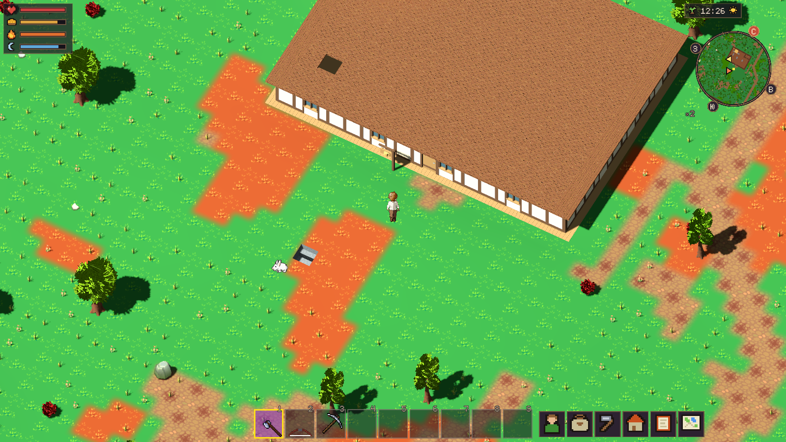
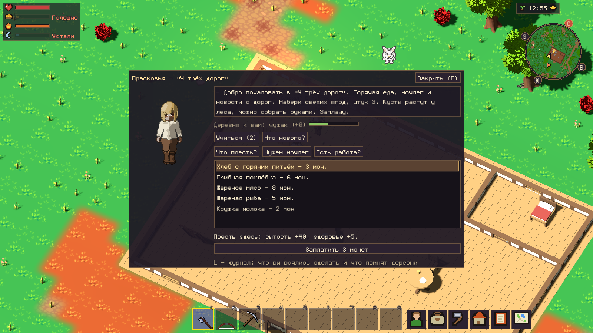
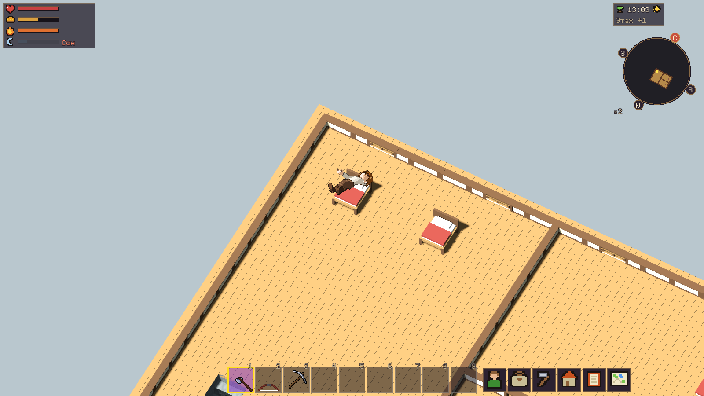
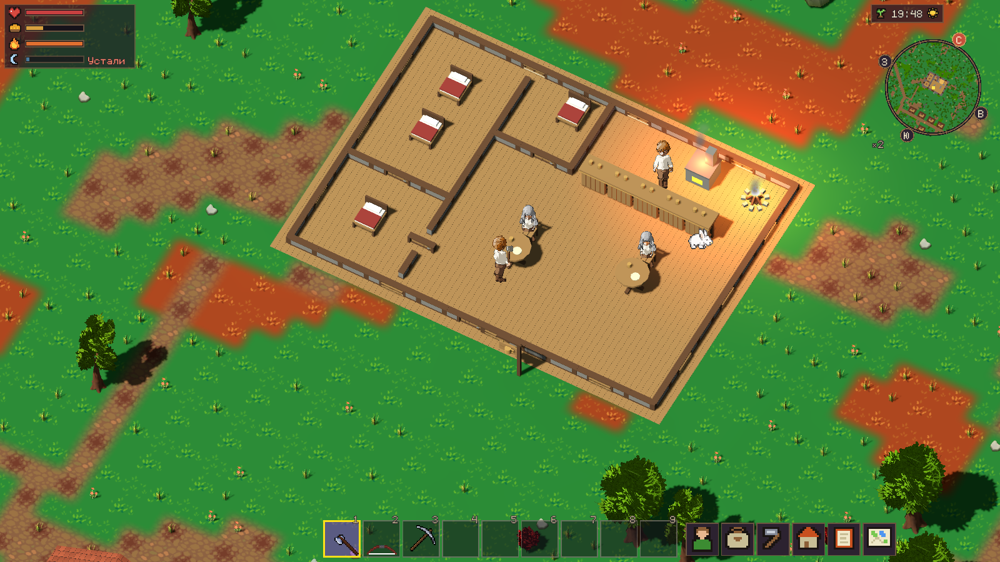
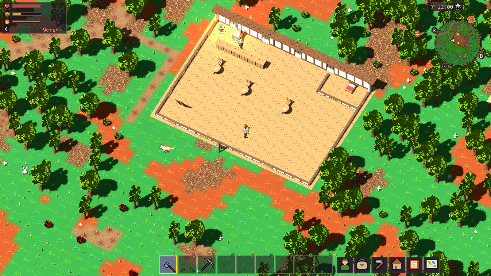

# Таверны и дороги — v0.17.0

Этап автора от 30.10.2026 выполнен перед ростом и упадком деревень.
Архитектурное решение: [ADR-0070](adr/0070-taverns.md).

## Что появилось

Деревенская таверна 15×11: зал, стойка, очаг/кухня, две общие кровати и
отдельная комната; у хозяина собственная служебная спальня со стенами и дверью. Два придорожных двора 18×13 и 20×15: зал внизу,
отдельная служебная спальня хозяина внизу, гостевые спальни наверху, соответственно 4 и 7 гостевых кроватей, двор для упряжки.
Планы отражаются; меняются каменная/деревянная отделка, палитра мебели,
круглые/прямоугольные столы, дополнительные стулья и названия.
Мебель состоит из столешниц, ножек, спинок, стоек и посуды, вывеска — с кружкой.

Размещение детерминировано. Таверны появляются у подходящих деревень,
не у каждого маленького поселения; придорожный двор — максимум один на гроздь,
у достаточно длинной действующей дороги. Проверяются вода, уклон, дома,
лагеря и дорога; двор очищается для остановки лошадей и охраны.
Сохранённые чанки не перестраиваются: в старых мирах заведения нужно искать
на новых территориях. Исходный `ccc` не изменялся.

## Как пользоваться

Разговор с постоянным хозяином открывает услуги в обычном окне NHN UI 2.0.
Еда стоит 2–8 монет: хлеб, похлёбка, мясо, рыба, молоко. Сервер применяет
обычные эффекты еды; товары и посуда в инвентарь не поступают.
Общая кровать стоит 6 монет на 12 игровых часов, отдельная комната — 15 на 24.
В окне видны номер, этаж, цена, срок и занятость; номер также виден при наведении
на кровать. Аренда исключительная, сохраняется, истекает и будит гостя.
Сон на оплаченной кровати восстанавливает силы быстрее, без перемотки общего
времени и изменения точки возрождения.

Новости берутся из настоящих летописей, связей дорог и нехватки у соседей.
Адаптер `Hospitality.news` допускает добавление будущих источников событий.
Хозяин последовательно предлагает сбор 3 ягод (6 монет), 2 брёвен (8 монет)
и доставку письма в другую деревню (12 монет). Награда выдаётся один раз;
письмо привязано к поручению и персонажу, потерянное можно получить снова.
Задачи используют текущий журнал и разговоры. Обучение — только существующие
рецепты хлеба и похлёбки, с обычными условиями знания, доверия и платы.

Часть настоящих жителей приходит после работы, сидит у столов и уходит домой.
Существующие караваны используют двор как ночную стоянку, без лишнего костра;
утром продолжают путь с охраной. Детальная симуляция действует около игроков.

## Исправления по игровой проверке

Лежащие персонажи сохраняют исходную перспективу спрайта при повороте камеры.
Торговец не нанимает охрану для отсутствующего/замкнутого маршрута; названия
одинаково названных деревень различаются координатами. Старые некорректные
договоры завершаются с расчётом. Поиск объезда учитывает габариты упряжки,
точную текущую позицию, препятствия и свободные места охраны; караван может
свернуть с дороги и вернуться дальше по маршруту. Полностью перекрытый двор
не вызывает бесконечных попыток въезда: караван останавливается снаружи.

На копии последнего сохранения `ccc` воспроизведено исходное застревание;
после исправления тот же караван завершил рейс и обратный путь.

## Проверки

Профильная группа — 15 тестов: услуги, конкурирующая аренда, сохранение,
истечение срока, задания, обучение, посетители, въезд/выезд телеги и вьюка,
детерминизм. После поправки автора добавлена проверка разделения всех спален
стенами и дверями, по одной кровати в отдельном номере. Она прошла для всех
трёх планировок; повторный графический сценарий — 16 проверок без провалов.
Проверен видимый и доступный для взаимодействия лестничный проём наверху.
Адаптированы две старые проверки жителей: отдельный хозяин заведения больше
не считается владельцем обычного деревенского дома; обе проверки проходят.

Обязательный выпускной барьер: `tools/run_tests.sh`, сборки `tools/package.sh`,
затем workflow `release` для точного SHA тега. Итог полного прогона и ссылка
на успешный CI приводятся в [релизе v0.17.0](https://github.com/mirivlad/noheroneeds/releases/tag/v0.17.0).
Графический сценарий `tools/experiment_3d/check_hospitality.gd` использует
настоящие App, LocalGame, сервер, GameClient и окно игры на RX 580; создаёт
отдельный профиль, задаёт позиции/время для проверки и отправляет обычные
запросы услуг, дверей, лестниц и сна. Это воспроизводимый сценарий,
а не заявление о полностью ручном прохождении от нового персонажа.

## Проверить вручную без отладочных команд

1. Запустить релиз, создать новый мир с зерном **431** и стартовым набором.
2. Открыть карту **M**: рядом со стартом таверна «Медный котёл», примерно
   (22, −25), на северо-востоке. Двор «У трёх дорог» — примерно (−53, −120),
   на северо-западе, у дороги. Координаты — клетки мира, не пиксели.
3. Войти через дверь (**E**), поговорить с хозяином. Выбрать блюдо и нажать
   «Заплатить». Выбрать кровать, оплатить; в дворе подняться по лестнице,
   найти номер кровати наведением и лечь через **E**, когда устанет персонаж.
4. Открыть новости и работу. Ягоды собираются руками с ягодного куста;
   брёвна можно взять из стартового набора или срубить дерево. Вернуться
   к хозяину, сдать поручение, проверить деньги и журнал **L**.
5. Письмо отнести любому местному жителю указанной другой деревни.
   После помощи попробовать обучение готовке. Вечером посмотреть посетителей.
6. Выйти и снова зайти: хозяин, деньги, поручения и действующая аренда сохраняются.

Полные закупки кухни, поставки, замки комнат, изменение цен/банкротство,
рост поселений и новые семьи остаются будущими этапами. После выпуска
v0.17.0 работа останавливается по указанию автора.

## Кадры работающей игры

