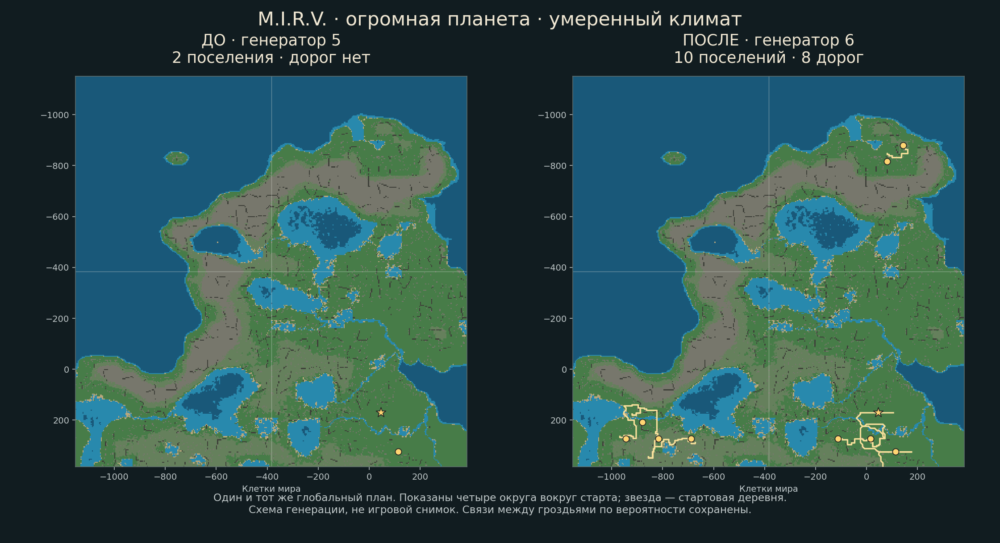
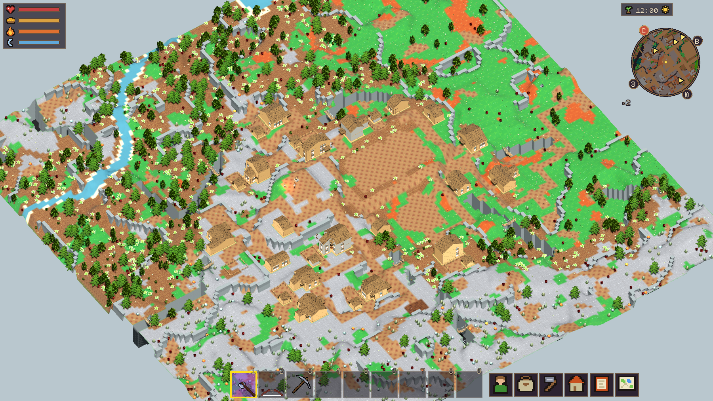
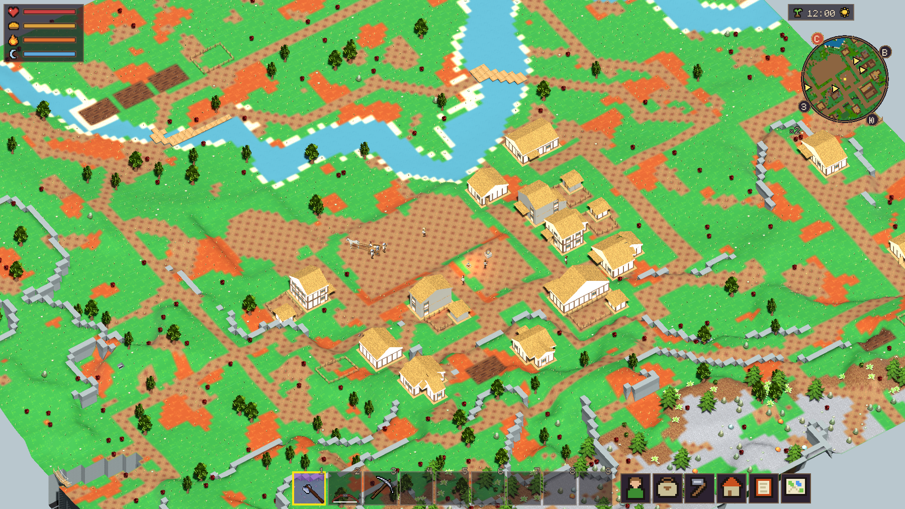

# Поселения по местности — 12.11.2026

Исправление подготовлено локально в `codex/settlement-placement` от `c2d60ce`.
На момент этих замеров коммит, push, слияние и новый релиз не выполнялись.
Публикация изменений в main одобрена автором 16.11.2026. Опубликованная v0.20.0
не менялась. Решение описано в [ADR-0080](adr/0080-terrain-fitted-settlements.md).

## Воспроизведение

Параметры автора: `M.I.R.V.`, огромная планета, умеренный климат. Текстовый
seed даёт число `237895547`; стартовая деревня — **Боровое**, как на снимке
автора. [Проверка имени и регистра](evidence/terrain-settlements/names.log).

Проверен один и тот же глобальный WorldPlan format 3, SHA-256
`6982cf53ad36e30118d63489fda8cd35f58a9d7b1fc4fd936c076748169b609e`.
Высоты, биомы и вода исходного плана не перегенерировались.

| Проверяемая область | Генератор 5 | Генератор 6 |
|---|---:|---:|
| Поселения в девяти округах x/y=-1…1 | 2 | 23 |
| Поселения в четырёх округах на сравнении | 2 | 10 |
| Дороги стартового, западного и северного округов | 0 | 8 |

Это локальная окрестность, не подсчёт всех поселений огромной планеты.
В исходном расчёте найдены две деревни. По одному снимку нельзя установить,
попадали ли клетки второй в исследованную область автора; обе остались без
междеревенских дорог. Исходный результат повторно
подтверждён кодом выбора поселений из тега v0.20.0.



Это схема генерации с координатами клеток, не снимок игрового экрана.
На ней четыре округа, звезда обозначает стартовую деревню. Отдельные гроздья
по-прежнему могут не иметь внешней связи: это предусмотренная вероятность,
а не обещание одной дороги через все континенты.
[До](evidence/terrain-settlements/before.json),
[повторная проверка до](evidence/terrain-settlements/before-rechecked.json),
[после и реальные пути](evidence/terrain-settlements/after.json).

## Что изменено

Готовая схема остаётся, когда действительно помещается. Для остальных мест
генератор отдельно ищет участки под все выбранные здания, площадь, основной
караванный двор, резервную стоянку, каждый предусмотренный посев и загон.
Состав поселения и архитектурные варианты не урезаются ради размещения.

Участки проверяются целиком. Между ними строятся связанные трёхклеточные
проходы с учётом воды и препятствий. Двери повёрнуты к настоящим подходам.
Сухое плато больше не исключается только по абсолютной высоте. Площадь и
стоянки выравниваются каждая на своей отметке, а не на общей высоте площади.
Деревья и расселины в незанятых промежутках не исчезают из-за большого
прямоугольника вокруг разбросанных зданий.

Локальный поиск улиц передаёт наружной дороге уже свободный выход из
застройки. Наружные дороги различают ступень рельефа и настоящую скалу.
Проверка и рисование дороги используют одинаковую ширину, включая поворот.
Проведены **6403 проверки клеток покрытия восьми дорог**: нет пересечений со сплошными
постройками, глубокой водой или настоящими скалами. До исправления проверки
кромки промежуточный вариант задевал стены в шести клетках; одна проверка
центральной линии была недостаточна.

## В настоящей игре





Нативный Godot 4.7.2, Compatibility, Radeon RX 580. Это настоящий LocalGame с
серверными клетками и клиентской геометрией, отдельный временный профиль.
Адаптер перемещает персонажа и камеру для обзора; поселения и дома не собраны
вручную. [Нативный отчёт](evidence/terrain-settlements/native.json),
[журнал](evidence/terrain-settlements/native.log),
[караван во дворе](evidence/terrain-settlements/caravan.webp).

Караван поставлен в контрольную позицию у настоящего сгенерированного двора:
штатная серверная логика принимает прибытие и переводит его к торговле.
Это проверка вместимости и обслуживания стоянки, не проезд всего маршрута.
Снимки WebP попиксельно совпадают с исходными PNG в RGBA.
[Размеры и хеши](evidence/terrain-settlements/images.json).

## Проверки

- Изолированные проверки охватывают связанные широкие проходы вокруг озера,
  сохранение всех заданных посевов, отказ слишком маленьких островов,
  сухие высокие плато, стык локальных улиц с наружной дорогой и её полную ширину.
- Планетарные регрессии используют `M.I.R.V.`/huge/temperate и прежний озёрный
  seed `1278862159`/small/temperate; проверяются реальные участки, собственные
  отметки общественных площадок и независимость от порядка округов.
- `TEST_TIMEOUT=2400 TEST_JOBS=6 tools/run_tests.sh`: **680 тестов в 104 наборах,
  без провалов**, 1193.91 с. Все 527 входных файлов остались неизменными.
  [Итоги](evidence/terrain-settlements/full-tests.json),
  [журнал](evidence/terrain-settlements/full-tests.log),
  [исходники](evidence/terrain-settlements/tested-sources.json).
- `tools/site/test.sh`: документационный барьер, 32 Python-теста и 10
  браузерных тестов. [Журнал](evidence/terrain-settlements/site-tests.log).

Первый полный прогон обнаружил истечение окна ENet на холодной генерации.
Стенд передачи огромного плана теперь вызывает `prepare_spawn_view(2)` до
начала протокольного отсчёта, как настоящий dedicated-сервер. Лимит 15 секунд
и проверка полного полученного WorldPlan сохранены. Направленный ENet-прогон
после этого прошёл. Второй прогон остановлен после обнаружения пересечения
кромки дороги со стенами. Следующий полный прогон прошёл 103 набора, но
проверка плотности поселений превысила прежний лимит 180 секунд. Он сохранён;
исправлен лишний расчёт дальних округов в запросе `plans_near`. Состав и порядок
результата сверены с исчерпывающим перебором для разных радиусов, граничных
и отрицательных координат. Изолированно исходный запрос также превысил 180 секунд; исправленный прошёл
за 78,990 секунды при том же лимите. Свежая нативная сводка сохранила все
координаты, количества зданий/полей и полные пути дорог.
[Команды, время и границы замера](evidence/terrain-settlements/query-timing.json).
Это локальный замер CPU-теста, не аттестованный аппаратный бенчмарк.
Окончательный полный прогон прошёл все 104 набора; тот же тест плотности
внутри него завершился за 46.259 секунды. Лимиты проверок не повышались.

Холодный расчёт сложных районов остаётся заметным по времени. Исключено
предварительное исследование полной ширины у каждой неиспользуемой точки
поиска: выбранные пути всё равно проверяются целиком. Съёмка включает холодную
генерацию и загрузку геометрии, её строки FPS не являются стабильным
производительным бенчмарком. Отсутствие пауз при первом исследовании здесь
не заявляется.

## Сохранения и повторение

Версия поселений — **6**, поверхности — **18**. Для изменения нужен новый мир;
существующие миры генератора 5, включая v0.20.0, получают явный отказ до записи.
Миграции и перестройки исследованных областей нет; реальные сохранения автора
не открывались для записи.

Сжатый исходный глобальный план содержит только сгенерированную географию,
без персонажей, исследованных клеток и приватных ключей:
[mirv-plan.json.gz](evidence/terrain-settlements/mirv-plan.json.gz).

```sh
mkdir -p build/settlement-placement
gzip -dc docs/evidence/terrain-settlements/mirv-plan.json.gz > build/settlement-placement/mirv-plan.json
godot --path . --audio-driver Dummy -s res://tools/experiment_3d/check_terrain_settlements.gd
tools/run_tests.sh --only=world/test_settlement_terrain_layout
tools/run_tests.sh --only=world/test_settlement_planets
tools/run_tests.sh --only=world/test_roads
TEST_TIMEOUT=2400 TEST_JOBS=6 tools/run_tests.sh
python3 tools/site/build.py
tools/site/test.sh
```
