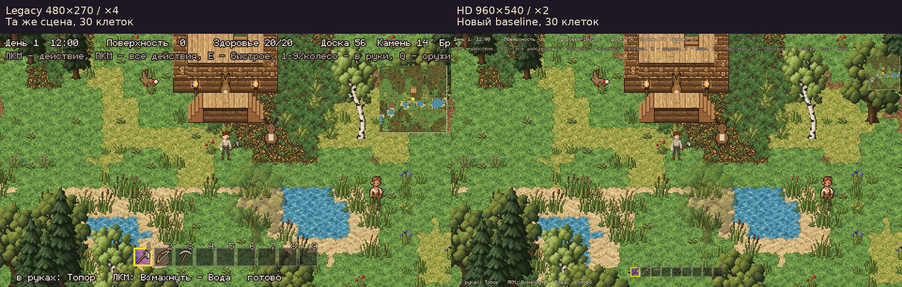
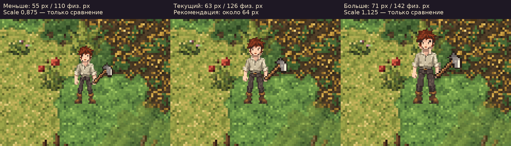
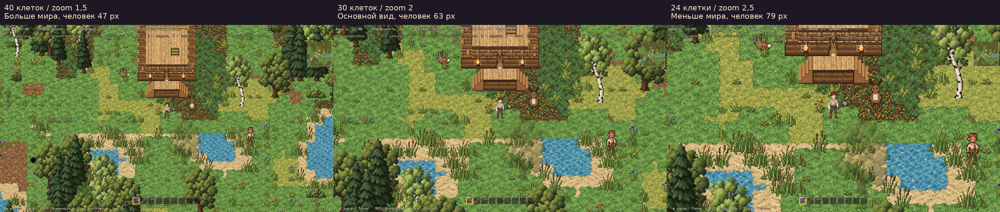
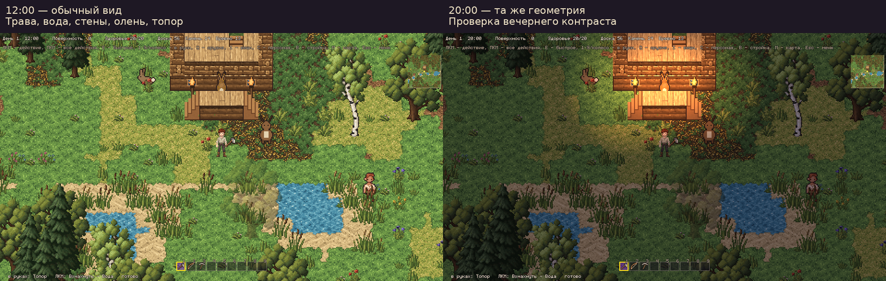

# Четыре игровых сравнения для Visual Standard HD

> **20.10.2026, уборка:** исходные захваты окна, маски, логи и JSON-замеры этого отчёта не перенесены в основную историю (десятки мегабайт). Они лежат в ветке `codex/character-art-production-01`, коммит `f9bf7e1`; ссылки ниже на них ведут туда, а не в рабочую копию.

17.10.2026. Решение по направлению: **960×540 — основной baseline**.
Цель этих сравнений — выбрать рабочий размер и читаемость, не производить арт.
Новые персонажи, тайлы и текстуры не создавались. Правила собраны в
[Visual Standard HD v1](../visual_standard_hd.md).

## Как получены изображения

Настоящая `scenes/main.tscn`, App, GameScreen, LocalGame и серверный мир seed=1.
Дом строится существующим `--demo` через запросы сервера. Земля, вода и деревья —
обычная генерация. Персонаж — существующий `human_m`, стартовая одежда и топор;
олень добавлен обычным серверным CreatureSim, передаётся клиенту и рисуется WorldView.
Профиль и новый мир находятся в `/tmp`; default-профиль не читается и не меняется.

После подготовки **один мир заморожен**: камера (8,120), персонаж, олень и другие
NPC не перемещаются между захватами. В группе 3 меняется только zoom камеры,
в группе 4 — действующие часы и освещение игры. Это не макет, не коллаж из ассетов
и не повторная независимая генерация мира.

Godot 4.7.2, X11, Mesa llvmpipe на отдельном Xvfb/xfwm4. Все оригиналы окна —
**1920×1080**, прямые пиксели окна `DisplayServer.screen_get_image`, без увеличения.
Отдельно сохранён фактический viewport. Во всех семи случаях окно попиксельно
совпадает с nearest ×4 для legacy либо ×2 для HD.

Обзорные листы ниже — **подписанные производные для сравнения**: группы 1/3/4
уменьшены nearest вдвое; группа 2 — одинаковые фрагменты (800,380)–(1120,620)
из окон, увеличенные nearest ×2. Пиксельную структуру оценивайте по оригиналам
1:1, а не по автоматически уменьшенному предпросмотру Markdown.

## 1. Legacy vs HD — одна сцена и один обзор



Оригиналы: [legacy 1920×1080](legacy-window.png), [HD 1920×1080](hd-window.png).
Камера и видимый прямоугольник мира совпадают: 480×270 мировых единиц,
**30×16,875 клетки**. В HD яснее лицо, складки и кисть; UI занимает меньше места.
Старые тайлы не стали настоящими 32×32 исходниками и сохраняют более крупный тексель.
Это сравнение совместимости; legacy не рассматривается как дальнейший художественный ориентир.

Минимальный шаг итогового растра — 4 физических px в legacy и 2 в HD.
Геометрическая проекция исходного текселя человека в legacy равна 2 px,
но промежуточный растр 480×270 отбрасывает половину исходных отсчётов:
реальный видимый пиксель всё равно кратен 4. HD сохраняет больше исходной информации.

## 2. Размер персонажа в HD



| Вариант | Рост, лог. px | Рост, физ. px в 1080p | Оценка |
|---|---:|---:|---|
| Меньше, scale 0,875 | 55 | 110 | свободнее вокруг ног, хуже различимы лицо и хват |
| Текущий, scale 1 | 63 | 126 | близок к цели 64, сохраняет баланс с клеткой и дверью |
| Больше, scale 1,125 | 71 | 142 | детали крупнее, но фигура/топор занимают больше сцены |

Оригиналы: [55 px](character-small-window.png), [63 px](hd-window.png),
[71 px](character-large-window.png). Обзор во всех случаях 30×16,875 клетки.
Менялся только runtime scale узла персонажа вместе с предметом; симуляция,
коллизия, atlas и pivot не менялись. Дробные коэффициенты — временные сравнения,
не новые режимы игры. Видимый рост измерен прозрачной маской тех же слоёв,
отдельно от 96×96 кадра и оружия.

**Рекомендация:** около **64 логических px**, без дополнительного увеличения
текущей фигуры. Новый production-персонаж должен улучшать силуэт и анимацию,
не маскировать их дефекты масштабом.

## 3. Визуальная плотность / сколько мира видно



Оригиналы: [40 клеток](density-far-window.png), [30 клеток](hd-window.png),
[24 клетки](density-near-window.png).

Во всех трёх случаях **viewport 960×540 и вывод ×2 одинаковы**; меняется
масштаб мира, не физический размер логического пикселя. Камера стоит в той же точке.

| Вид | Camera zoom | Обзор, клетки | Рост человека, лог. px | Тексель старой земли / человека, физ. px |
|---|---:|---:|---:|---:|
| Дальний | 1,5 | 40×22,5 | 47 | 3 / 1,5 |
| Основной | 2 | 30×16,875 | 63 | 4 / 2 |
| Ближний | 2,5 | 24×13,5 | 79 | 5 / 2,5 |

В дробных величинах физические ряды чередуются, это средний размер проекции
текселя. Дальний вид уже соответствует существующему view_zoom 0,75;
ближний — только временное сравнение. Настройки профиля не менялись.

**Рекомендация:** оставить основной обзор **30 клеток**. Дальний полезен для
обзора ситуации, но уменьшает лицо и хват. Ближний сильнее показывает грубые
тексели окружения и сокращает пространство. Уменьшить ощущение «кирпичности»
дальше должны настоящие исходники 32×32, а не приближение камеры.

## 4. Читаемость окружения днём и вечером



Оригиналы: [12:00](hd-window.png), [20:00](environment-dusk-window.png).
Деревья трёх пород, трава, вода, стена, дверь, настоящий олень, человек и топор
присутствуют в одной сцене. Геометрия, положение камеры и обзор совпадают.
Меняется только игровое время и существующий свет, без новых шейдеров/текстур.

Наблюдения для будущих правил:

- Породы деревьев, берег и дверной проём различимы; масштаб места совпадает с персонажем.
- Плотная травяная фактура конкурирует с обувью и нижней частью одежды.
  Для новых тайлов нужны связанные группы тона и спокойные участки вокруг ног.
- Олень заметно грубее нового человека: это старый ресурс с крупным пикселем,
  его текущий вид не является утверждённым образцом нового стандарта.
- Топор связан с кистью, но его старый источник остаётся крупнопиксельным.
  Будущий character pass обязан проверить хват в движении и восьми направлениях.
- В 20:00 вода и берег ещё различимы, персонаж темнее фона. Факелы у дома
  дают сильный свет и местами забивают детали фасада: их баланс — ограничение
  текущей сцены, не требование копировать такой контраст в новые материалы.

Эти выводы — рабочая художественная оценка сравнения; они не означают принятие
существующих фигур или всех текстур как production-эталона.

## Проверка и воспроизведение

```sh
tools/check_pixel_display.sh res://tools/compare_visual_standard.gd
python3 tools/verify_visual_standard.py
```

Стенд использует существующий оконный wrapper; нужны Godot, Xvfb, xfwm4 и xprop.
Проверка использует Pillow и системный DejaVu Sans; NumPy не требуется.
Сырые параметры: [measurements.json](measurements.json),
[таблица](measurements.md), [verification.json](verification.json),
[runtime.log](runtime.log), [verification.log](verification.log).

Проверяются семь пар реального окна/viewport, одинаковая камера и позиция,
маски роста, неизменные земля/вода и видимые типы объектов, фактический топор,
настоящий серверный олень, 351 неизменённый файл контента/ресурсов и ссылки документации.
Результаты автоматических тестов: [tests.log](tests.log),
[HD default](focused-tests.log), [legacy gameplay](legacy-tests.log),
[повторная проверка окна персонажа в HD](hd-gameplay-check.log).
Итог: **223 теста, 0 провалов**; отдельно **5 проверок отображения**,
**6 игровых тестов legacy**, **1 повторный игровой тест HD** — все прошли.
В оконном сравнении — **28 проверок**, **7 точных nearest-пар**,
**4 листа сравнения**, **351 файл ресурсов без изменений**.
Это проверка корректности на llvmpipe, не GPU-бенчмарк; Windows/DPI отдельно не проверялись.

**Единственный следующий этап после утверждения стандарта — character standard pass:**
один production-ready персонаж около 64 px, с одеждой, инструментом и проверкой
анимаций/хвата. Перерисовка окружения и UI сейчас не начинается.
