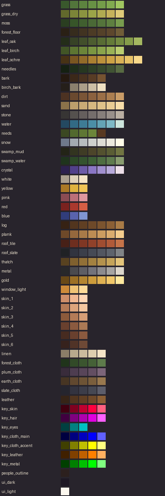

# Мастер-палитра (версия 2: средняя палитра B4)

Источник — `tools/art/palette.py` → `tools/art/palette.json`. Рампы от тёмного к светлому: природные базовые цвета B4 после «средней» тонировки, с добавленным полутоном между средними ступенями. Группа `keys` — ключевые цвета перекраски (в обычном арте не встречаются), `ink` — контур людей и цвета интерфейса.

## nature

| Рампа | Цвета |
|---|---|
| grass | `#39582c` `#52753b` `#5d833f` `#689144` `#749d49` `#81aa4f` `#a0c660` |
| grass_dry | `#62692c` `#7b8538` `#8b9440` `#9ba448` `#b0ab51` `#c5b25b` `#deca78` |
| moss | `#2a3e21` `#375529` `#405f2f` `#4a6936` `#54743b` `#5e7f40` `#789c4e` |
| forest_floor | `#2a2015` `#362c1d` `#413321` `#4c3b25` `#544129` `#5d472d` `#705d38` |
| leaf_oak | `#242d19` `#374226` `#424f2b` `#4d5d30` `#586c34` `#647b39` `#748b41` `#859c4a` `#a5b861` |
| leaf_birch | `#425526` `#5d7532` `#6c8539` `#7b9641` `#8aa44b` `#9ab256` `#bacd70` |
| leaf_ochre | `#473215` `#7a5621` `#926b29` `#ab8031` `#bc913b` `#cda245` `#dab256` `#e7c267` `#f8d98b` |
| needles | `#152012` `#1f2e1a` `#263720` `#2e4026` `#37492c` `#405333` `#586b42` |
| bark | `#251910` `#3b2819` `#49321f` `#583c25` `#765331` |
| birch_bark | `#251f1a` `#8b806d` `#ac9f89` `#cdbfa5` `#efe0c2` |
| dirt | `#4c3222` `#6a492f` `#7a5537` `#8b613f` `#9b6f47` `#ab7e50` `#c99c67` |
| sand | `#8b724a` `#bc9f6c` `#c9ab76` `#d6b880` `#dfc289` `#e9cc93` `#f8dea9` |
| stone | `#373534` `#55514e` `#655f5d` `#756e6c` `#877f7b` `#99908a` `#baafa2` |
| water | `#244961` `#326a84` `#3e7c95` `#4b8ea6` `#64a3b5` `#7eb8c5` `#cde5dc` |
| reeds | `#3b4822` `#52692e` `#5f7734` `#6c853a` `#583921` |
| snow | `#6f798a` `#a3aab1` `#b8bdbf` `#ced0cd` `#dddcd5` `#ece9de` `#fffbe8` |
| swamp_mud | `#232417` `#323420` `#3f3c25` `#4c452a` `#53512f` `#5a5d35` `#717542` |
| swamp_water | `#1f341d` `#2c4827` `#34532e` `#3d5f35` `#4e6d41` `#5f7b4e` `#899c6f` |
| crystal | `#2d214e` `#51408a` `#6d5ba7` `#8a76c4` `#a190cf` `#b8aada` `#eddfe8` |

## flowers

| Рампа | Цвета |
|---|---|
| white | `#aba090` `#ded1ba` `#f4e4c6` |
| yellow | `#ab7926` `#deb23f` `#efc356` |
| pink | `#8b4c53` `#bc7079` `#de979e` |
| red | `#7a221f` `#ab392e` `#d65e45` |
| blue | `#313d7b` `#5963ad` `#8095d3` |

## build

| Рампа | Цвета |
|---|---|
| log | `#362214` `#52351e` `#603f23` `#6e4929` `#7c542f` `#8b5f35` `#a97b46` |
| plank | `#6e4929` `#95683d` `#a87a48` `#bc8c53` `#cb9c60` `#daac6e` `#f4cc8d` |
| roof_tile | `#472017` `#6e2e1f` `#7f3724` `#90412a` `#a04d31` `#b05a39` `#c57349` |
| roof_slate | `#202225` `#31343f` `#3b3f4a` `#464a55` `#525660` `#5e636c` `#808386` |
| thatch | `#584220` `#7f602e` `#917037` `#a38140` `#b4924d` `#c5a45a` `#e3c47a` |
| metal | `#28282a` `#4a4a4e` `#5e5e64` `#73737b` `#8c8b8e` `#a6a4a2` `#dcd6cb` |
| gold | `#694917` `#9c7025` `#b48630` `#cd9c3b` `#dfb152` `#f1c769` `#ffe99f` |
| window_light | `#cd8b3a` `#efc375` `#fcda97` |

## skin

| Рампа | Цвета |
|---|---|
| skin_1 | `#ce8f6a` `#f1b892` `#ffd6b4` |
| skin_2 | `#b47b57` `#dca47c` `#f4c7a0` |
| skin_3 | `#8b5a3b` `#b47b57` `#d69e76` |
| skin_4 | `#69402e` `#8b5a3f` `#ab7955` |
| skin_5 | `#472b20` `#69402e` `#8b5a3f` |
| skin_6 | `#36221d` `#503327` `#6e4936` |

## clothes

| Рампа | Цвета |
|---|---|
| linen | `#8b7e68` `#b8a98d` `#cbbb9d` `#deceae` `#f4e4c6` |
| forest_cloth | `#20341b` `#324a28` `#3b552f` `#456137` `#5e7b4b` |
| plum_cloth | `#392c3b` `#4e3d50` `#584559` `#634e62` `#7c6579` |
| earth_cloth | `#473523` `#61482f` `#6d5335` `#7a5e3c` `#98784e` |
| slate_cloth | `#25252e` `#33333f` `#3c3d49` `#464853` `#5c5d6a` |
| leather | `#362417` `#52351e` `#603f23` `#6e4929` `#8b5f35` |

## keys

| Рампа | Цвета |
|---|---|
| key_skin | `#400010` `#800020` `#c00030` `#ff0040` `#ff6080` |
| key_hair | `#400040` `#800080` `#b000b0` `#e000e0` `#ff60ff` |
| key_eyes | `#004040` `#008080` `#00c0c0` |
| key_cloth_main | `#000040` `#000080` `#0000c0` `#0000ff` `#6060ff` |
| key_cloth_accent | `#404000` `#808000` `#c0c000` `#ffff00` `#ffff80` |
| key_leather | `#402000` `#804000` `#c06000` `#ff8000` `#ffb060` |
| key_metal | `#004000` `#008000` `#00c000` `#00ff00` `#80ff80` |

## ink

| Рампа | Цвета |
|---|---|
| people_outline | `#2c201e` |
| ui_dark | `#1e1824` |
| ui_light | `#fbf7ee` |
