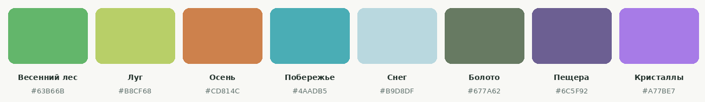
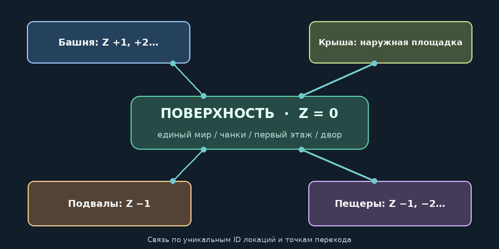
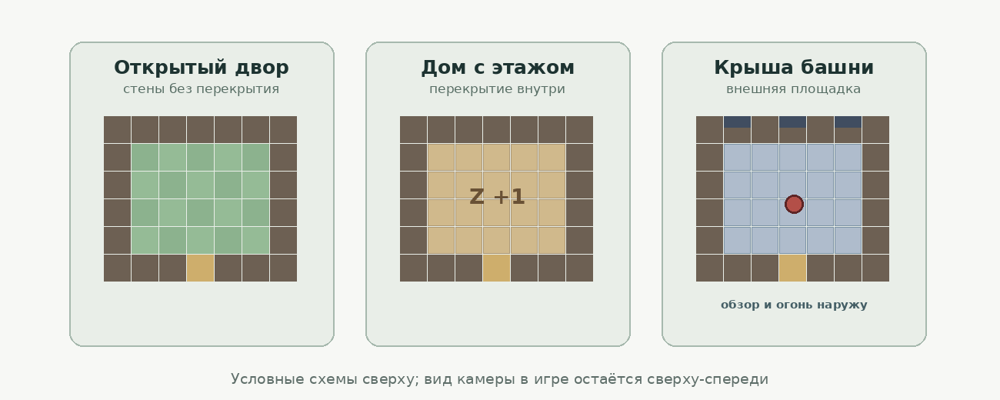
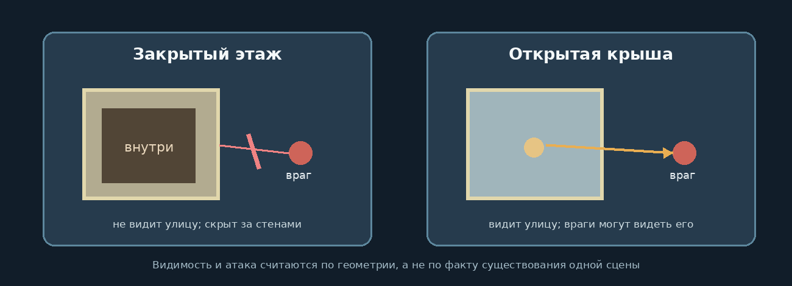

# NO HERO NEEDED — «Герой не требуется»

**Game Design Document (GDD) · версия 0.3 · 14 октября 2026**  
**0.3:** приняты масштаб, контур, направления и слоистые персонажи (ADR-0001), движок и симуляция (ADR-0002), принцип идентичности (ADR-0003), сеть (ADR-0004), хранилище мира (ADR-0005), подписи и переносимый профиль (ADR-0006); см. `docs/adr/`.  
**Статус:** живой проектный документ для разработки и обсуждения с Claude.  
**Направление:** самостоятельная 2D-пиксельная игра на Godot 4.x. Старой 3D-реализации больше нет, переносить её код и проводить её аудит не нужно.

> **Главная мысль:** игрок не обязан становиться героем, побеждать последнего босса или следовать сюжету. Игра — живой мир, в котором можно поселиться, работать, строить, путешествовать, исследовать, дружить, торговать, сражаться — или просто жить. Мир задуман для развития годами, без заранее назначенного «окончательного релиза» и без MVP как цели.

## 0. Как читать этот документ

- **[ПРИНЯТО]** — решение пользователя, не переосмысливать без обсуждения.
- **[НАПРАВЛЕНИЕ]** — рекомендуемый способ реализации, допускающий техническую альтернативу с аргументами.
- **[ОТКРЫТО]** — вопрос без окончательного решения; не выдавать гипотезу за спецификацию.
- **[ПРИМЕР]** — иллюстрация желаемого поведения, не жёсткий список обязательных объектов.

При противоречии между документами пакета приоритет имеет этот GDD, затем `ARCHITECTURE.md`, затем `DEVELOPMENT.md`; сомнение записывается в `OPEN_QUESTIONS.md`, а не молча решается генерацией кода. Документы и их решения должны жить рядом с исходниками игры и изменяться с проектом.

## 1. Замысел и философия

### 1.1. Живая песочница, а не продукт с заранее известным финалом [ПРИНЯТО]

*No Hero Needed* — долговременная игра-песочница, где удовольствие возникает из жизни в мире, из исследования и пересечения игровых систем. Дух развития — **Dwarf Fortress** и **NetHack**: новые механики, предметы, существа, события и способы взаимодействия можно придумывать и добавлять много лет. При этом интерфейс и представление пространства **не должны наследовать сложность Dwarf Fortress**.

Не планировать работу вокруг MVP, презентации инвесторам, «быстрого выхода на рынок» или даты, когда развитие игры якобы завершится. Допустимы небольшие проверяемые шаги разработки, экспериментальные сборки и выпуски версий — **как инженерный способ выращивания мира**, а не как сокращённая коммерческая концепция.

В каждой рабочей версии существующие возможности должны оставаться играбельными и проверяемыми, а новые системы — соединяться со старыми. Количество механик не важнее согласованности и глубины взаимодействий.

### 1.2. Необязательность героизма [ПРИНЯТО]

Фермер, рыбак, ремесленник, охотник, торговец, хозяин таверны, исследователь, строитель крепостей, защитник поселения, путешественник и воин — полноценные способы игры. У игрока нет обязанности идти в опасные подземелья, чтобы заниматься хозяйством. Редкости допускают альтернативные пути получения: торговлю, услуги, обмен, совместную деятельность. Не навязывать глобальный сюжет и последний обязательный бой.

### 1.3. Системное, эмерджентное поведение [НАПРАВЛЕНИЕ]

Стремиться к взаимодействию независимых систем. Огонь может нагревать предметы; материалы отличаются горючестью; NPC реагируют на опасность; сооружения влияют на маршруты — и тогда история о пожаре таверны возникает без отдельного «квеста о пожаре». **Это принцип архитектуры и долгосрочная цель, а не требование немедленно написать физическую симуляцию мира.**

Не вводить десятки неиспользуемых абстракций «на будущее». Добавлять фундаментальные свойства и взаимодействия, когда понятен ближайший реальный игровой сценарий; не связывать системы напрямую там, где можно обмениваться понятными событиями и данными.

## 2. Художественный язык и камера [ПРИНЯТО]

- **Полноценное 2D, пиксельная графика**, вид сверху-спереди, ориентир — *Dust City / «Пыльный город»*. Это не изометрия и не 3D с пиксельным фильтром.
- **Стилизованные персонажи — жители мира, а не игрушки** (пересмотр ADR-0001: было «чиби / аниме»). Слегка стилизованные, около 3 голов роста, с узнаваемыми силуэтами, эмоциями и нормальной анимацией движений и действий. Не заменять их безликими кубами и геометрическими болванками.
- **Природная, тёплая, приглушённая и изменяющаяся палитра** (средняя палитра B4): солнечные поля, осенние леса, болотная сырость, тёплые окна зимой, мерцающие кристаллы в пещерах. По атмосфере ближе к Dust City, но светлее и богаче; его сдержанное тревожное настроение как универсальная норма — нет; «витринная» яркость B2 — тоже нет.
- **NPC говорят «облачками»** в окружающем мире; полноценные диалоги — в манере визуальной новеллы, с портретами, эмоциями, репликами и вариантами ответов.
- Детали и читаемость важнее формального размера пикселя. **[ПРИНЯТ HD BASELINE, ADR-0022]:** логический viewport **960×540**, nearest ×2 на 1080p, целевой тайл **32×32 логических px**, взрослый человек **около 64 px видимого роста**, обычный обзор около 30×17 клеток. No Hero Needed развивает самостоятельный детализированный 2D pixel art; крупность пикселя Dust City не служит ориентиром. Мир, физика и сохранения сохраняют прежние единицы; legacy 480×270 — совместимость и сравнение. Единые правила и порядок производства — [Visual Standard HD](../art/archive/visual_standard_hd.md).
- **Обитаемость окружения** [НАПРАВЛЕНИЕ]: заросли, кустарники, папоротники, высокая трава, цветы куртинами, тени крон, разные дорожки (камень, грунт, колея, натоптанная тропа), камыш, огороды, мелкие предметы быта. Детализация появляется постепенно слоями (грунт → наземный декор → растения и предметы), без смены масштаба и стиля. Пример направления — проба B2 в `docs/proposals/001-foundation/`.
- **Производственный арт** — генерация с доработкой; процедурные пробы — только эскизы масштаба.
- Освещение, погода, время суток, сезонность — желательные развиваемые системы; эффекты не должны скрывать проходы, предметы, противников или интерфейс. **[ПРИНЯТО, ADR-0014]** Время суток серверное и единое для мира, сохраняется; длина суток — настройка сервера; освещённость клетки (день/ночь, крыша, источники) — основа для обнаружения существ.

### 2.1. Герой и редактор персонажа [ПРИНЯТО]

**Редактор персонажа обязателен как фундаментальная система игры**, а не будущий необязательный экран. Создание, предварительный просмотр и последующее изменение внешности должны использовать один и тот же формат данных персонажа.

Редактор предусматривает настройку внешности: варианты мужского/женского облика, телосложение в рамках согласованной чиби-стилистики, лицо, оттенок кожи, глаза, волосы, причёску, цвета, аксессуары; в перспективе — звероморфные головы, уши, хвосты и другие детали. **[ПРИНЯТО автором 17.10.2026]:** редактирование самого персонажа доступно только после выхода из мира, через редактор в меню. Текущая реализация: мужской/женский пол, два телосложения, три лица, три причёски или отсутствие волос, оттенок кожи и цвет волос. Одежда и экипировка меняются из инвентаря в игровом окне персонажа (C), без выхода и сброса движения/действия. Остальные параметры остаются развитием редактора.

Одежда, броня, причёска и предметы в руках рисуются согласованными слоями спрайта; анимации ходьбы, бега, приседа, прыжка, атаки и взаимодействия должны работать с этими слоями. **[ПРИНЯТО, ADR-0001]:** слоистые кадры («бумажная кукла»): тело покадрово, волосы/одежда/броня/предметы — отдельными листами на той же сетке кадров, цвета — палитровой подменой; **8 направлений** для гуманоидов (другим существам — по их плану тела); порядок слоёв зависит от направления и может переопределяться в кадрах анимации. Размеры и пропорции задаёт *план тела*; вещи рисуются под планы тел. Стартовая одежда — скромная базовая одежда без демонстрации интимных деталей; визуальная стилистика подходит широкой аудитории.

Данные внешности не должны зависеть от одного сервера или пути к локальному файлу с ассетами. Отдельно документировать версионирование схемы внешности и совместимость набора контента.

## 3. Пространство: одна бесшовная поверхность и связанные локации

### 3.1. Поверхность [ПРИНЯТО]

Единый большой процедурно генерируемый мир, перемещение без экранов перехода между чанками: леса, луга, горы, реки, болота, берега, деревни, города и дикие территории. Первый этаж дома, двор, ферма, улица и открытая крепость являются частью **того же поверхностного пространства (Z = 0)**. При входе в дом перекрытие/кровля визуально скрываются в нужной зоне для показа интерьера.

Генерация должна быть воспроизводимой по сиду и версии генератора. Уже посещённые и изменённые участки не теряют изменений после обновления генератора. Размер мира и правила дальних регионов — [ОТКРЫТО].

### 3.2. Этажи построек [ПРИНЯТО]

Верхние этажи здания — **отдельные устойчивые 2D-локации**, связанные лестницами, люками, лифтами и иными явными переходами. Игрок видит активный этаж, не наложение всех слоёв. На интерфейсе показывается понятная метка `Этаж +2`, `Крыша +3` либо `Глубина −1`. Число Z — метка уровня; реальная идентичность определяется `location_id`.

**Важное правило:** стены сами по себе не создают новый этаж. Огороженный двор, крепостная стена или загон без потолка остаются открытой поверхностью. **Перекрытие/потолок** даёт опору и область для следующего этажа. Возможны частичные перекрытия, балконы и галереи. *Перекрытие* и *кровля* — разные свойства, хотя строительный объект может сочетать оба.

### 3.3. Крыши и наружные площадки [ПРИНЯТО]

Доступная крыша, боевой настил на стене, мост между башнями — наружные позиции с известной высотой. С них игрок **видит соответствующую область улицы и врагов и может атаковать видимые цели**. Противники на поверхности также способны заметить персонажа на крыше. Закрытый верхний этаж без проёмов не даёт магического обзора подходов. Окна/бойницы дают ограниченные сектора видимости и стрельбы, если поддерживаются.

Крыша — не просто рисунок поверх интерьера: у неё может быть проходимость, точка доступа, парапет, укрытие, обзор и связь с общей боевой симуляцией. **[ПРИНЯТО, ADR-0015]** Скатная кровля по умолчанию непроходима (проход — только особой площадкой). Окна и бойницы — детали стены с сектором и дальностью из данных; смотреть через них может только тот, кто стоит у проёма изнутри. Видимость проверяется на плане с учётом высот препятствий (стены, растения, перекрытия, кровли), без 3D-баллистики. Поэтому настил на стене и открытая крыша сами становятся наружными позициями.

### 3.4. Подземный мир [ПРИНЯТО, ADR-0017]

Подземелья — не только готовые процедурные пещеры с монстрами и сокровищами, но **изменяемая среда**: горное дело, поиск полезных ископаемых, тоннели, шахты, подземные поселения. На экране по-прежнему один двумерный уровень; уровни связаны явными переходами.

**Общая геология.** Обычный подземный мир — одно согласованное пространство с координатами X, Y и глубиной Z (`Глубина −1`, `−2`…). Уровень глубины определяется зерном мира, правилами геологии, координатами и глубиной; генерируется по чанкам при исследовании или раскопках, согласованно между соседними чанками и уровнями, и созданное сохраняется навсегда. Два игрока, спустившиеся на −2 разными путями и роющие навстречу, действительно встречаются. Особые подземелья (магические лабиринты, сюжетные локации) могут иметь собственное пространство.

**Входы:** естественные — пещера в скале, нора, заброшенная шахта — доступны всем; собственный вход с поверхности — только через **особое сооружение** (шахтный копёр с подъёмником или иное шахтопроходческое оборудование) со сложным многоэтапным крафтом и значительными затратами. Глобального лимита числа шахт нет: ограничители — ресурсы, производство и права на территории. Материалы для первой шахты добываются без своей шахты (естественные пещеры, ремёсла, торговля). Рецепты и ступени — [ОТКРЫТО], проектируются с ремёслами.

**Горизонтальные раскопки — свободно** на любом подземном уровне: тоннели в любую сторону, расширение пещер, помещения, склады, мастерские, убежища, соединение пещерных систем, стены, двери, лестницы, ловушки. За полостями лежит порода, иногда сплошная на большие расстояния; долгое копание не гарантирует ни пещеры, ни месторождения, но и без находок даёт камень и пространство.

**Вертикальные переходы между подземными уровнями — разрешены** как особое действие строительства/горного дела (шахтный проход и лестница), а не свободное удаление объёма грунта. В точке спуска не создаётся пещера: в сплошной породе игрок оказывается в небольшой выработке у лестницы. Фиксированной максимальной глубины нет — её ограничивают настройки сервера и правила генерации.

**Месторождения** — свойство сгенерированной геологии: жилы и одиночные залежи (руды, самоцветы, редкие минералы) лежат там, где их положила генерация, и могут продолжаться через чанки и уровни; разрушая клетку породы, игрок получает её ресурсы. Добытое не восстанавливается автоматически. Существа появляются вновь по правилам экологии мира; геометрия, выработки, постройки и сундуки сохраняются. Позже — геологоразведка и специальные инструменты.

**Существа** подземелий — пассивные и агрессивные, на общей системе существ, с честным восприятием; тоннели и лестницы игроков им доступны, если позволяют их способности. **Света дня под землёй нет**, если нет сообщения с поверхностью: светят факелы, фонари, светящиеся растения и минералы. Обрушений, несущих колонн и расчёта устойчивости нет.

**Шахтное оборудование** можно строить, улучшать, закрывать и демонтировать; демонтаж не уничтожает выработки и постройки под землёй. Связь с поверхностью имеет своё сохраняемое состояние (действует, закрыта, законсервирована). Персонаж не должен оказаться безвозвратно заперт под землёй из-за демонтажа единственного выхода — правила безопасности переходов [ОТКРЫТО].

### 3.5. Без Z-слоёв на экране и без воксельного терраформинга [ПРИНЯТО]

Отказываемся от Dwarf Fortress-подобного просмотра одновременных Z-слоёв и от свободного «вырезания» произвольных объёмов мира. Игроку не нужно понимать пересечения разных высот в одном экранном слое: он видит один уровень.

Это **не запрещает** горное дело (3.4): горизонтальные раскопки на подземном уровне свободны, переходы между подземными уровнями игрок создаёт сам особым действием, а новый вход с поверхности — особым сооружением. Запрещено лишь прокопать вход в подземный мир с поверхности простой киркой или лопатой. Локальные земляные работы на поверхности, обработка почвы, неглубокие канавы и подобное могут быть добавлены отдельно — после решения о конкретной системе.

## 4. Строительство как игровой инструмент [ПРИНЯТО]

Раздельные компоненты строительства: опорная поверхность, стена, ограда, дверь, окно, лестница, перекрытие, крыша, настил, балкон, мост, ворота, ловушка, мебель и технологические устройства. Их свойства — материал, прочность, горючесть, проходимость, видимость, владелец/права, точки сопряжения и состояние — развиваются постепенно, но имеют единые определения.

- Можно построить избу, ферму, мельницу, таверну, склад, многоэтажный жилой дом, замок, башню, укрепление, мост, посёлок на деревьях.
- Стены препятствуют проходу; в подходящих условиях их можно ломать, перелезать, обходить, преодолевать лестницей; разрушение меняет маршруты NPC.
- Перекрытие создаёт основу для нового уровня; конструкция может быть частичной, открытой, несимметричной.
- Из разрушенной стены верхнего этажа или с открытой крыши можно прыгнуть/упасть наружу: это **межлокационное действие с учётом высоты, точки приземления и последствий**. Точная физика падения — [НАПРАВЛЕНИЕ].
- Доступ на боевую площадку стены возможен без превращения всего двора в комнату или этаж.
- **[ПРИНЯТО, ADR-0007]** Нагрузок, устойчивости и обрушений нет — ни сейчас, ни как обязательства на будущее. Разрушение отдельной стены не затрагивает другие конструкции; колонны и балки декоративны; этажность ограничена настройкой сервера.

**Пример:** игрок построил каменную крепость с открытым двором. Противники штурмуют ворота, пытаются преодолеть стену; защитники ведут огонь с настила и башен. Та же система без сражений позволяет сделать живописную деревню с мостками и галереями.

## 5. Видимость, высота, бой и осады

### 5.1. Видимость [ПРИНЯТО]

- Видимость не равна тому, что нарисовано на клиенте. **Сервер авторитетен** в определении допустимых целей, обзора, препятствий и ударов.
- Игрок в закрытом помещении видит интерьер, но не все подходы на улице.
- Игрок на крыше/настиле видит открытую часть поверхности; враги при соответствующих условиях видят его.
- Дальность и сектор наблюдения учитывают высоту, объекты, преграды и освещение в зависимости от реализованных механик.
- При уходе цели из видимости NPC помнит последнюю известную позицию, а не получает её координаты из будущего.
- Обстрел с крыши по поверхности и атака снизу по крыше — **межлокационное взаимодействие в едином серверном контексте**. Нельзя сделать этажи разными изолированными боевыми мирами.

### 5.1а. Бой [ПРИНЯТО, ADR-0019]

- **Здоровье** у персонажей и существ сохраняется. Если никто не ранил какое-то время, оно восстанавливается.
- **Оружие задаётся данными:** ближнее (урон, досягаемость, ширина удара, перезарядка) и дальнее (стрелы как снаряды по плану). Без оружия бьют руками.
- **Удар проверяет сервер:** досягаемость, сектор в сторону прицела, видимость цели.
- **Стрела** летит на высоте глаз. Её останавливает то, что стоит достаточно высоко. Если она промахнулась, то лежит там, где упала.
- **PvE основной.** PvP — правило мира (ADR-0016).
- **Убитое существо** оставляет добычу.
- **Погибший персонаж** по правилу мира (по умолчанию) оставляет всё, что нёс, на месте гибели и возвращается в точку появления. **10 минут эти вещи может взять только он**, потом любой (ADR-0016).
- **Волк** — первый хищник: ночной охотник, днём защищает территорию, раненый убегает.
- **Лутеры — поринги и попоринги** (отсылка к Ragnarok Online). Подбирают вещи с земли и за пару часов их переваривают. Убитый лутер отдаёт то, что ещё не переварил.
- **Взмахи видны:** удар, выстрел, работа инструментом показываются движением тела (замах назад, наклон в удар, присед, ноги в шаг) и того, что в руках (топор поднимается и опускается, копьё колет, лук натягивается). У существ — выпадом. Отдельных кадров взмаха на листах персонажей пока нет.
- **Работа занимает время:** дерево рубится столько ударов, сколько в нём дерева (дуб — 15, около 10 с), держа ЛКМ.

### 5.2. Осады и тактика [НАПРАВЛЕНИЕ]

Разные стили атакующих: ломать дверь, обходить стену, искать лестницу, карабкаться, использовать дальнобойное оружие, нападать на открытые подходы. Разные ответы защитников: наблюдение, бойницы, ловушки, возвышенности, баррикады, потайные выходы. Не требовать сразу «умного полководца»; важнее, чтобы враги честно понимали доступную информацию и перестраивали маршруты после разрушений.

**[ПРИНЯТО, ADR-0016]** Основной режим — PvE; PvP — настройка сервера (выключено, по согласию, свободное). Набеги NPC и разрушение построек противниками — отдельные настройки сервера.

**[ПРИНЯТО автором 15.10.2026, ADR-0016]** Прав на постройки нет: ломать и чинить чужое может кто угодно. Стены защищают прочностью. Каменная стена ломается долго: киркой — около 5 минут, топором и руками — гораздо дольше. Деревянная — около 3 минут топором. Перекрытия и кровли ломаются сверху вниз: перекрытие — только когда над ним ничего не осталось. Разобрать целиком и быстро может только тот, кто поставил деталь, остальные ломают. Двери открыты всем, поставивший может запереть дверь кодом из 4 цифр. Сундук открывают хозяин и его друзья (личный список персонажа); сломанный сундук высыпает содержимое. Вещи на земле лежат, пока сервер не перезапустят.

**[ПРИНЯТО, ADR-0015]** Окна и бойницы — проёмы с направлением и сектором из данных; обзор и стрельба — только у проёма, сервер проверяет препятствия и допустимость атаки. Открытые крыши, террасы и настилы — наружные позиции; скатная кровля непроходима без специальной площадки или прохода. Сложной 3D-баллистики нет.

## 6. Мир, биомы, ресурсы и природные процессы

### 6.1. Биомы [ПРИНЯТО]

Богатый набор различимых климатически и визуально территорий: леса, луга, болота, горы, снега, берега, реки, разные типы пещер. Биом определяет растительность, животных, ресурсы, музыку/звуки, погодные явления, типы поселений и опасности. Систему биомов расширять новыми контент-пакетами и правилами генерации, а не длинными ветками `if`.

### 6.2. Ресурсы [ПРИНЯТО]

Поверхность даёт дерево, камень, воду, съедобные растения, животных, повседневное сырьё. Подземелья — типичный источник руд, редких минералов, драгоценных камней, загадочных находок. Это **распределение возможностей, не принуждение каждого игрока добывать лично**: редкости можно купить, получить через обмен или совместный поход.

### 6.3. Развивающиеся системы [НАПРАВЛЕНИЕ]

Время суток, сезоны, температура, влажность, погода, рост и болезни растений, потребности животных, огонь, вода и сохранность предметов — **кандидаты на долгосрочное системное развитие**. Каждая механика должна иметь понятные последствия для мира и возможность пересечения с другими: дождь может тушить костёр; мороз — влиять на урожай; пожары — менять состояние построек. Не обещать всю симуляцию сразу и не создавать имитацию глубины из отдельных скриптовых событий, когда механизмы должны взаимодействовать.

## 7. Животные, NPC, отношения, диалоги

**[ПРИНЯТО, ADR-0018]** Поведение существ определяет сервер, без визуальной сцены.
- Восприятие честное: зрение зависит от света и заслонений, слух даёт место шума, но не его источник.
- Решения принимаются по памяти.
- Неактивные области симулируются упрощённо, раздумья ограничены бюджетом на тик.
- Первая очередь: дичь (заяц, олень) и жители.

NPC — жители мира с местом проживания, занятием, распорядком, реакциями на окружение и доступной памятью о событиях. Насколько детальна память, потребности, экономика и отношения — развиваемый дизайн, а не фиксированная «готовая» система.

- Короткие реплики в облачках возникают органично: работа, приветствие, ссора, дождь, торговля, радость, испуг.
- Существенные разговоры: диалоговые сцены в стиле визуальной новеллы, портреты/эмоции, варианты ответа и условия.
- Животные действуют по собственным правилам: пасутся, ищут еду, защищаются, мигрируют/размножаются, приручаются — по мере добавления соответствующих систем.
- Оффлайн/дальние чанки используют упрощённую симуляцию так, чтобы возвращение игрока не разрушало правдоподобие мира.
- Результаты важны больше, чем сложность ИИ: живость мира должна ощущаться и при небольшом наборе базовых действий.

## 8. Занятия, предметы, ремёсла, навыки

**Желаемый масштаб — большое разнообразие занятий и их пересечение.** Фермерство, огород, животноводство, рыбалка, охота, кулинария, кузнечное дело, плотницкое дело, строительство, торговля, собирательство, изготовление одежды, исследование, бой, ловушки, оборона. Со временем — любые органично подходящие занятия, профессии, культуры и технологии.

Каждый предмет имеет устойчивый идентификатор контента, свойства, возможные действия и визуальное представление. Рецепты и станки описываются данными. Навыки не обязаны строиться по единой универсальной XP-шкале: конкретные модели прогрессии — [ОТКРЫТО].

**Системность важнее количества:** материал используется и в строительстве, и в изготовлении орудий, и в торговле; огонь — для готовки, обогрева и опасности; верёвка — для ремесла, ловушек и преодоления препятствий, если механики существуют.

## 9. Процедурные подземелья и исследования

**[ПРИНЯТО, ADR-0017]** Геометрия и изменения игроков сохраняются; существа появляются вновь по правилам мира; добытые минералы по умолчанию не восстанавливаются; архитектура подземелий не зависит от боевой системы. Обычная геология — общее пространство X/Y/Z (3.4), раскапываемое игроками.

Типы: пещеры, шахты, заброшенные храмы, руины, катакомбы, подвалы, норы, подземные водоёмы; разные природные породы и неоднородная геология. Все расширяются контент-пакетами. Генератор может использовать шаблоны помещений, граф проходов, тематические наборы врагов, ловушки, освещение, интерактивные объекты, редкости и собственные небольшие истории. Созданный участок становится **конкретным постоянным местом**; дальнейшие посещения и обновления генератора не перетирают изменения. Особые подземелья могут быть отдельными локациями со своим пространством.

Исследование остаётся добровольной, содержательной ветвью. Добытые или открытые редкости влияют на ремёсла и торговлю, но не блокируют базовую мирную игру.

## 10. Многопользовательский мир [ПРИНЯТО]

**Многопользовательская игра и выделенные серверы — фундамент, а не поздний бонус.** Рядом с одиночной игрой есть мир для друзей и сообщества. Авторитетным источником состояния мира служит сервер, в том числе локальный сервер для одиночной игры, если это технически разумно. Целевой ориентир — **10–20 одновременных игроков** на одном мире с возможностью пересмотра после тестов; не объявлять этот ориентир подтверждённой производительностью.

Сетевые правила: сервер подтверждает инвентарь, крафт, строительство, урон, передачу предметов, межэтажные переходы и разрушения; клиент отвечает за ввод, отображение и допустимую предикцию. Интерес-менеджмент учитывает активную локацию, поверхность и **внешнюю область, видимую с крыши**; закрытые интерьеры не рассылаются посторонним без нужды.

Права (ADR-0016, правила автора 15.10.2026):
- участков земли нет, прав на постройки нет;
- двери запираются кодом;
- сундуки открываются хозяину и его друзьям;
- вещи погибшего 10 минут принадлежат только ему.

PvE/PvP и разрешение ломать чужое — параметры сервера. По умолчанию PvP выключено, ломать можно.

## 11. Персонаж вне сервера и перенос между мирами [ПРИНЯТО]

**Игрок создаёт персонажа в редакторе, а не только внутри конкретного мира. Полный переносимый профиль должен быть возможен между совместимыми серверами.** Это проектное требование с начала работы, даже если механизм прямой передачи появится позже.

### 11.1. Что переносится

- Постоянный ID персонажа и версия формата; имя, параметры внешности, цветовые выборы, конфигурация чиби-спрайта.
- Развитие: характеристики, умения, навыки, изученные рецепты/возможности, значимые персональные достижения, если такая система введена.
- Инвентарь, экипировка, содержимое переносимых контейнеров, состояние прочности, индивидуальные модификаторы; предметы только с **устойчивыми IDs и понятным описанием контента**.
- Личные настройки персонажа, не завязанные на конкретный мир; история переходов/подписи и происхождение данных — по принятой модели безопасности.

**Не переносится автоматически:** географическое положение в другом мире, участок земли, дом, сундуки в мире, владение зданиями, локальные отношения и репутация NPC, серверные права и роли. Эти данные принадлежат конкретному миру и связываются с `character_id` отдельно.

### 11.2. Надёжность, согласование и доверие

- Экспорт/импорт — **версионированный формат**, миграции схемы, манифест зависимостей/контента, проверка размера, полей и идентификаторов.
- **Принимающий сервер решает**, какие персонажи, навыки, уровни силы и предметы допустимы по его правилам. Не доверять без проверки произвольному пользовательскому файлу.
- Межсерверный перенос должен защищать от дублирования при подтверждённом доверенном обмене: транзакционный перенос или резервирование/блокировка персонажа с подтверждением приёма, корректный откат после сбоев.
- В **недоверенной** сети независимых серверов нельзя гарантировать невозможность клонирования локально контролируемых данных. Не обещать абсолютную защиту; определить границу доверия и политику допущения.
- **[ОТКРЫТО]** Семантика персонажа на двух серверах: единственный мигрирующий экземпляр, независимые копии либо разные режимы по правилам серверов. Архитектура не должна случайно закрепить один вариант до решения пользователя.
- **[ОТКРЫТО]** Первый транспорт: экспортируемый файл, прямой обмен, общее удостоверяющее хранилище или сочетание методов.
- **[ОТКРЫТО]** Что делать при отсутствующем модовом контенте на целевом сервере: запрет импорта, безопасное преобразование, частичный импорт.

### 11.3. Отдельные сущности

`PlayerAccount`/владение аккаунтом, `PortableCharacter`/переносимый профиль, `WorldCharacterState`/состояние в конкретном мире и `WorldProperty`/мировые объекты не должны смешиваться. Указанные имена концептуальные; Claude может предложить иные с той же семантикой.

## 12. Архитектура для десятилетнего роста [НАПРАВЛЕНИЕ]

Godot 4.x, настоящий 2D; разделение доменной симуляции, сетевого слоя, сохранения и представления. Предпочтение — читаемые маленькие системы, явно названные события и данные вместо монолитных менеджеров на тысячи строк. Не выбирать сверхсложный ECS автоматически; обосновать конкретный подход на реальных сценариях.

**Контент через данные:** биомы, материалы, предметы, существа, NPC, диалоги, станции, рецепты, правила добычи и генерации. По возможности обновление контента не требует переписывать ядро. Поддержка модов — **важная перспективная цель**, её минимальные интерфейсы и стратегия безопасности должны обсуждаться при проектировании контент-слоя, но не ценой раннего усложнения.

**Сохранения:** world_id, версии генерации, постоянные UUID локаций/сущностей, seed + история изменений там, где это надёжно; сгенерированные однажды постоянные подземелья нельзя перегенерировать при смене алгоритма. Версии схемы, миграции, бэкапы, проверка восстановления, журналы изменений при необходимости. Уже обжитые миры — ценность проекта. Можно менять API и устройство исходников без ранних обещаний обратной совместимости, но нельзя легкомысленно терять пользовательские сохранения.

**Обновления:** системные свойства с явными контрактами (материал, температура, повреждение, способность взаимодействия), ограниченные коммуникации событий; тесты игровых инвариантов. Новые системы могут углублять старые — например, со временем добавится влажность древесины и зависимость горения от погоды.

Подробности структуры и рисков — в `ARCHITECTURE.md`.

## 13. Как разрабатывать без MVP [ПРИНЯТО]

Нет «финального минимального продукта» и гонки к релизу. Есть **долговременная последовательность осмысленных возможностей**, каждая из которых может расширяться и перерабатываться. Параллельно развиваются художественная целостность, системная глубина и надёжность.

Ближайшая инженерная отправная точка — **не искусственно урезанная игра**, а проверка связности фундамента на небольшом игровом участке: красивый 2D-чиби-персонаж и редактор; участок мира; подключение нескольких игроков; взаимодействие и сохранение; первая постройка с перекрытием; крыша/обзор; отдельное постоянное подземелье. Эти испытания **не объявляются релизом и не ограничивают замысел**.

Далее мир растёт **направлениями**, без обязательной очереди завершения: природа; ремёсла и экономика; общество NPC; боевые и защитные системы; строительство; подземелья; модификации; транспорт; новые биомы. В каждое направление можно возвращаться сколько угодно раз.

**Критерий качества разработки:** механизм интегрирован, понятен игроку, переживает сохранение/загрузку и работает в многопользовательском режиме в предусмотренном объёме. Развитие не должно превращать мир в совокупность несовместимых мини-игр.

## 14. Проверяемые игровые сценарии

1. Игрок создаёт чиби-персонажа, настраивает внешность; после перезапуска облик и одежда восстановлены.
2. Два клиента видят правильные анимации и изменение экипировки персонажа; не появляется рассинхрон слоёв.
3. Два игрока находятся в одном мире, взаимодействуют с предметами; сервер предотвращает удвоение при гонках запросов.
4. Игрок проходит между чанками поверхности без отдельной сцены-загрузки.
5. Стена вокруг двора без перекрытия не создаёт этаж или крытую комнату.
6. Частичное перекрытие создаёт доступную строимую область верхнего уровня; лестница стоит под проёмом и выводит на площадку с полом, куда смотрит её верх (не сквозь пол над собой); разрушенная лестница оставляет проём, через который можно спрыгнуть без инструментов (ADR-0007).
7. Вход в дом на Z=0 скрывает крышу только там, где нужно, и не переносит игрока с поверхности.
8. На закрытом верхнем этаже игрок не видит врагов сквозь сплошные стены.
9. С крыши игрок видит разрешённые участки улицы и может стрелять по видимому врагу; противник при прямом обзоре видит игрока.
10. После ухода с крыши враг сохраняет последнюю известную позицию, а не точное текущее положение игрока.
11. Повреждение двери/стены меняет проходимость и путь врага; новые состояния согласованы на клиентах.
12. Прыжок наружу с верхнего уровня приводит в физически согласованную точку поверхности с соответствующими последствиями.
13. Первый вход в пещеру создаёт постоянный участок подземного мира; повторное посещение и перезапуск сервера сохраняют сундук, открытые проходы, выработки и добытые ресурсы.
14. Обновление версии генератора не уничтожает уже созданное и посещённое подземелье.
15. Переносимый профиль корректно сериализуется и повторно загружается с навыками, внешностью и инвентарём; мировые постройки в профиль не попадают.
16. Принимающий тестовый сервер корректно отвергает несовместимый или изменённый недоверенный профиль; проверка политики импорта не находится только на клиенте.
17. Обрывы связи, повторные нажатия и перезапуск сервера не должны порождать дубли предметов или потерю подтверждённых строительных операций.
18. Новое дерево, предмет и рецепт добавляются через контентные данные без ветвления по «имени конкретного предмета» в базовом коде.
19. Изменения сохранённых данных проходят через явное обновление версии схемы/миграцию; существует резервная копия до опасного преобразования.
20. Автоматизированный тест нескольких клиентов проверяет реальную серверную нагрузку, а не предполагает, что 10–20 игроков гарантированно работают.
21. Два игрока спускаются на одну глубину разными путями (своя шахта и природная пещера), роют навстречу и встречаются в одной выработке; после перезапуска выработка общая и та же.
22. Шахта вниз из сплошной породы приводит в небольшую выработку у лестницы, а не в созданную пещеру; месторождение в клетке остаётся тем же при повторной генерации и после перезапуска.
23. Демонтаж шахтного оборудования на поверхности не уничтожает выработки, постройки и сундуки под землёй и не запирает персонажей внизу без выхода.

Эти сценарии — **регрессионная карта долгой разработки**, а не список задач, после выполнения которых игру следует объявить «готовой».

## 15. Открытые решения, требующие разговора с автором

- Семантика переноса персонажа: перемещение единственного экземпляра, допустимые копии, правила возврата.
- Механизм межсерверного доверия: файл, прямой обмен, собственный центр идентичности, доверенные серверы.
- Финальная палитра мира и палитра интерфейса (масштаб и анимация приняты, ADR-0001).
- Ограничения высоты строений, прочности опор и допустимых типов крыш.
- Падения с высоты.
- Масштаб поверхности и правила роста новых областей при обновлении генератора.
- Детальность времени, сезонов, температуры, жидкостей и физики материалов на разных стадиях развития.
- Границы модификаций, набор доверенных контент-пакетов, политика импорта чужих предметов.

Нельзя закрывать такие вопросы произвольным решением код-ассистента без отдельного предложения и согласования.

## 16. Референсы и границы заимствования

**См. `REFERENCES.md` для ссылок и конкретной роли каждого источника.** Коротко:

- **Dust City** — собственный проект автора: ракурс, пиксельная выразительность, облачка, повествование через NPC.
- **Dwarf Fortress, NetHack** — горизонт многолетнего развития и взаимодействующих симуляционных систем; **не** сложности UI или многослойной карты.
- **Terraria** — богатство занятий, вещей и история расширений.
- **Necesse** — top-down приключенческая песочница, поселения, кооператив и подземелья.
- **Stardew Valley / Sun Haven** — цвет, быт, образы персонажей, эмоциональные диалоги.
- **Core Keeper** — пещерное исследование, атмосфера и ремесленная петля.
- **RimWorld** — игровая логика помещений, потолков, открытых дворов, строительства и обороны.

Это **ориентиры задач**, не лицензия копировать арты, персонажей, карты, UI или чужую реализацию. Иллюстрации в настоящем пакете — рабочие схемы и палитра предыдущего GDD, а не скриншоты других игр.

## 17. Что Claude должен сделать после чтения

1. Принять этот документ как спецификацию нового, чистого 2D-проекта. **Не восстанавливать, не переносить и не аудировать удалённую 3D-версию.**
2. Ознакомиться с `ARCHITECTURE.md`, `DEVELOPMENT.md`, `OPEN_QUESTIONS.md`, `REFERENCES.md`.
3. Кратко сформулировать, какие архитектурные инварианты обязательны сразу: серверная авторитетность, разделение переносимого персонажа и мира, устойчивые ID, однократная генерация каждого участка подземного мира (общая геология X/Y/Z), разделение этажей и наружных позиций, расширяемый контент.
4. Предложить **простую расширяемую 2D-структуру Godot-проекта** с реальными границами модулей. Не навязывать неподтверждённые решения о миграции персонажа или правилах серверов.
5. Подготовить 2–3 сопоставимых художественных эскиза/мокапа одного и того же игрового экрана (если имеются подходящие инструменты и ассеты), чтобы утвердить пиксельный масштаб, чиби и палитру **до массового изготовления ресурсов**.
6. Реализацию вести небольшими проверяемыми изменениями, но **без терминологии MVP, искусственного урезания замысла и сроков коммерческого релиза**. Перед крупными решениями фиксировать альтернативы, последствия и вопросы.
7. Поддерживать GDD, журнал архитектурных решений и автоматические тесты вместе с кодом; не скрывать незавершённые/непроверенные системы за статусом «готово».

**Финальный принцип:** не делать одну большую «игру на прохождение». Создавать мир, в который интересно возвращаться и который интересно развивать, пока у автора есть новые идеи.
