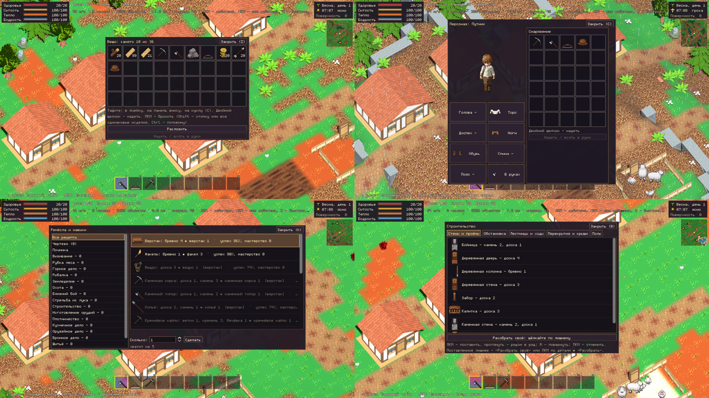
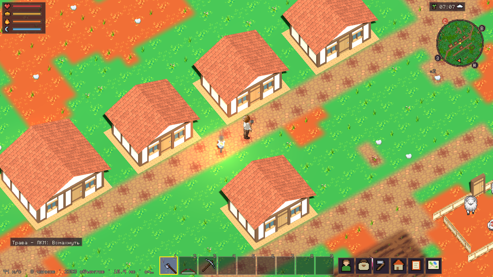
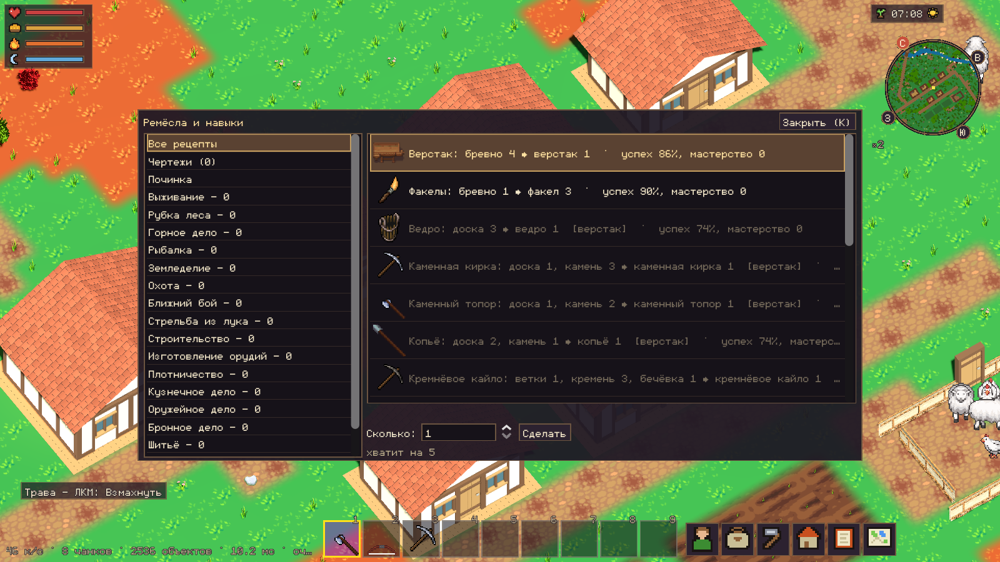

# NHN UI 2.0 — организация интерфейса

Проектный документ к заданию автора [`UI_2_0_TASK.md`](UI_2_0_TASK.md) (27.10.2026). Ветка
`feat/ui-2` от `main`; этапы A–F отдельными коммитами; в `main` — только по разрешению автора.

Главный принцип: **игрок большую часть времени смотрит на мир, а не на окна.** Постоянно на
экране только то, без чего нельзя играть; остальное — по наведению или по клавише.

## 1. Что есть сейчас (28.10.2026)



### Карта действий

| Где | Что | Как |
|---|---|---|
| Мир | действие по цели (рубить, копать, бить, открыть) | ЛКМ (удерживать — повторять) |
| Мир | все действия по цели | ПКМ → меню |
| Мир | быстрое действие / ближайшее | E |
| Мир | вверх/вниз по переходу | F / Shift+F |
| Мир | прыжок с края этажа | J |
| Мир | движение, бег | WASD, Ctrl |
| Мир | камера 3D: поворот, наклон, приближение | средняя кнопка и тянуть, с Shift — наклон; колесо |
| Руки | быстрые слоты, оружие, выбросить | 1–9, Q, G |
| Окна | вещи, персонаж, ремёсла, стройка, журнал, карта | I, C, K, B, L, M |
| Окна | закрыть окно → системное меню | Esc |
| Стройка | поставить / протянуть / повернуть / отпустить | ЛКМ / тянуть / R / ПКМ |
| Миникарта | дальше / ближе | − / = |

Колесо мыши над миром приближает камеру и не листает слоты — решение автора 27.10.2026
(колесо мешало); в задании UI 2.0 слоты колесом — это расходится, оставляем решение автора.

### Что мешает

- Вверху постоянно две строки текста: материалы (доска, камень, бревно), к/с и длинная
  подсказка всех клавиш; внизу — строка «в руках … ЛКМ: … — …» во всю ширину.
- Полосы потребностей — с названием и числами «20/20» в каждой строке: большой блок.
- Окна открываются каждое своей логикой: что закрывает что, решает `game_screen` в каждой
  клавише отдельно; Esc перечисляет все окна вручную.
- Ни одной кнопки для окон — только клавиши (новичку не найти).

### Что можно взять как есть

| Компонент | Остаётся | Что меняется |
|---|---|---|
| `Art.theme()`, `Art.window_head` | тёмная тёплая основа, тонкая рамка, шрифт monogram | токены дизайн-системы, кнопки-пиктограммы, стили HUD |
| `Hotbar` | 9 слотов, выделение, стопки, полоска износа, сломанное тусклое, перетаскивание, подсказка-карточка | без изменений на этапе A |
| `ItemCard`, `WearBar`, `SlotGrid` | карточка предмета, износ, сетка вещей | этап B |
| `HudBoxes` | пиксельные картинки погоды и времён года | компактные полосы с пиктограммами, часы в одну строку |
| `ActionMenu`, `Actions` | меню действий по ПКМ, действия по цели | подсказка у курсора из тех же `Actions` |
| `Minimap`, `WorldMap` | как есть | этап E |

## 2. Правила окон (`UiWindows`)

Простая игровая система, не оконный менеджер ОС.

- **Рабочие окна** (вещи, персонаж, ремёсла, стройка, журнал): открыто одно; открытие
  другого закрывает прежнее. Та же клавиша закрывает своё окно.
- **Окна у предмета мира** (сундук, торговля, разговор, кодовый замок): открываются ответом
  сервера на действие с этим предметом и закрывают рабочие окна; E или Esc закрывает.
- **Всплывающее** (меню действий ПКМ) — поверх всего, закрывается первым.
- **Esc**: меню действий → окно у предмета → рабочее окно → выбранный чертёж → системное
  меню. Только последний шаг открывает меню; игра Esc не закрывается.
- **Размещение:** по центру между верхними индикаторами и быстрыми слотами, всегда целиком в
  экране 960×540 (логические координаты, ADR-0058).
- **Мышь:** окна и HUD с кнопками останавливают щелчки; мир получает только то, что прошло
  мимо интерфейса (`_unhandled_input`). Подсказки и индикаторы мышь не ловят.
- **Пока открыто окно:** движение (WASD) и камера работают; щелчки по миру — нет (окно их
  перехватывает); в поле ввода клавиши действий не срабатывают (поле забирает ввод).

## 3. HUD

```
┌──────────────┐                                       ┌──────────────┐
│♥ ▓▓▓▓▓▓▓▓░░  │                                       │✿ 07:16 ☀    │
│◆ ▓▓▓▓▓▓▓▓▓▓  │                                       │ ┌──────────┐ │
│✹ ▓▓▓▓▓▓▓▓▓▓  │                                       │ │ миникарта│ │
│☾ ▓▓▓▓▓▓░░░░  │                                       │ └──────────┘ │
└──────────────┘                                       └──────────────┘


                    Дуб — ЛКМ: рубить · E: осмотреть     ← у курсора
                         «нельзя: слишком далеко»       ← сообщение, гаснет
            [1][2][3][4][5][6][7][8][9]  [☺][▣][⚒][⌂][✎][◫]
```

- **Слева вверху** — четыре короткие полосы с пиктограммами (здоровье, сытость, тепло,
  бодрость). Числа — в подсказке по наведению. Опасное состояние (ранен, голод, холод,
  усталость) — полоса мигает, рядом короткое слово-предупреждение.
- **Справа вверху** — время и погода одной строкой, под ней миникарта. Время года и день,
  погода словом — в подсказке; этаж или глубина — строкой ниже, только не на поверхности.
- **Внизу по центру** — 9 быстрых слотов; справа от них кнопки окон с пиктограммами и
  подсказками («Вещи — I»).
- **Подсказка у курсора** — что под ним и главное действие: `Дуб — ЛКМ: рубить · E: …`.
  Текст — из `Actions` (то, что разрешено сейчас и этим инструментом). В строительном
  режиме — чертёж, сколько поставится и чего хватает.
- **Сообщения** (отказ сервера, «получено», «вы погибли…») — над слотами, гаснут.
- **Материалы** (доска, камень, бревно) — только в строительном режиме.
- **Отладка** (к/с, чанки) — только с настройкой «показывать к/с», мелко внизу слева.

## 4. Визуальный стиль — токены `Art`

| Токен | Значение | Где |
|---|---|---|
| `PANEL` | тёмно-лиловый, 94 % | окна |
| `HUD_PANEL` | тот же, 70 % | индикаторы, подсказки |
| `FRAME` / `FRAME_HOT` | бронза / золото | рамки / выделение, фокус |
| `TEXT` / `TEXT_DIM` / `TEXT_HOT` | светлый пергамент / приглушённый / тёплый | текст |
| `DANGER` | красно-оранжевый | предупреждения |
| `GOOD` | травяной зелёный | хватает, готово |
| `GAP` | 4 px | шаг отступов (×1, ×2) |

Шрифт monogram 16, обводка `INK`. Без кислотных цветов; выделение — золотая рамка, а не
заливка. Пиктограммы — пиксельные, 12×12 (`Art.glyph`), вдвое для кнопок.

## 5. Клавиши

Назначения сохраняются (раздел 1). Изменения:

- кнопки окон внизу дублируют I, C, K, B, L, M;
- переназначение основных клавиш — этап F (настройки).

## 6. Этапы

- **A.** Токены и компоненты `Art`; `UiWindows` (окна, Esc, размещение); HUD: компактные
  полосы, часы, кнопки окон, подсказка у курсора, сообщения; верхние строки текста убраны.
- **B.** Вещи и снаряжение в одном окне, карточки предметов, сундуки рядом с вещами.
- **C.** Ремёсла: категории с пиктограммами, поиск, навыки, чертежи и починка.
- **D.** Строительный режим: категории, материалы в панели, предпросмотр.
- **E.** Разговоры и торговля, журнал, карта в общем стиле.
- **F.** Настройки (переназначение клавиш), единое управление, полировка, проверка.

## 7. Проверки

Каждый этап: полный набор тестов; снимки настоящей игры на видеокарте (3D, 960×540
логических при 1600×900 окне); в документ — до/после. Мир только в 3D (ADR-0063): отдельной
проверки «в 2D» больше нет.

## 8. Этап A — сделано





- **Токены `Art`:** `HUD_PANEL`, `DANGER`, `GOOD`, `GAP`; `Art.hud_box()` — панель HUD,
  `Art.icon_button()` — квадратная кнопка с пиктограммой и подсказкой.
- **`UiWindows`** (`src/presentation/ui_windows.gd`): рабочие окна (вещи, персонаж, ремёсла,
  стройка, журнал), окна у предмета (сундук, торговля, разговор, замок) и всплывающее меню
  действий. Одно рабочее окно за раз; Esc закрывает по порядку (меню → окно у предмета →
  рабочее → чертёж) и только потом открывает системное меню; окна ставятся между верхними
  индикаторами и сообщениями над слотами, целиком в экране. `game_screen` больше не
  перечисляет окна вручную.
- **HUD:** полосы потребностей с пиктограммами (сердце, хлеб, огонь, месяц), числа — в
  подсказке, опасное мигает со словом рядом; часы одной строкой (время года, время, погода),
  день и погода словом — в подсказке, этаж/глубина — только не на поверхности; миникарта
  круглая, 88 px, стороны света значками снаружи кольца, север красный.
- **Кнопки окон** справа от слотов: персонаж, вещи, ремёсла, стройка, журнал, карта — с
  подсказкой «Вещи — I».
- **Подсказка у курсора:** «что — ЛКМ: действие · E: действие» (и стрелы у лука), в стройке —
  чертёж, сколько поставится и чего хватает; над интерфейсом не показывается. Настройка
  «Подсказки управления» включает её (в стройке — всегда).
- **Сообщения** — над слотами по центру, гаснут через 5 с; состояние связи не гаснет.
- **Убраны:** строка материалов (теперь только в строительном режиме), длинная строка всех
  клавиш, строка «в руках …» внизу; к/с — мелко внизу слева, только с настройкой.
