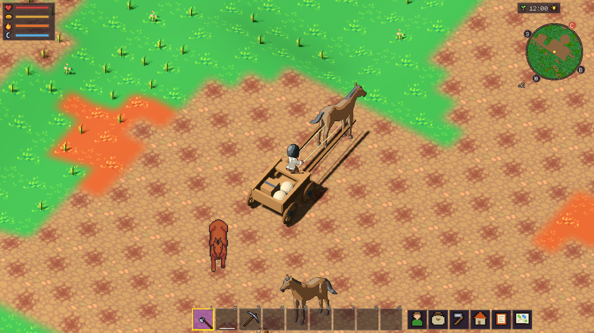

# Разбор движений, зайца и оглобель — 12.11.2026

Автор положительно оценил лошадь Quaternius, спросил об остальных животных,
о замене зайца и указал пересечение оглобель с ногами.
Это дополнительный разбор к [первой съёмке набора](../quaternius-animals/README.md).
Игровые определения и исходная модель телеги не менялись; коммита/push нет.

## Движения набора

Просмотрены ключевые фазы шага и галопа экспортированных моделей с общим
масштабом и опорой. Есть сгибание суставов, перенос ног, движение корпуса
и изменение положения головы; отсоединённого бедра первой процедурной пробы
не видно. Художественная оценка ниже не является измерением скольжения копыт.

- Олень и самец оленя: бег читается через сбор/вытягивание тела и ног.
- Волк, лиса, хаски и сиба: сгибается корпус, задние ноги подбираются под тело;
  шаг и бег различаются. В маленьком игровом размере часть работы лап теряется.
- Корова и бык: шаг пригоден для следующей игровой пробы; галоп размашистый,
  стилизованный, с сильным сбором ног. Ему ещё нужен просмотр в реальном движении.
- Осёл и альпака: связные циклы, но быстрый бег тоже довольно пружинистый.

Готовые GIF: [волк — шаг](../quaternius-animals/models/Wolf/walk.gif),
[лиса — бег](../quaternius-animals/models/Fox/run.gif),
[олень — бег](../quaternius-animals/models/Deer/run.gif),
[корова — шаг](../quaternius-animals/models/Cow/walk.gif),
[бык — галоп](../quaternius-animals/models/Bull/run.gif).

Все 2880 кадров ранее проверены на упаковку, рамки и длительности.
Нативно проверялась только лошадь. Соответствие скорости ног реальному
поступательному движению остальных видов ещё не проверено. Пастьба, атаки,
смерть и другие исходные Actions в эту съёмку не включались.

## Заяц

В Quaternius Ultimate Animated Animals зайца нет. Проверены два отдельных
свободных файла, сохранённых вне Git в `art_src/hare_candidates/`.
[URLs, SHA-256 и размеры](hare-sources.json), [результаты импорта](hare-inventory.json).

Предпочтительный технический кандидат —
[Rabbit, CDmir / Čestmír Dammer](https://opengameart.org/content/rabbit-0),
5996916 байт, SHA-256 `bb6deef1ee91b21380355138374cae87946451ce864502b1af68eb60f4750843`.
CC0 указана на странице и в текстовом блоке `License` внутри `.blend`:
[извлечённая лицензия](CDmir-LICENSE.txt). Blender 5.2.2 открыл файл с
отключённым автоматическим исполнением скриптов. Найдены 37 костей, основная
сетка 893 вершины и дополнительная Fur-сетка 1303 вершины, упакованные текстуры.
Есть `Running` (0–16), `Jump` (0–24), `Guarding` (0–400), `Sitting.000/001`
(0–550), `Dying.000/001` (0–20), статические позы Basic/Dead/Guard.
Это ещё не RO-экспорт: материалы старого Blender, мех, заячий силуэт и прыжковый
цикл нужно отдельно проверить в нашей камере и масштабе. Не считать кроличью
модель автоматически принятой моделью игрового зайца.

Второй кандидат — [Gobkit Hare](https://gobkit.com/api/free), CC0 в авторском
manifest. Файл импортирован: 16 костей, 458 вершин основной сетки; имя этой сетки
в исходнике `Boar`. Реально существуют отдельные Actions idle/attack/dead/walk,
а не диапазоны одного трека; отдельного бега нет. Поэтому это запасной вариант,
а не готовая замена бегущему зайцу.

## Оглобли: дефект подтверждён, исправлением не объявлен

В `tools/art/build_caravan_cart.py:66` оглобли заданы на высоте **0,53 м**,
сечением 0,10×0,10 м и осями X=±0,43. У нормализованной новой лошади диапазон
0,48–0,58 м содержит ноги. Это подтверждено деформированной геометрией на
14 фазах idle и 14 фазах walk: [границы по высотам](horse-bounds.json).

Есть и ограничение перекрытия: телега — настоящее 3D, лошадь — плоская карточка.
`paper_doll.gdshader` оценивает глубину по высоте пикселя над стопами, но не
знает, где ближний бок, дальняя нога и грудь объёмной лошади. Даже физически
разнесённые по X детали могут перекрываться неверно на итоговом изображении.

Снята **диагностическая** проба: скопированный builder меняет только высоту
оглобель с 0,53 на 0,95 м, вывод — в `build/`, основная GLB не заменена.
Проверочный наследник подставляет эту телегу только в памяти клиента.
Godot 4.7.2 / RX 580: 250 проверок без провалов
([метаданные](cart-preview.json), [журнал](cart-preview.log)).
Эти проверки подтверждают загрузку/отрисовку и кадры лошади, **не отсутствие
геометрических пересечений**. Снимок показывает, что простой подъём не
доказывает правильного взаимного перекрытия во всех ракурсах.

Следующий шаг для полноценного исправления — правильная высота/крепление
вдоль боков лошади плюс корректное перекрытие ближней и дальней оглобли с
её корпусом. Проверять все восемь направлений, поворот камеры и движение;
одного удачного статичного кадра недостаточно. Подходящий кандидат для
проверки — глубина, снятая с исходной 3D-модели вместе с кадрами; общий
RO-конвейер уже умеет выводить карты глубины. Его влияние на землю, стены
и другие билборды нужно проверить до включения.
