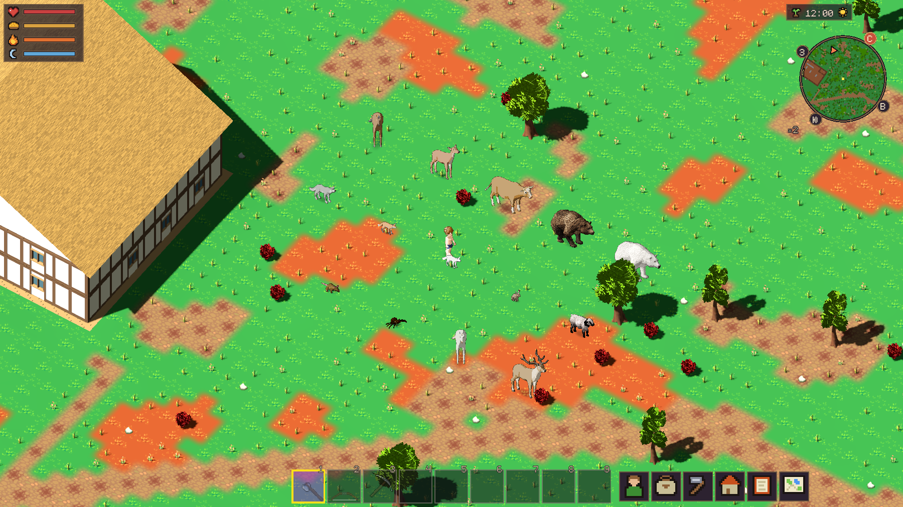
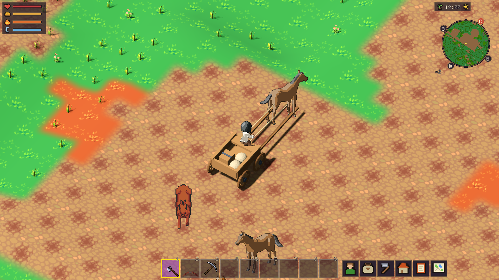
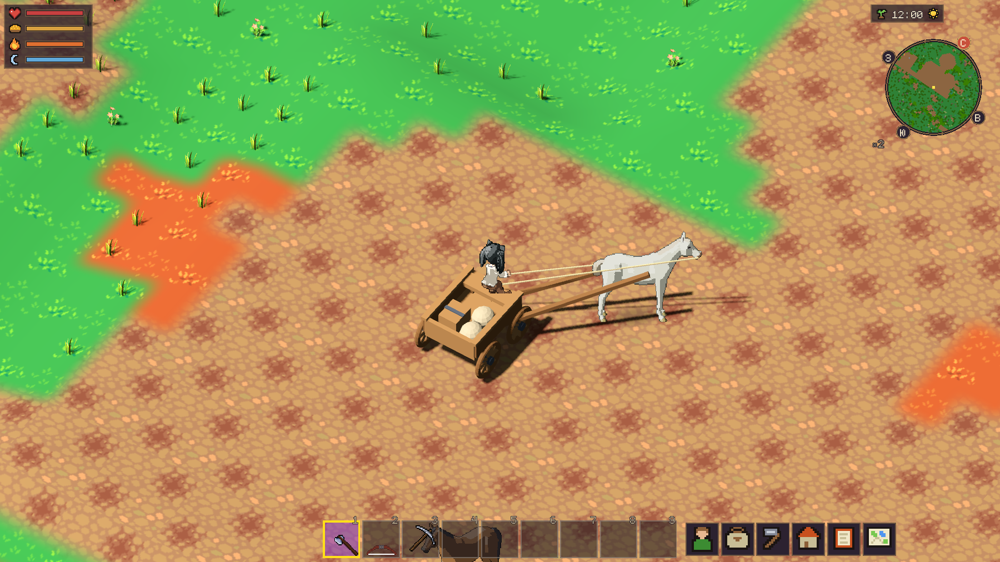

# Животные, контактные тени и упряжь — 12.11.2026

Подключены 13 существующих видов и 15 визуальных вариантов, 6752 кадра.
Новых видов, скоростей, добычи, правил AI и тел в редакторе персонажа нет.
Отпечаток игровых правил до/после совпадает. Сохранения игрока не открывались
для записи; все нативные сцены сняты в отдельном профиле seed 431.

## В настоящей игре



Это стандартные игровые определения и серверные реплики в LocalGame,
а не монтаж спрайтов. Для обзора существа расставлены отдельно и повёрнуты;
в основном проверочном мире убраны мешающие растения, сохранён настоящий рельеф.
Заяц, крыса и паук здесь поставлены на поверхность только для сравнения:
обычные места их появления и поведение не менялись.

[Исходная расстановка](native/gallery.webp),
[после движения](native/gallery-moving.webp),
[шаг в игре](native/walk.gif), [бег в игре](native/run.gif).
GIF игрового движения уменьшены до 900×506 ближайшим соседом; статические
WebP сохраняют исходные пиксели PNG без потерь. Исходники PNG остаются в build.

## Упряжь до и после

До — настоящая предыдущая съёмка с неподвижными оглоблями старого GLB:



После — боковые точки и уздечка следуют позе лошади; направления лошади
и телеги различаются в повороте:



[Повозка и идущая лошадь](native/cart.gif).
Проверены восемь сторон камеры:
[0](native/harness-0.webp), [1](native/harness-1.webp),
[2](native/harness-2.webp), [3](native/harness-3.webp),
[4](native/harness-4.webp), [5](native/harness-5.webp),
[6](native/harness-6.webp), [7](native/harness-7.webp),
а также наклон [35°](native/harness-tilt-35.webp) и
[65°](native/harness-tilt-65.webp). Это разные ракурсы, не попиксельный
before/after одной камеры. Старые кадры описывают предшествующий этап.

## Контрольные пары теней

Слева/справа можно сравнить одну сцену с выключенными и включёнными
контактными тенями. Камера, позы и время суток сохранены:
[день без теней](native/12-off.webp), [день с тенями](native/12-on.webp),
[ночь без теней](native/00-off.webp), [ночь с тенями](native/00-on.webp).
Это контрольное переключение отображения в нативной сцене, не разные сборки.
Проверка яркости пар — [shadow-difference.json](shadow-difference.json):
тени затемняют поверхность и не повышают её яркость ночью. Ночная проверка
ограничена маской тени из дневной пары: декоративная растительность вне неё
может двигаться от времени рендера.
В той же сцене проверены прежние вьючные сумки на новой лошади.

## Движения всех вариантов

GIF показывают три ракурса исходного экспорта: SE, E, SW. Это съёмка фермы,
а не игровой экран; игровой темп показан выше. В атласах восемь направлений.
Длина цикла оценивается по опорным ногам. Частота ограничена тремя циклами
шага и четырьмя циклами бега в секунду, чтобы короткие лапы не мелькали при
игровых скоростях. Нулевое скольжение каждого копыта не заявляется.

| Вид / вариант | Всего кадров | Шаг | Бег |
|---|---:|---|---|
| Лошадь | 504 | [шаг](motion/Horse-walk.gif) | [бег](motion/Horse-run.gif) |
| Белая масть | 504 | [шаг](motion/Horse_White-walk.gif) | [бег](motion/Horse_White-run.gif) |
| Олень | 440 | [шаг](motion/Deer-walk.gif) | [бег](motion/Deer-run.gif) |
| Рогатый олень | 472 | [шаг](motion/Stag-walk.gif) | [бег](motion/Stag-run.gif) |
| Корова | 504 | [шаг](motion/Cow-walk.gif) | [бег](motion/Cow-run.gif) |
| Волк | 528 | [шаг](motion/Wolf-walk.gif) | [бег](motion/Wolf-run.gif) |
| Лиса | 528 | [шаг](motion/Fox-walk.gif) | [бег](motion/Fox-run.gif) |
| Песец | 528 | [шаг](motion/ArcticFox-walk.gif) | [бег](motion/ArcticFox-run.gif) |
| Заяц | 512 | [шаг](motion/Hare-walk.gif) | [бег](motion/Hare-run.gif) |
| Медведь | 568 | [шаг](motion/Bear-walk.gif) | [бег](motion/Bear-run.gif) |
| Полярный медведь | 568 | [шаг](motion/PolarBear-walk.gif) | [бег](motion/PolarBear-run.gif) |
| Овца | 248 | [шаг](motion/Sheep-walk.gif) | [бег](motion/Sheep-run.gif) |
| Курица | 280 | [шаг](motion/Chicken-walk.gif) | [бег](motion/Chicken-run.gif) |
| Пещерная крыса | 312 | [шаг](motion/CaveRat-walk.gif) | [бег](motion/CaveRat-run.gif) |
| Пещерный паук | 256 | [шаг](motion/CaveSpider-walk.gif) | [бег](motion/CaveSpider-run.gif) |

Заяц использует авторские Jump/Running, паук ускоряет авторский WALK.
У паука нет отдельного исходного падения; у остальных доступны выбранные
авторские разовые действия. Слизни и грибной ходок сохраняют прежнюю графику.

## Проверки и воспроизведение

- `TEST_TIMEOUT=2400 TEST_JOBS=4 tools/run_tests.sh`: **670 тестов в 102 наборах,
  0 провалов, 1393,21 с**. Четыре изолированных worker-профиля; 977 входных
  файлов не менялись во время прогона и совпали после него.
- `python3 tools/site/build.py`, `python3 tools/site/check.py`, `tools/site/test.sh`:
  документационный барьер, 32 Python-теста и 10 браузерных тестов без провалов.
- `python3 tools/art/animal_sprites/test_export.py`: пакетная пикселизация
  совпадает с исходным правилом RO, включая прозрачность и цветовые ничьи.
  Дополнительно сравнены реальные кадры четырёх моделей: [результат](reducer-equivalence.json).
- Нативный LocalGame/Godot 4.7.2, RX 580, Compatibility: **6794 проверки,
  0 провалов**, включая каждый из 6752 кадров, движение и поворот настоящей
  упряжки. Дополнительная съёмка дня/ночи и сумок: **10 проверок, 0 провалов**.
- Состояние бега проверено через сервер и двух клиентов: [без исправления](gait-without-fix.log)
  проверка воспроизводит ошибку, [с исправлением](gait-fixed.log) проходит.
  Начальная камера без наклона также не вызывает деления на ноль в упряжи.
- `python3 tools/experiment_3d/verify_assets.py`: исходные наборы и GLB,
  встроенные зависимости и четыре колеса проверены.

Нативный адаптер делает один серверный тик и шаг представления на 20 Гц.
Его строки FPS отражают заданный шаг и **не являются замером производительности**.
Первый диагностический сценарий ошибочно проверял бег уже после достижения
близкой цели; в итоговой съёмке маршрут удлинён, движение проверено до остановки.

Команды:

```bash
python3 tools/art/animal_sprites/build_production.py
python3 tools/art/animal_sprites/install.py
godot --path . --audio-driver Dummy -s res://tools/experiment_3d/check_animals.gd -- --out=/absolute/repo/build/animal_sprites/game-review
# Дополнительная съёмка принимает только профиль из build/animal_sprites:
godot --path . --audio-driver Dummy -s res://tools/experiment_3d/check_animal_contact.gd -- --profile=/absolute/repo/build/animal_sprites/game-review-final/profile-ID
```

Дополнительный сценарий намеренно принимает только временный профиль внутри
`build/animal_sprites/`; обычные пользовательские профили отклоняются.

[Итог](verification.json), [логи тестов](tests.log), [логи вики](site-tests.log),
[нативный отчёт](native.json), [нативный лог](native.log),
[дополнительный отчёт](contact.json), [дополнительный лог](contact.log),
[проверенные входные файлы](tested-sources.json),
[источники и установленные контрольные суммы](assets.json).
Подробности производства и лицензий — [ANIMALS.md](../../art/ANIMALS.md),
решение — ADR-0079. Производные от 0 A.D. сохраняют CC-BY-SA-3.0;
Quaternius, CDmir и br-n518 — CC0. Доступа к авторизованному браузеру не было.
Релиз и публикация сайта в этом этапе не выполнялись.
