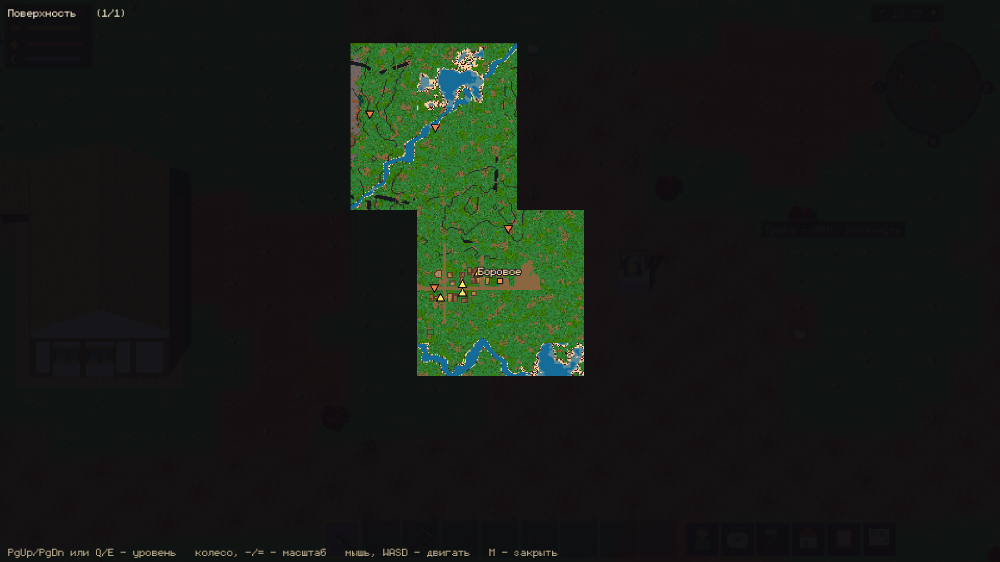

# Карта и фризы

[Отчёт с ограничениями и проверками](../../PERFORMANCE_REPORT.md).
Все миры и профили созданы для диагностики; сохранения автора не открывались
для записи. На момент замеров релиз и публикация не выполнялись.

## Исходники v0.20.0, release

- [Обычные кадры до](v020-before.json), [после](v020-after.json): одинаковый
  контроллер, копия закрытого мира, viewport 1800×1013, Compatibility, RX 580,
  ограничение 60 кадров/с; оба `debug: false`. Это один локальный прогон,
  не статистически аттестованный аппаратный бенчмарк.
- Карта: блокирующий кадр 16 846,971 → 22,243 мс; подпись 16 895,540 → 149,848 мс.
- [CPU-запрос до](cpu-v020-before.json), [после](cpu-v020-after.json):
  18 429,356 → 0,015 мс. Одинаковая видимая подпись Боровое (79, 164).
  [Журнал до](cpu-v020-before.log), [после](cpu-v020-after.log).
- [Проверка игрового кода baseline против тега](v020-baseline-source-check.json),
  [исходники до](v020-before-sources.json), [после](v020-after-sources.json),
  [хеши бинарных файлов](binaries.json). Отдельные диагностические точки входа
  не считаются игровыми изменениями. Хеши GDScript внутри экспортированного
  JSON пусты из-за компиляции; используются внешние манифесты исходников.
- [Сравнение 26 чанков](v020-geometry.json): слои, свойства и прежние метаданные
  совпали; исключено только производное поле `terrain_pads`.

Это настоящие кадры игры. Они показывают сохранение видимого результата;
время подтверждается JSON интервалов кадров. [Размеры и хеши изображений](images.json),
проверено точное равенство RGBA с исходными PNG.

## Рабочая ветка, генератор поселений 6

- [Трассировка повторных неудачных объездов](blocked-caravan-trace.log),
  [кадры до кеширования](gen6-before-detour-cache.json),
  [обычный игровой цикл после](gen6-after.json),
  [его исходники](gen6-after-sources.json). До использован подкласс с таймерами;
  это диагностика горячего пути, не сравнение статистически сопоставимых FPS.
- p99 загруженной деревни 308,944 → 17,736 мс, самый длинный кадр после — 23,250 мс.
  Холодная подготовка первого вида всё ещё заняла 165 с в фоне; подготовка
  графики оставляет отдельные длинные кадры. Это ограничение не скрыто.
- [Свежая проверка геометрии](terrain-regression.json), [её журнал](terrain-regression.log):
  9 проверок без провалов, прежние 23 деревни и восемь дорог, 6403 проверки
  покрытия без коллизий. Ускоренный адаптер съёмки не используется как игровой FPS.
- [Первый полный прогон](first-full-tests.json) красный: 698 тестов в 108 наборах,
  четыре набора с провалами. Исправления и обновлённые тестовые условия описаны
  в отчёте; этот результат не подменяется финальной зелёной проверкой.

После замеров исправлены отмена поиска двора и хранение стартового вида на
нулевом тике. Манифесты замеров относятся к своим снимкам, не к этим двум
последующим правкам. Текущая вики и точные хеши игровых файлов проверяются
документационным барьером.

## Окончательные проверки

- [Полный прогон](full-tests.json), [журнал](full-tests.log),
  [535 входных файлов](tested-sources.json): 700 тестов, 108 наборов, 0 провалов,
  1008,51 с. Это снимок до последней локализации кеша объездов; он также сохранён как
  [pre-local-cache](pre-local-cache-full-tests.json). Последняя малая правка
  проверяется отдельно, полный прогон на неё не приписывается.
- [Потоковая готовность](streaming.log), [передача и отмена](handoff.log),
  [сохранённые этажи](settlement-levels.log), [предсказание](prediction.log),
  [разведанные названия](chronicle-map.log).
- [Вики и браузер](site-tests.log): 32 Python- и 10 браузерных тестов,
  проверка документации и сохранения оформления.

Команды: `TEST_TIMEOUT=2400 TEST_JOBS=6 tools/run_tests.sh`,
`tools/site/test.sh --base origin/main`,
`godot --audio-driver Dummy --path . -s res://tools/experiment_3d/check_terrain_settlements.gd -- --out=...`.
Для обычного цикла использован [контроллер](../../../tools/experiment_3d/measure_frame_latency.gd)
с отдельным профилем и копией закрытого тестового мира; он не открывает сохранение автора.

## Последняя локальная правка кеша, 16.11

- [Воспроизведение](local-cache-red.log), [исправление](local-cache-green.log):
  дальние загрузки/выгрузки не повторяют неудачный поиск, местная стена разрешает его.
- [Окончательная игра](final-runtime.json), [неизменные исходники](final-runtime-sources.json).
  Естественно выгружены 39 дальних чанков; кадр возврата 30,259 мс вместо
  [315,698 мс предыдущего снимка](remote-unload-before.json). Дополнительное
  наблюдение 12 с: p99 19,767 мс, максимум 39,164 мс. Никакого ускорения симуляции.
- Холодная подготовка 168 с и первая подготовка графики до 1,49 с остаются.
- Полный прогон 700 относится к предыдущему снимку. После него изменены ровно
  один игровой файл и его тест; окончательный кеш проверяется профильным набором
  караванов, регрессией и нативной игрой, а не объявляется новым полным прогоном.

Последняя правка проверена: [26 тестов караванов](final-caravan-tests.json),
[журнал](final-caravan-tests.log), ещё 3 регрессии поиска NPC (см. зелёный журнал),
[535 файлов окончательного снимка](final-tested-sources.json).
[Сводка границ всех проверок](verification.json).
