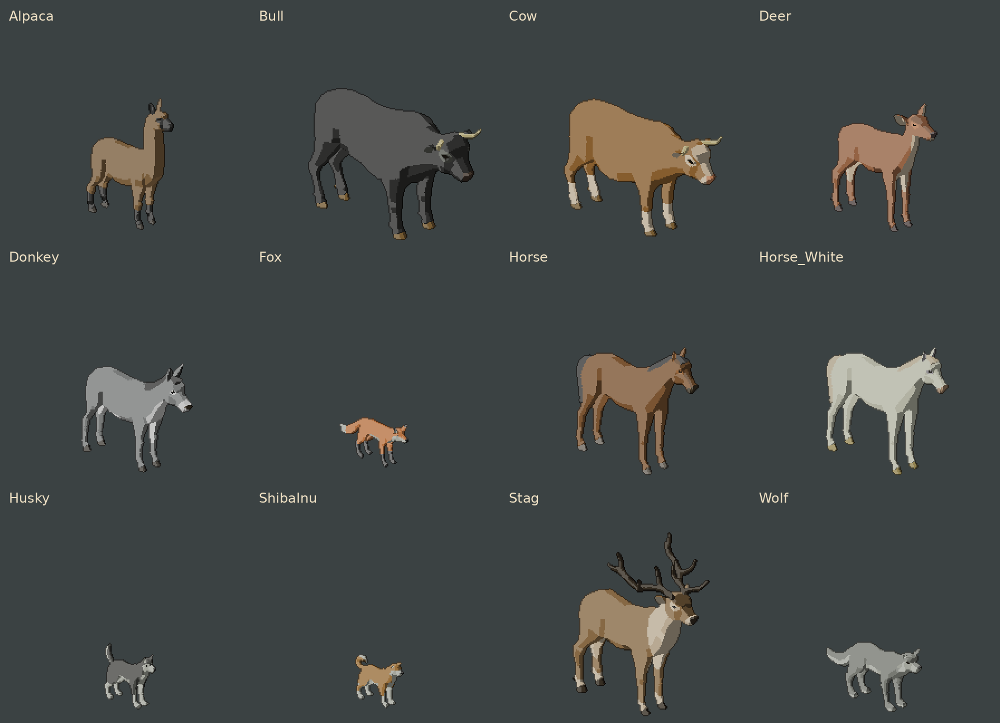
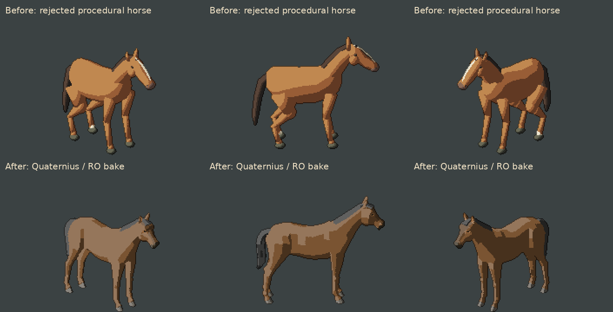
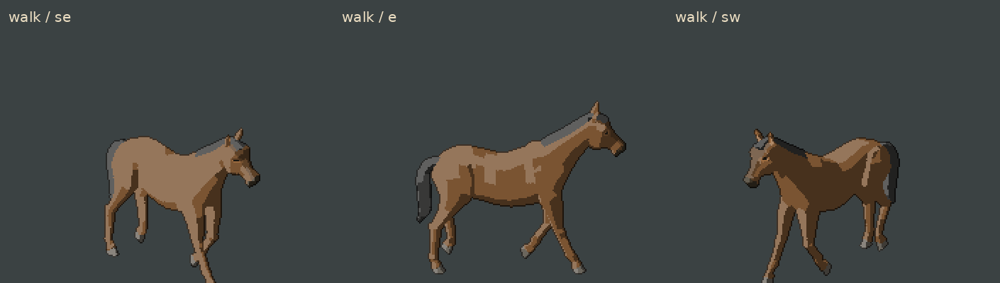
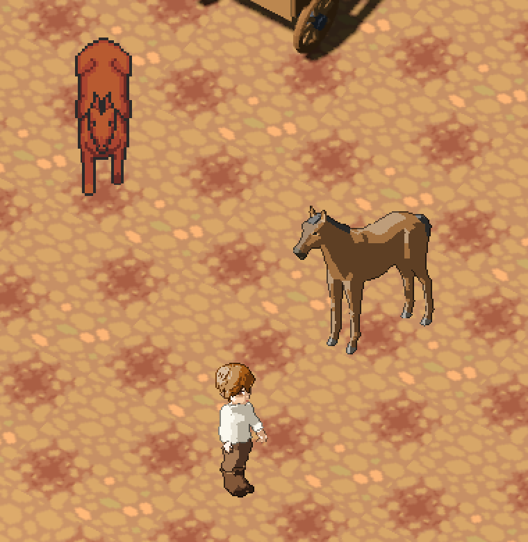

# Quaternius → RO-спрайты: художественная проба, 12.11.2026

Локальная ветка `codex/animal-sprites`, основа `f33772c`.
По выбору автора используется **Ultimate Animated Animals (July 2021)**.
Это проба для визуального одобрения. Игровые LPC-атласы и определения существ
сохраняются; сервер, протокол, сохранения и игровой конструктор не меняются.

## Источник и лицензия

Модели, скелеты и исходные анимации — Quaternius, **CC0-1.0**.
[Страница набора](https://quaternius.com/packs/ultimateanimatedanimals.html),
[публикация автора от 07.07.2021 с явной CC0](https://www.patreon.com/quaternius/posts/ultimate-animals-53427821).
Авторский Google Drive отказал в скачивании из-за квоты. Взята открытая копия
[agentkaerf/FreeModels](https://github.com/agentkaerf/FreeModels/tree/db3df04d1e4714298a09510b26fb6de6645138a2/Ultimate%20Animated%20Animals%20-%20July%202021)
на коммите `db3df04d1e4714298a09510b26fb6de6645138a2` от 15.02.2026.
В ней сохранена исходная лицензия CC0; общая новая лицензия сайта к этим
закреплённым байтам не подставляется.

[Источник каждого файла и SHA-256](source.json), [читаемая копия лицензии](LICENSE.txt).
Загружены только 12 glTF и лицензия: 37 248 850 байт. Все буферы встроены,
внешних текстур/зависимостей нет. Исходные модели вне Git:
`art_src/quaternius_animals/`; оригинал лицензии там сохранён побайтно.

## Что делает адаптация

Сохраняются сетки, веса, скелеты, исходные Actions и длительность движений.
Процедурная лошадь из предыдущей пробы не используется. Размер нормализуется
по видам относительно RO-человека; направление переводится в восемь ракурсов.
Поверх исходной палитры используются RO-камера 22°, 77 пикселей/метр, toon-свет,
суперсэмплинг 4×, бинарная прозрачность и пиксельный контур.

У лошади 50 костей, 4400 вершин, отдельные материалы белков и зрачков.
Окрас берётся из закреплённого glTF, включая множитель базового цвета и цвета
вершин. Это исправляет белого оленя, получавшегося при чтении только
`Material.diffuse_color` после импорта Blender. Рамка вычисляется по всем
выбранным позам: крупный бык в галопе помещается без изменения масштаба.
Одна опорная точка используется для всех кадров; полёт в галопе не притягивается
к земле покадровым выравниванием.

## Воспроизведение

```bash
python3 tools/art/animal_sprites/fetch_quaternius.py
tools/art/animal_sprites/build_quaternius.sh build/animal_sprites/quaternius-checked
# Дополнительные авторские действия доступны отдельно:
tools/art/animal_sprites/build_quaternius.sh build/animal_sprites/horse-all --models Horse --clips all
```

Сборка создаёт `model.blend`, исходные кадры, атлас, `visual.json`, восемь
ракурсов и GIF. Снимки ниже — пиксели реального экспорта без дорисовки.
`visual.json` в материалах ссылается на соответствующий атлас в `build/`;
для нативного воспроизведения сначала выполнить сборку.

## Полученный результат

**12 моделей, 2880 кадров**, по восемь направлений: стояние, шаг и галоп.
[Проверка пакета](pack-verification.json), [импортированные скелеты и Actions](inventory.json).
Все кадры непустые, без обрезания; прозрачность атласов только 0/255.
Проверены адреса кадров атласа, отсутствие замороженных циклов шага/галопа,
совпадение длительностей с time-accessors исходных glTF и размеры всех
12 визуалов относительно существующего billboard-viewport 384×384.
Скольжение опорного копыта для этих импортированных клипов **не измерялось**;
поле `max_planted_hoof_slip` имеет значение `null`.

| Модель | Кадров | Исходных Actions | Движения |
| --- | ---: | ---: | --- |
| Alpaca | 296 | 13 | [шаг](models/Alpaca/walk.gif), [галоп](models/Alpaca/run.gif) |
| Bull | 240 | 13 | [шаг](models/Bull/walk.gif), [галоп](models/Bull/run.gif) |
| Cow | 240 | 13 | [шаг](models/Cow/walk.gif), [галоп](models/Cow/run.gif) |
| Deer | 232 | 13 | [шаг](models/Deer/walk.gif), [галоп](models/Deer/run.gif) |
| Donkey | 232 | 13 | [шаг](models/Donkey/walk.gif), [галоп](models/Donkey/run.gif) |
| Fox | 232 | 12 | [шаг](models/Fox/walk.gif), [бег](models/Fox/run.gif) |
| Horse | 240 | 13 | [шаг](models/Horse/walk.gif), [галоп](models/Horse/run.gif) |
| Horse_White | 240 | 13 | [шаг](models/Horse_White/walk.gif), [галоп](models/Horse_White/run.gif) |
| Husky | 232 | 12 | [шаг](models/Husky/walk.gif), [бег](models/Husky/run.gif) |
| ShibaInu | 232 | 12 | [шаг](models/ShibaInu/walk.gif), [бег](models/ShibaInu/run.gif) |
| Stag | 232 | 13 | [шаг](models/Stag/walk.gif), [галоп](models/Stag/run.gif) |
| Wolf | 232 | 12 | [шаг](models/Wolf/walk.gif), [бег](models/Wolf/run.gif) |

Галерея сохраняет общий масштаб **2× пикселей экспорта** и общую опору ног;
маленькие животные не растянуты до размера лошади.



Сверху отвергнутая процедурная проба, снизу — Quaternius. Один пиксель экспорта
в обоих рядах увеличен вдвое; пропорции модели не подгонялись под сравнение.



[Все 14 фаз шага сбоку](horse-walk-poses.webp),
[восемь ракурсов лошади](models/Horse/directions.webp).



## Нативная игра

Godot 4.7.2, GL Compatibility, Radeon RX 580; свежий одноразовый LocalGame,
seed 431, версия генератора 5. Подставлен только визуал проверочной лошади
в памяти клиента. Рядом оставлена настоящая игровая LPC-лошадь; собственный
персонаж использует RO-тело, караван — существующую GLB-повозку.

**249 проверок, 0 провалов**, [метаданные](native.json), [журнал](native.log).
240 из проверок поочерёдно отрисовывают каждый кадр новой лошади, читают
изображение настоящего GPU SubViewport и проверяют видимость и отсутствие
обрезания. Остальные подтверждают подключение клиента, получение существ
с сервера, загрузку геометрии, сохранение исходного LPC-визуала и повозку.
Все 12 моделей проверены по атласам и геометрии рамок; нативная GPU-проверка
на этом этапе выполнена **для лошади**.

```bash
godot --path . --audio-driver Dummy \
  -s res://tools/experiment_3d/check_horse_candidate.gd -- \
  --visual=res://build/animal_sprites/quaternius-checked/Horse/visual.json \
  --out=/tmp/nhn-quaternius-review
```

Слева исходная LPC-лошадь, справа новый визуал, внизу RO-персонаж.
Это обрезка настоящего снимка, увеличенная 2× без сглаживания.



Полные кадры: [ракурс SE](horses-se.webp), [ракурс SW](horses-sw.webp),
[лошадь с повозкой](harness-close.webp).
Нативная съёмка процедурной ревизии v6 ранее упала; этот успешный прогон
относится к Quaternius и не подтверждает прежнюю ревизию.

## Фактические проверки и границы

[Сводка команд и SHA-256 проверенных файлов](verification.json).

- `fetch_quaternius.py`: 13 закреплённых файлов, CC0-1.0.
- Blender завершил съёмку всех 2880 исходных кадров: [журнал](render.log).
  После трёх моделей последовательная упаковка остановлена для распределения
  остальных экспортов по четырём независимым процессам. Итог —
  `ALL_12_EXPORTS_OK`, [журнал упаковки](export.log), отдельные журналы в `models/`.
- `python3 docs/evidence/quaternius-animals/verify_pack.py`: 12/2880, без ошибок;
  команда после сборки повторяет проверки и обновляет этот набор материалов.
- `python3 -m py_compile tools/art/animal_sprites/*.py`; `bash -n` обоих
  сборочных скриптов; `git diff --check` — без ошибок.
- `python3 tools/site/check.py --base origin/main`: 294 записи, 14 руководств.
  Игровые `src/`, `content/`, настройки и прежние 508 файлов тестового снимка
  не менялись. Полный игровой набор заново не запускался: новые проверки
  направлены на импорт, экспорт, кадры и нативную отрисовку пробы.

Это ещё не перевод игровой фауны на новый арт. Пастьба, атаки, смерть и прочие
авторские Actions пока не сняты в этом пакете. В наборе нет овцы, курицы и
свиньи: для них понадобится другая совместимая основа. Подключение существующих
видов, подбор игрового темпа движения и привязок упряжи — следующий этап после
визуальной оценки. Коммит, push и релиз этого художественного этапа не выполнялись.
