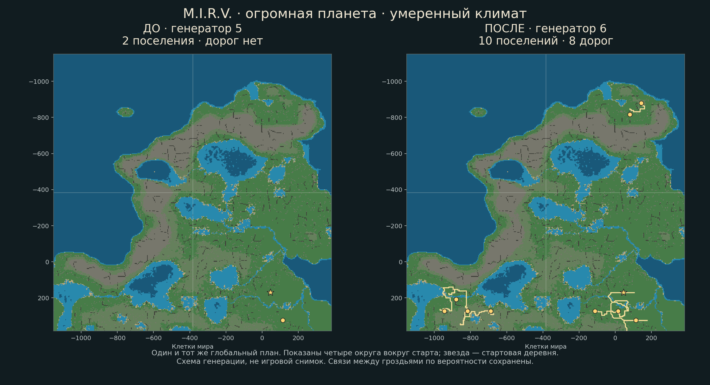
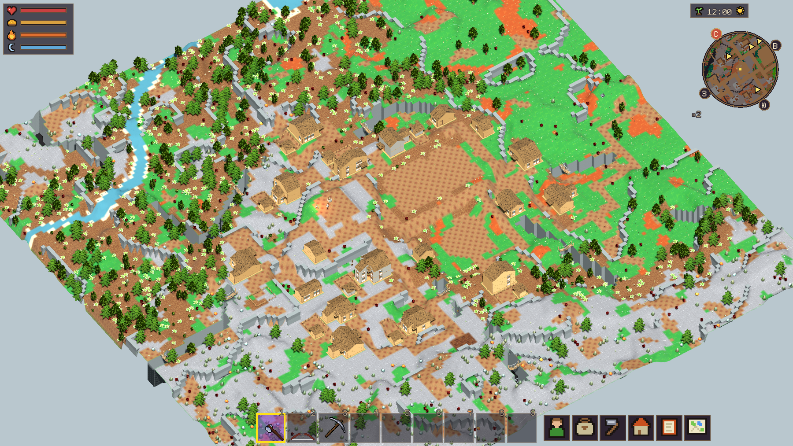
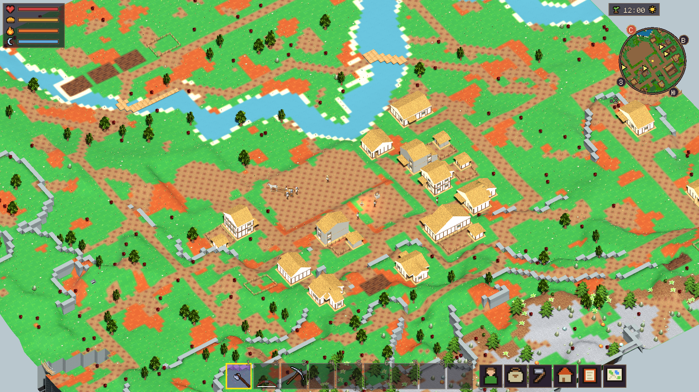

# Подгонка поселений к местности

[Полный отчёт](../../TERRAIN_SETTLEMENTS_REPORT.md), [решение](../../adr/0080-terrain-fitted-settlements.md).

Это схема четырёх округов по одному неизменному глобальному плану, не снимок
клиентской карты. В этих четырёх округах 2 → 10 поселений; во всех девяти
проверенных округах 2 → 23. Для стартового, западного и северного округов
проверены восемь реальных дорог: 6403 проверки клеток их покрытия.

Нативные кадры LocalGame из отдельного профиля; планировки настоящие.
[Караван у стоянки](caravan.webp) поставлен в контрольную позицию и принят
штатной логикой сервера для торговли. Это не запись полного путешествия.

- [Данные до](before.json), [повтор по исходнику v0.20.0](before-rechecked.json).
- [Данные после с путями](after.json), [полный нативный отчёт](native.json),
  [нативный журнал](native.log).
- [Исходный WorldPlan](mirv-plan.json.gz) — только сгенерированная география,
  без персонажей, мира SQLite и приватных ключей.
- [Хеши и размеры WebP](images.json). Проверено точное совпадение RGBA с PNG.
- [Проверка запроса в радиусе и время](query-timing.json): исходный вариант
  превысил 180 секунд; исправленный — 78,990 секунды при прежнем лимите.
  Это локальные времена теста, не аппаратный бенчмарк.
- [Сводка проверки](verification.json), [полный игровой прогон](full-tests.json),
  [журнал](full-tests.log), [входные хеши](tested-sources.json): 680 тестов
  в 104 наборах без провалов, 1193.91 с; исходники за время прогона не менялись.
  Профильные журналы взяты из этого же полного прогона.

Исходный результат получен до изменений в чистом main на игровом коде
v0.20.0. Повтор использовал исходник Settlements из тега, убрав только
регистрацию class_name и создание неиспользуемых в выборе деревень помощников
лагерей/таверн; колбэк непригодности оставлен со старым ограничением высоты.
Координаты, планы и отсутствие дорог полностью совпали с первым расчётом.
