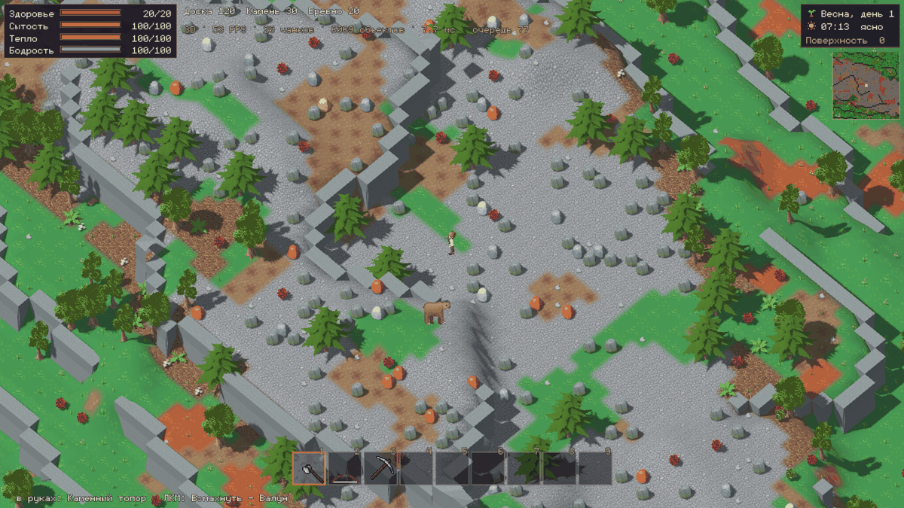
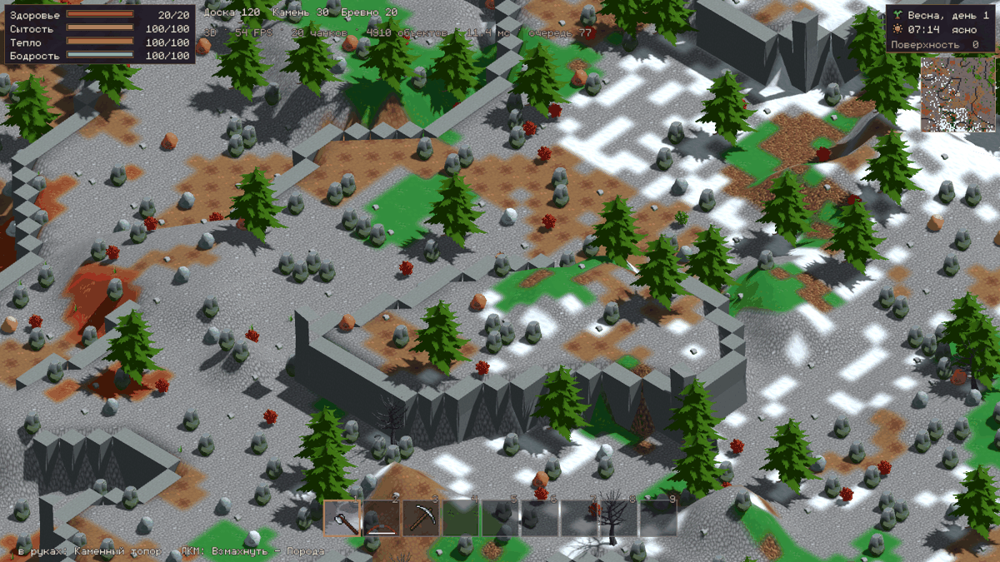
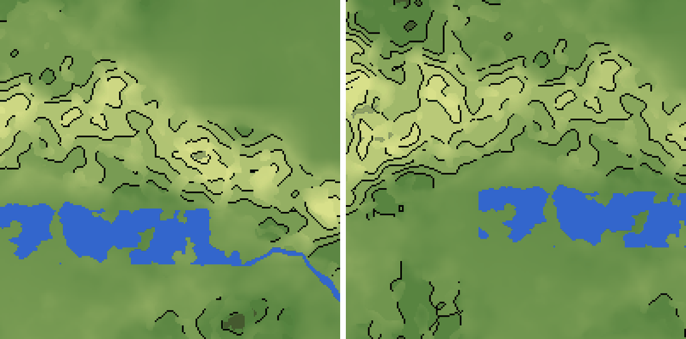
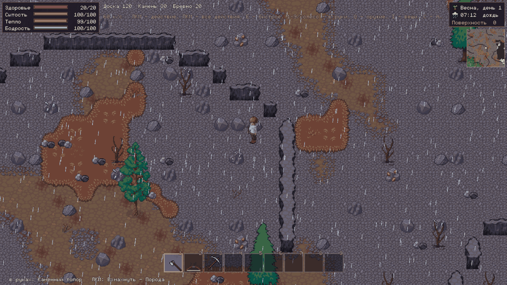
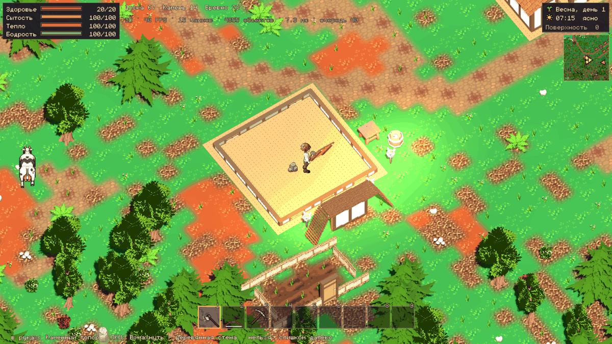
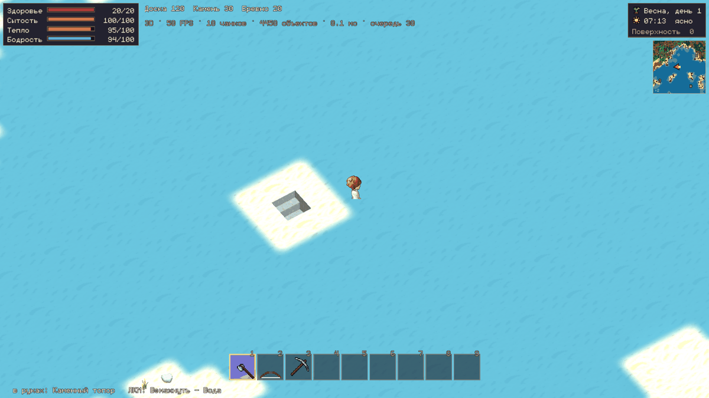
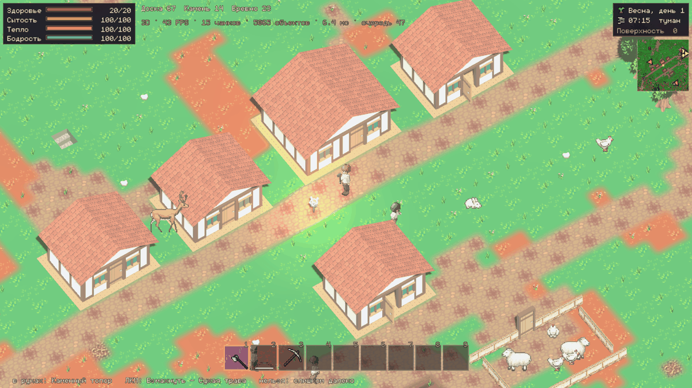
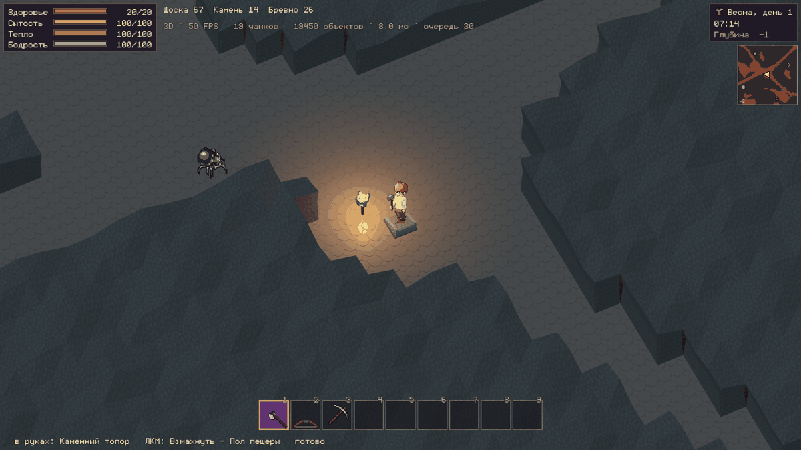
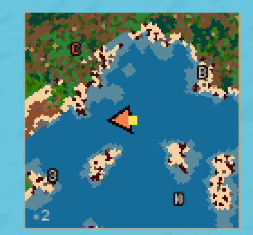

# Играбельный 3D-эксперимент No Hero Needed

Влит в `main` 2026-10-27 (была ветка `experiment/3d-world`); 3D — вид игры по умолчанию.
Linux x86_64, Godot **4.7.2**, существующий `gl_compatibility`.

## Исправление качества

Актуальные исправления, маршрут seed 431, сравнение спрайтов и реальные кадры:
[отчёт о качестве](quality/REPORT.md). Быстрый просмотр: `tools/start_3d_experiment.sh --quality`,
F6 — поселение, F8 — горная дорога, F7 — пещера.

## Рельеф уровнями (ADR-0061, 28.10.2026)

Хребет раньше был одной длинной наклонной гранью: высота шла плавно из карты высот
(72 м на единицу). Теперь, как в Ragnarok Online, изрезанная земля (холмы, горы, кое-где
низины) лежит плоскими площадками через 3 м со столовыми горами, между ними — обрывы
(клетки породы: не пройти, можно прорубить киркой) и проходы, где земля плавно
переходит с уровня на уровень. Равнины остаются пологими. Висячих мостов пока нет.

| Площадка в обрывах | Уровни и проходы |
|---|---|
|  |  |

Карты высот (светлее — выше, чёрное — обрывы, синее — вода), горы и каменистые холмы:



В 2D обрывы — полосы скалы:



## Замечания автора (28.10.2026)

Дом, в который вошёл персонаж: перекрытия и крыша не рисуются, стены — бортик в
шестую часть высоты. Вход в пещеру — яма со ступенями, не лестница на земле. Свет:
солнце лепит форму (освещённая и теневая стороны), небо только подсвечивает тень,
тон-маппинг Filmic. Миникарта поворачивается вместе с камерой, по краю — стороны света.

| Дом изнутри | Вход в пещеру |
|---|---|
|  |  |

| Деревня, свет | Пещера: у скалы персонаж виден | Миникарта |
|---|---|---|
|  |  |  |

## Запуск

Обычная игра в 3D со своим профилем и мирами:

```bash
tools/run_game.sh                    # 3D
tools/run_game.sh -- --renderer=2d   # прежний 2D-вид
```

Отдельный профиль и мир эксперимента, не трогающие сохранения основной игры:

```bash
tools/start_3d_experiment.sh
```

Godot уже должен быть установлен; другой путь можно указать через `GODOT=/path/to/godot`.
Для первой установки зависимости нужны `curl`, `unzip`, `sha256sum`; также нужны
Git, Bash, `timeout`, `flock` (обычный Linux desktop). Нативный godot-sqlite v4.9
проверяется по SHA-256. Если та же версия уже установлена в соседней основной копии,
её библиотеки копируются без скачивания и без изменения источника. Иначе архив
скачивается один раз в отдельный кэш. Изменённые существующие библиотеки не заменяются.
Все выбранные модели и текстуры лежат в репозитории: ZIP пользователю не нужен.
Импорт Godot обновляет только изменённые ресурсы в `.godot`.

У `start_3d_experiment.sh` настройки, ключи, персонажи и мир находятся под
`../.noheroneeds-3d-data/data/noheroneeds/profiles/experiment-3d/`.
Остальные XDG-каталоги, кэш и журнал импорта также находятся внутри
`../.noheroneeds-3d-data/`. Профиль `default` основной игры не используется.
Одновременный запуск двух экземпляров этого эксперимента блокируется.
Обычный выход через Esc/закрытие окна сохраняет мир прежним механизмом игры.

Для сравнения того же экспериментального мира в исходном 2D:

```bash
tools/start_3d_experiment.sh --2d
```

Сначала закройте предыдущий экземпляр.
Параметры, меняющие профиль, мир, подключение, сервер или renderer, запрещены launcher'ом.

## Управление и маршрут

- WASD/стрелки — движение относительно камеры; Ctrl — прежний бег.
- Средняя кнопка + движение мыши — поворот на 360°.
- Shift + средняя кнопка — наклон (25–78°); колесо — масштаб.
- 1–9 — быстрые слоты (колесо их больше не листает); I — инвентарь, G — выбросить предмет.
- ЛКМ — основное действие выбранным инструментом; ПКМ — прежнее контекстное меню.
- E — быстрое взаимодействие; F — существующая лестница/переход, Shift+F предпочитает спуск.
- B — существующий каталог строительства; R — поворот детали; Esc — меню.
- **F6** — тестовый перенос к настоящей деревне этого мира.
- **F7** — тестовый перенос к настоящему сохранённому входу в пещеру; затем **F** для спуска.

F6/F7 работают только в локальном 3D-эксперименте на поверхности. Это средства
быстрого осмотра, использующие существующий серверный перенос персонажа и координаты
настоящей генерации. Они не создают деревню, вход или другую карту. Обычная ходьба
доступна всегда. Начальный набор игры содержит топор, кирку и строительные материалы.

Практический маршрут: F6, повернуть камеру и поговорить с жителем; выбрать топор и
срубить дерево; выбросить и подобрать камень; B и построить дверь/пол. Затем F7,
F, киркой добыть породу. На −1 можно построить обычную шахту вниз через каталог и
спуститься на −2; вернуться через ту же лестницу. Рубка, добыча и строительство
сохраняются в отдельном мире. Камера сохраняет выбранный ракурс в его профиле.
Здания, крыши и деревья автоматически не исчезают и не становятся прозрачными.

## Граница эксперимента

`App` → прежний `GameScreen` → прежние `LocalGame`, `GameServer`, `GameClient`.
Только при `--renderer=3d` `GameScreen` выбирает `WorldView3D`, наследующий
необходимый интерфейс `WorldView`. HUD, карты, инвентарь, ремёсла, действия и сетевые
запросы остаются прежними. Генераторы, серверная симуляция, протокол и формат мира
не изменены.

- Один 3D-метр соответствует клетке (256 единиц симуляции / 16 мировых пикселей).
  Этаж — два метра. Это масштаб изображения, не новая физика.
- Высота берётся из **исходного** `SurfaceGenerator.land_at`, использующего
  `GameClient.geography.world_seed`: та же Geography, локальный grain и береговые данные.
  Для изображения нормализованная высота относительно моря умножается на 14.
  Никакой повторной генерации содержимого чанков нет: покрытия, вода, дороги,
  мосты, постройки и объекты берутся только из принятых клиентом `Chunk`.
- Соседние чанки используют общие мировые координаты вершин. Стопы и picking
  согласованы с теми же треугольниками рельефа. Исходные непроходимые скалы
  изображаются объёмными препятствиями; проходимость определяет `Terrain` сервера.
- `catalog.json` сопоставляет content ID и модели; имена glTF не попадают в игровую логику.
  Неизвестные детали получают явную геометрическую заглушку.
- Геометрия строится по строкам с бюджетом около 4,5 мс за кадр, ближайшие чанки — первыми.
  Отрисовывается радиус два чанка, дальние узлы удаляются, кэш высот ограничен областью.
  Растения и детали группируются в MultiMesh по модели и чанку. Внутренняя порода
  закрывается общими верхними гранями, детальные модели нужны на открытых стенах.
- Чанки обновляются по `changed_chunks`. Вырубка не создаётся заново из seed.
  Каждая глубина использует свою настоящую локацию `depth:-N`.
- Персонажи и животные используют прежние `CharacterSprite`/`LpcSprite` в прозрачных
  SubViewport → Sprite3D. Сохраняются слои внешности/одежды/инструментов и анимации.
  Направление выбирается относительно камеры, без изменения позиции сервера.
- Коллайдеры нужны исключительно для луча мыши: действительный World3D берётся
  у Camera3D. Они не управляют ходьбой. Объект под лучом преобразуется в прежний
  content ID, слой, клетку или entity ID, далее работают прежние `Actions` и `Reach`.
- Свет следует существующему `Daylight`; факелы и костры дают OmniLight3D.
  Дождь/снег/туман остаются существующими экранными эффектами.

## Ассеты и воспроизводимость

Только бесплатные редакции, лицензия **CC0-1.0**, 31 модель. Исходные тексты лицензий
лежат рядом с моделями. В `assets/experiment_3d/manifest.json` записаны авторы,
страницы источников, SHA-256 архивов и каждого отобранного файла. Большие архивы,
FBX/OBJ и неиспользуемые модели в репозиторий не включены.

| Пакет | Автор | Использование |
|---|---|---|
| [Stylized Nature MegaKit Standard](https://quaternius.itch.io/stylized-nature-megakit) | Quaternius | деревья, кусты, цветы, трава, грибы, валуны |
| [Medieval Village MegaKit Standard](https://quaternius.com/packs/medievalvillagemegakit.html) | Quaternius | стены, окна, двери, полы, лестницы, крыши |
| [Resource Bits FREE](https://kaylousberg.itch.io/resource-bits) | Kay Lousberg | пни, камни, железо, медь, серебро, золото |
| [Dungeon Pack FREE 1.1](https://kaylousberg.itch.io/kaykit-dungeon-pack) | Kay Lousberg | стены, полы, лестницы, сундуки, столы, факелы |

Для воспроизведения отбора скачайте бесплатные версии с этих страниц и поместите
ZIP в один каталог под именами `nature.zip`, `village.zip`, `resource.zip`, `dungeon.zip`:

```bash
python3 tools/experiment_3d/import_assets.py /path/to/archives
```

Импортёр читает только выбранные glTF и их зависимости, проверяет наличие CC0 и
отказывается перезаписывать отличающиеся файлы. В штатном запуске он не нужен.
Канонический `game-dev` CLI на машине разработки отсутствовал; его package/vendor
receipt не заявляется. Выполнены непосредственные проверки исходных лицензий,
SHA-256 и импорта выбранных ресурсов в Godot.

## Проверки

Без сети и без пользовательских сохранений:

```bash
python3 tools/experiment_3d/test_prepare_addons.py
python3 tools/experiment_3d/verify_assets.py
```

Проверки адаптера и исходные тесты игры:

```bash
tools/run_tests.sh --only=experiment_3d
tools/run_tests.sh
```

Сквозная проверка в настоящем окне на GPU, с отдельным временным профилем:

```bash
godot --path . -s res://tools/experiment_3d/check_runtime.gd -- --out=/tmp/nhn-3d-runtime
```

Она проверяет настоящее подключение LocalGame, ходьбу, выбор лучом, мышиные действия,
подбор/выброс, разговор с сгенерированным NPC, рубку, дверь, добычу, переходы −1/−2,
возврат и сохранение разрушенной породы после повторного открытия БД. Создаёт
`runtime.json` и PNG. Она ожидает Radeon RX 580, то есть проверяет именно целевой ПК.
Для измерения обычного игрового цикла есть `EXPERIMENT_3D` каждые 300 кадров и `--perf`.
Результаты текущей проверки находятся в [VERIFICATION.md](VERIFICATION.md).

## Ограничения прототипа

- Это играбельный графический эксперимент, а не готовая замена производственного рендера.
  Вода пока непрозрачная, без отражений и волн; материалы земли используют плоские цвета.
- Модули зданий приспособлены к клеткам; это не окончательная художественная сборка.
  Цельные крыши объединяются только для полностью заполненных прямоугольников.
  Разрушенный/непрямоугольный участок рисуется отдельными фрагментами, без заполнения дыр.
- Picking крупных объектов использует bounding boxes. Пустые промежутки кроны могут
  выбираться как дерево; ближайшее препятствие перекрывает цель за ним.
- Первая загрузка glTF/создание коллизии может превышать бюджет строки. Генерация
  нового района сервером и существующая симуляция животных тоже дают отдельные пики.
- Географическая высота остаётся визуальной: сервер не получает новой физики склонов.
  На склонах полы и основания отдельных модулей требуют дальнейшего художественного согласования.
- Визуальные частицы ударов, 3D-стрелы и поза сна ещё не адаптированы; их игровые правила
  продолжают исполняться прежним сервером. Автоматического скрытия крыш нет.

Для полноценной альтернативной графики нужны отдельный художественный проход,
точные формы picking, асинхронная подготовка тяжёлых ресурсов, более подробная вода,
сезонные материалы, остальные эффекты/позы и длительные игровые проверки при
исследовании больших расстояний, многоэтажном строительстве и сетевой игре.
