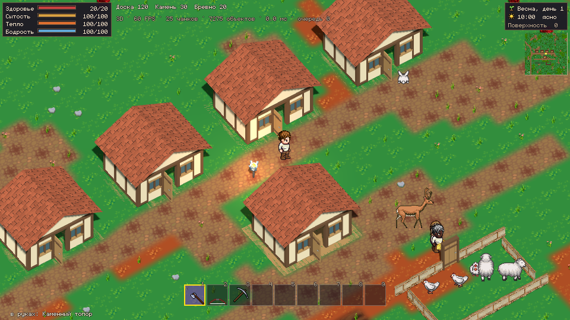
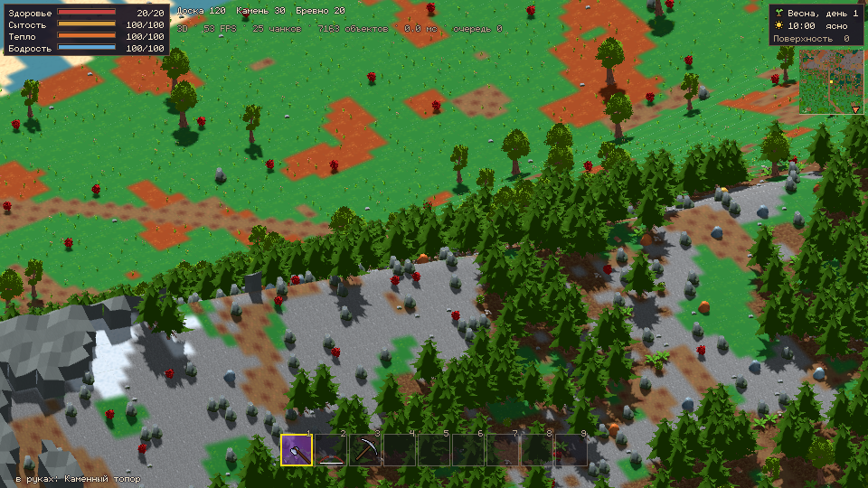
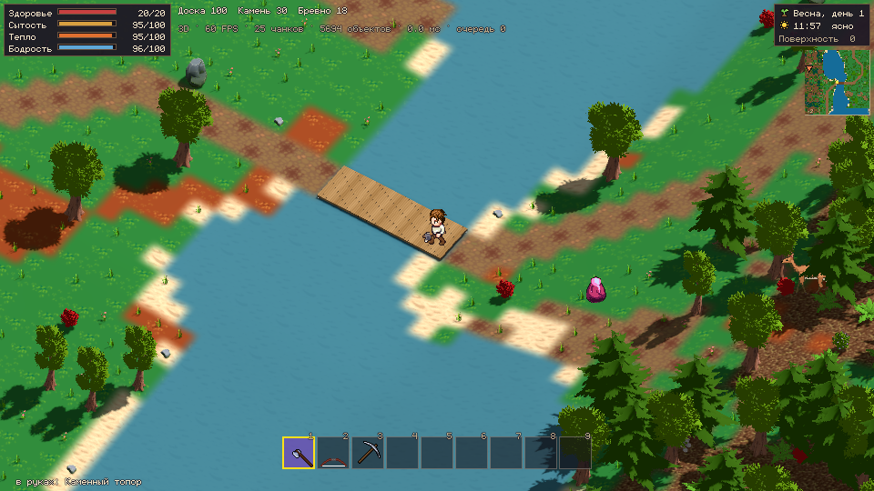

# Исправление качества 3D-эксперимента

Изменения находятся только в `experiment/3d-world`. Это продолжение существующего
адаптера NHN, Godot 4.7.2, GL Compatibility. Генераторы, симуляция, протокол,
исходные LPC-изображения и основная рабочая копия не изменены. Нового проекта нет.

## Посмотреть

Из рабочей копии:

```bash
tools/start_3d_experiment.sh --quality
```

Это отдельный профиль `experiment-3d-quality`, мир `quality_431`, настоящий seed
**431**. Первый запуск создаёт БД через `ServerWorld.open(seed=431)`; последующие
открывают её. Существующие миры не пересеиваются. Параметры библиотеки читаются
только после появления БД — это отдельно учтено при подготовке маршрута.

- **F6** — поселение, родная плотность спрайтов 32 пикселя/метр.
- **F8** — настоящая горная дорога **(-231, 816)**, обзор хребта.
- **F7** — существующий вход в пещеру; F — штатный переход.
- Средняя кнопка — вращение; Shift + средняя — наклон; Ctrl + колесо — масштаб.
- `tools/start_3d_experiment.sh --quality --2d` — тот же профиль, персонаж и мир
  штатным 2D-рендерером. Сначала закрыть другой экземпляр.

Обычный запуск без `--quality` сохраняет прежний отдельный профиль эксперимента.
F8 в мире с другим seed показывает объяснение вместо телепортации по чужим координатам.
Телепортации работают только на поверхности и только локально, через существующий
`ServerWorld.move_character`. F6/F8 выбирают также удобный ракурс; дальше камера свободна.

## Кадры из работающей игры

Все PNG получены с GPU после `RenderingServer.frame_post_draw`, с настоящими
LocalGame/GameClient, исходными чанками и seed 431. В capture-сценарии часы
зафиксированы на 10:00, существующая модель Weather выбрана ясной в обеих областях.





[Поселение до изменений](evidence/before-village.png),
[горная область до изменений](evidence/before-mountain.png).
Исходные кадры сняты при прежнем масштабе камеры 25; новый игровой масштаб 16.875,
обзорный горный — 38. Это сравнение вида, а не попиксельный diff всей сцены.
В evidence сохранены по четыре ракурса каждой области; сопоставление спрайтов
сделано отдельно при одинаковой плотности пикселей.

## Найденные причины и исправления

**Спрайты.** `Art.character_sprite` собирал LPC при `pixel_scale=.5` внутри
96×96 SubViewport. Ортографическая камера повторно уменьшала результат: исходные
пиксели терялись до попадания на экран. Теперь та же многослойная кукла рисуется
в 192×192 при масштабе ×2, а `Sprite3D.pixel_size` уменьшен вдвое, сохраняя мировой
рост. Стандартный масштаб камеры — 540/32 = 16.875. Nearest применяется на обоих
этапах; у paper doll нет mipmaps и освещения. Одежда, волосы, оружие, анимации и
порядок слоёв по-прежнему принадлежат исходному CharacterSprite/LpcSprite.

В Compatibility обнаружено также затемнение тёмных цветов из-за приближённого
sRGB-преобразования. Проверенный на GPU shader компенсирует его, сохраняя
билборд и отсечение прозрачных пикселей. Сравнение одного одетого человека и овцы
при четырёх направлениях: **одинаковые силуэты и альфа, максимальная разница RGB
2/255 у человека, 0 у овцы**. Промежуточные композиции совпадают с 2D побайтно.
[Нативные кадры и сравнение ×2](evidence/sprites/comparison.html),
[измерения](evidence/sprites/pixel-comparison.json).
При свободном масштабе и движении камеры остаётся обычный nearest-алиасинг;
проверенное совпадение относится к родной плотности пикселей.

**Дома.** Прежний импорт выравнивал AABB и независимо масштабировал три оси.
Стена 2×3.125×0.406 превращалась в 1×2×0.32. Крыша 5.513×4.249×5.561 сначала
сжималась до 1×0.5×1, затем повторно растягивалась по прямоугольнику только
внутренних roof-клеток. Углы выбирали одну ориентацию; дверь вращалась вокруг центра.

Теперь структурные модули имеют явные размеры: клетка 1 м, этаж 2 м, стена
0.18 м, согласованные стойки и перемычки. Угловой модуль соединяет все имеющиеся
соседние стены. Дверь вращается вокруг левого косяка, оконные проёмы имеют раму,
подоконник и утопленное стекло. Связанные крыши имеют общий конёк; каждый живой
roof-part рисует собственный участок. Карниз расширяется только к существующей
стене без отдельного roof-part. Отсутствующая часть оставляет отверстие. Удаление
части не заменяется цельным prefab. Фасады проверены с четырёх сторон.
Деревенские площадки используют исходные home.rect, пользовательские — живые
связанные полы клиента. Площадки плавно переходят в грунт.

**Рельеф.** Старый адаптер умножал `land_at.height` целиком на 14; крупная форма
и мелкий шум имели одинаковый масштаб. Объекты вставали только по высоте центра,
полы пересекали склон, у второй треугольной грани использовалась нормаль первой.

Новая форма использует **исходную** `Geography.HEIGHT` для крупного рельефа,
а разность `land_at.height - Geography.HEIGHT` — для небольшого зерна. Это
разделяет хребет и неровность грунта. Масштаб проверен относительно человека
около 1.5 м, дома 2 м и деревьев 4–5 м. Добавлены площадки, общие береговые
вершины, исходные уровни морей/озёр, спускающиеся по долине реки, деформируемая
по поверхности мостовая настилка и общие нормали на границах чанков. Грунт под дощатыми/каменными полами опущен ниже настила на 0.14 м, чтобы
исключить coplanar z-fighting и зелёные полосы. Мостовой настил поднят над водой
на 0.18 м; его верхняя грань и ноги используют одинаковые треугольники. Дороги
остаются исходными клетками Settlements, повторяют треугольники рельефа.

Измерения 49×49 клеток, включая оба направления рёбер:

| Участок | Старый перепад | Новый перепад | Максимум на ребре дороги |
|---|---:|---:|---:|
| Поселение (28, 1) | 1.04 м | 2.89 м | 0.208 м/клетку |
| Горная дорога (-231, 816) | 5.84 м | 28.00 м | 0.677 м/клетку |

Дорога выбрана поиском по 26 039 реальным клеткам дорог. На горном участке
найдено 84 клетки дорог; максимальный перепад любого ребра — 0.841 м.
[Аудит моделей и географии](evidence/audit.json).

Высота ног берётся из той же пары треугольников, что рисуется. У удалённых
сущностей сначала интерполируется XZ, затем высота под интерполированными ногами.
Скальные стены занимают только реальные blocked rock-клетки. Проходимые склоны
и дорога остаются непрерывными пандусами, а не вертикальными стенами.
Симуляция NHN остаётся клеточной: она не рассчитывает физический уклон/падение.
Универсальная проверка всех склонов всех seed не выполнялась; здесь проверен
воспроизводимый настоящий маршрут. Новой физики и ограничений движения нет.

**Материалы.** Грунт использует существующие LPC terrain fills с mipmaps и
плавным смешиванием соседних типов по общей карте, включая границу чанка.
Явные производные UV устраняют mip-сетку на повторениях атласа. Геометрия имеет
общие нормали. Трава, кусты, цветы и деревья инстансируются только из полученных
клеток существующего биома. Нового случайного декоративного слоя нет.

**Пещеры.** Природная порода — связанная скальная масса с общими неровными
вершинами, сколотыми открытыми гранями и текстурой камня вместо кирпичных prefab.
Внутренние боковые грани отсутствуют. Порода собирается одним мешем на чанк;
после добычи перестраиваются также соседние границы. Руды остаются исходными
part-ID и месторождениями. Лестницы и глубины используют прежние правила.

## Проверки

- Полный `tools/run_tests.sh`: **403 теста, 0 failed checks**, 488.1 с.
  Две ожидаемые ошибки ENet — намеренные проверки ошибки подключения.
- После последних изменений адаптера — **11 тестов, 0 ошибок**:
  реальные высоты, ноги, камеры, дверная петля, крыши, общие скальные вершины.
- Реальный LocalGame/GameClient и RX 580 — **32 проверки**, без ошибок:
  движение, ray picking, разговор, предметы, рубка дерева, строительство,
  дверь, добыча, две глубины, возврат, сохранение/повторное открытие.
- Дополнительные **19 проверок**, без ошибок: фактический seed 431,
  построенный сервером пол через четыре чанка, разбор одной крыши и отсутствие
  её меша, сохранение соседних частей/конька, реальное движение по горной дороге,
  ноги людей/животных на склоне, совпадение вершин и нормалей фактических мешей
  двух соседних чанков, завершение подгрузки и ограничение 25 чанками.
  Найден настоящий мост **(34, 168)**: проверены исходные water-клетки,
  серверный bridge-ID и настил/ноги на 0.18 м выше уровня воды.
- Git/worktree launcher — **8 проверок**, безопасная зависимость — **4 проверки**.
- SHA-256 всех **93 исходных файлов 4 CC0-пакетов** совпадает с manifest.

Логи и JSON находятся в [evidence](evidence/). Сценарии сохранены в
`tools/experiment_3d/quality/`: `inspect.gd`, `capture.gd`, `sprites.gd`,
`compare_sprites.py`, `gameplay.gd`. Это реальные игры с временными отдельными
профилями, исходными чанками и запросами серверу.

Проверка не заменяет художественную оценку пользователем. Представленные кадры
позволяют оценить дома, персонажей и горы непосредственно; принятие выбранной
палитры и архитектурного стиля остаётся за пользователем.

## Radeon RX 580 8 ГБ

Нативный AMD Radeon RX 580 2048SP, 8 589 934 592 байта VRAM по sysfs,
Mesa 26.1.4, OpenGL Compatibility. [Метрики последнего запуска](evidence/capture.json),
[полный журнал загрузки и кадров](evidence/captures.log).
Логический 3D framebuffer — **960×540**; физическое окно — **1920×1013**.
Окно масштабируется штатным PixelDisplay с nearest и сохранением сторон.
При таком размере физический масштаб дробный; PNG отражают исходный логический
растр. Это не обещание идеальной сетки в произвольном размере окна.

После подгрузки 25 чанков обе области держат около **60 FPS с VSync**;
300 кадров на область занимают около 5 с. Точные p95/worst указаны в JSON.
Это ограниченный замер двух реальных видов, без заявления о предельном FPS.
Скачок при холодном запуске/генерации около 1.1 с и редкие пики при подгрузке
и снимках до нескольких сотен миллисекунд остаются видимыми в полном журнале.
Их нельзя скрывать за средним FPS статичного кадра.


Проверен также обычный App с активным `_process`, физическое окно X11:
[поселение](evidence/native-village-window.png),
[переход клавишей F8 в горы](evidence/native-mountain-window.png).
Это непосредственные снимки окна, включая letterbox и дробный физический масштаб.
Штатный dev-флаг `--screenshot` в отдельном smoke-запуске дал пустой кадр на выходе;
поэтому доказательство вида основано на ожидании post-draw в capture.gd и снимках
живого окна. Этот общий dev-механизм в рамках исправления рендерера не менялся.



[Пещера после добычи](evidence/cave-after.png): общая скальная масса и открытые грани.
