# Конвейер 2D-персонажей в стиле Ragnarok Online (8 направлений)

Ветка: `experiment/ro-sprite-pipeline` (от `experiment/3d-world`). Скрипты лежат в
`tools/art/ro_sprites/`, исходники и результаты в git не входят
(`art_src/ro_sprites/`, `build/ro_sprites/`).

Цель: генератор спрайтов тела, одежды и причёски для любой анимации в любом из 8
направлений и конструктор персонажа, который накладывает эти слои друг на друга.

| Этап | Что делает | Состояние |
|---|---|---|
| 1 | Базовая модель (мужская, затем женская) в пропорциях RO | мужская принята, женская сделана |
| 2 | Анимации базовой модели | 12 клипов, приняты |
| 3 | Съёмка анимаций и idle в 8 направлениях | все клипы × 8 направлений |
| 4 | Одежда и амуниция: съёмка на невидимой модели | 9 вещей и 10 предметов в руки, на оценке |
| 5 | Причёски: съёмка так же, как одежды | 8 причёсок у обоих тел, цвет любой, срез под убором |
| 6 | Послойное наложение на базовую модель | оба RO-тела в игре (2D и 3D); редактор: причёска, цвет волос и кожи, примерка одежды |

## Запуск

```bash
tools/art/ro_sprites/build.sh                          # всё: оба тела, все слои, все клипы
tools/art/ro_sprites/build.sh walk chop                # только эти клипы, остальные кадры остаются
LAYERS="body boots axe" tools/art/ro_sprites/build.sh  # только эти слои
BODIES=female tools/art/ro_sprites/build.sh            # только женское тело
```

Нужны Blender 5.2 (`BLENDER=/путь/к/blender`, иначе `blender` из PATH или
`~/bin/blender-5.2.2-linux-x64/blender`) и Python 3 с Pillow и numpy. Рендер идёт
без окна (`blender -b`) и ничего не открывает на рабочем столе. Слои
раздаются `JOBS` процессам Blender на тело (по умолчанию 3, больше не влезает в 8 ГБ
видеопамяти), оба тела рендерятся одновременно. Каждый кадр снимается одним проходом
сглаживания: пиксель спрайта — самый частый цвет своего блока 8×8, так что 16 проходов
меняли 0,6% пикселей и стоили две трети времени. Сборка упирается в видеокарту.

Результат в `build/ro_sprites/<тело>/` (`male`, `female`):
- `base.blend`: базовая модель с арматурой; `hair.blend`: она же с причёсками;
  `gear.blend`: она же с одеждой и предметами, по коллекции на предмет;
- `pixels/<слой>/<клип>_<направление>_<кадр>.png` — пиксели слоя и
  `….depth.png` — его карта глубины (16 бит, ближе — светлее); направления s, se, e, ne, n,
  nw, w, sw; `face/body/` — нарисованное лицо;
- клетка тела и одежды 172×172, точка опоры (земля под ногами) — столбец 86, строка 133,
  рост около 100 px; у предметов в руках клетка 256×256 с опорой в столбце 128, строке 176
  (то же место относительно тела, просто больше поля для длинного оружия);
- `outfits/<наряд>/` — собранные кадры примерных нарядов (`gear.OUTFITS`),
  `preview/<наряд>/<клип>.gif` — клип во всех 8 направлениях, `<клип>.png` — все кадры листом.

Подписанные листы и анимации персонажа ровно так, как его рисует игра (из атласов игры):

```bash
python3 tools/art/ro_sprites/review_sheet.py content/base OUT --plan base:human_ro_f --held axe --clips chop run
```

Снимки из самой игры: персонаж держится в позах по списку и каждый кадр сохраняется
(`--pose_list=chop:ne:7,run:s:2,...`; без списка — стойка, ходьба, бег и вся рубка в
направлениях n, s, e, ne, se):

```bash
tools/run_game.sh -- --profile=poses --body=base:human_ro_f --poses=/tmp/pose
tools/run_game.sh -- --profile=hats --body=base:human_ro_f --hair=base:human_ro_hair_long --wear=base:felt_hat --poses=/tmp/hat
```

`--hair` — причёска нового персонажа разработки, `--wear` — вещи, которые ему выдаются и
надеваются в начале.

## Этап 1: базовая мужская модель

Исходник: VRoid **HairSample_Male** (CC0, лицензия записана и в метаданных VRM)
из [madjin/vrm-samples](https://github.com/madjin/vrm-samples). Его скачивает
`fetch_base.sh` и проверяет по SHA-256.

`build_base.py`:
- убирает одежду, 3D-брови, ресницы, веки и рот; белки и радужки остаются кожей и
  закрывают глазницы, а зона глаз и рта выравнивается по гладкой поверхности лица;
- меняет пропорции масштабом костей и затем применяет позу как исходную:
  голова ×1,45, ноги по длине ×0,47 (и толще на 15 %), руки ×0,65, торс ×0,77.
  Получается рост 1,28 м и около 3,6 головы: голова с волосами, торс и ноги
  примерно равны, как в спрайтах RO;
- рисует облегающие тёмно-синие плавки атрибутом граней тела (без отдельной сетки);
- сглаживает нормали затенения, чтобы рельеф мышц VRoid не дробил заливку на пятна;
- ставит на кость головы метки `eye_r`, `eye_l`, `mouth`.

Материалы (`toon.py`, цвета в `palette.py`) дают три плоских тона на материал:
свет, полутень и тень. Цвет берётся из рампы по освещённости и выводится через
emission, поэтому в рендере нет промежуточных цветов.

`render.py`: ортографическая камера смотрит сверху под 22°, свет закреплён
слева сверху относительно экрана, поэтому все направления освещены одинаково,
как в RO. Поворачивается персонаж, а не камера. Кадр рендерится в 8 раз
крупнее спрайта (`gear.PX_PER_M`, 77 px на метр; до 27.10 было 58). В `anchors.json` записываются экранные точки глаз и рта:
насколько каждая точка повёрнута к зрителю и не закрыта ли телом.

`pixelate.py`: каждый блок 8×8 становится пикселем самого частого цвета в блоке.
Тёмные линии весят вчетверо больше, поэтому тонкие детали не теряются. Вокруг
силуэта рисуется контур в 1 px затемнённым цветом соседнего пикселя.

`face2d.py`: лицо рисуется пикселями, как в RO, а не лежит текстурой на 3D-голове.
В точках глаз ставится шаблон: полный для глаза, повёрнутого к зрителю, узкий
для глаза вполоборота, и никакого для отвёрнутого. Рот — 1–2 px. Лицо ложится
только на пиксели кожи, поэтому чёлка причёски остаётся поверх глаз. Лицо
выводится отдельным слоем, так что цвет глаз и выражение потом можно менять,
не перерендеривая тело.


### Почему лицо не текстура

Первый вариант рисовал лицо текстурой на 3D-голове. При голове шириной около
20 px глаза размывались или пропадали при уменьшении, а сверху их закрывало
надбровье. Нарисованные пиксельные шаблоны в спроецированных точках дают
чёткие глаза в любом направлении и в любом кадре анимации.

## Женская модель

Источник — VRoid **HairSample_Female** (CC0), те же шаги `build_base.py --body female`:
пропорции те же, рост 1,22 м. Бельё — плавки и облегающий топ на груди, только на
торсе (в T-позе руки на высоте груди и иначе попали бы в полосу). Грудь у VRoid висит
на пружинных костях `J_Sec_*`, которые сборка удаляет; их веса переходят к ближайшей
основной кости (груди), иначе грудь не двигалась бы с телом, а одежда, снятая с тела,
оставляла бы на ней дыры. Пробная причёска — два хвоста.

Одежда снимается с того же тела тем же `build_gear.py`: все её высоты (низ штанин, верх
сапог, плечи и кости плаща, низ капюшона) берутся из костей тела, а не числами. Оболочки
сдвигаются по сглаженным нормалям, чтобы не проваливаться под грудь и в подмышки. Шапки
облегают голову и только 5 см волос над ней: длинные хвосты и пучки остаются снаружи, их
срежет этап 5 (как в RO).

## Этап 2: анимации

Позы задаются каналами (`rig.py`): каждый канал — одно анатомическое движение,
и плюс всегда означает естественное направление («локоть сгибается», «бедро
вперёд», «рука опускается из T-позы»). Поворот задан вокруг оси исходной позы и
переносится вместе с родительской частью тела: рука ходит в системе груди,
предплечье сгибается вокруг шарнира плеча. Поэтому поза читается одинаково при
любом повороте корпуса, и локоть или колено с плюсом не выгнутся назад.
После позы тело опускается или поднимается, пока нижняя вершина не коснётся
земли, так что шаги и приседания сами стоят на полу.

Клипы (`clips.py`): циклы заданы функциями фазы, действия — ключевыми позами
со сглаженными переходами. Оружие в правой руке, как в RO. Кадры и fps совпадают
с нынешними анимациями людей в игре.

| Клип | Кадры, fps | Что |
|---|---|---|
| idle | 4, 3 (цикл) | дыхание |
| walk | 8, 11 (цикл) | ходьба |
| run | 8, 13 (цикл) | бег |
| sit | 1 | сидит на земле, руки на коленях |
| pickup | 6, 12 | присесть и поднять с земли |
| hurt | 4, 12 | отшатнуться от удара |
| dead | 6, 10 | упасть на спину (последний кадр держится) |
| slash | 6, 16 | меч одной рукой: из-за плеча вниз наискось |
| chop | 10, 22 | топор: замах над правым плечом, удар по стволу наискось |
| mine | 10, 22 | кирка: над головой и вниз, в камень перед ногами |
| thrust | 8, 18 | копьё: отвести и уколоть на прямой руке |
| shoot | 12, 22 | лук в левой руке: развернуться, натянуть, выстрелить |
| cast | 10, 18 | удочка или заклинание: замах назад и вперёд |

В кулаках есть точки хвата `grip_r`, `grip_l`. Ось предмета идёт через кулак
наискось (на 22° к пальцам), как рукоять лежит в ладони, поэтому в ударе
предмет продолжает линию руки, а не торчит вверх. Палки в превью — только
заглушки для проверки хвата, в слои тела они не входят.

Превью (с пробной причёской и заглушками в руках, сняты на этапе 2):

| | |
|---|---|
|  |  |
|  |  |
|  |  |
|  |  |
|  |  |
|  |  |

Известные ограничения:
- левая рука не держит древко копья и тетиву: двуручных хватов (IK) пока нет;
- длинные предметы (копьё, удочка) выходят за клетку 128: на этапе 4 у оружия
  будет своя клетка или своё смещение;
- плавки сделаны раскраской граней, поэтому край у них ступенькой по сетке.

## Этап 4: одежда и амуниция

Предметы взяты из игры (`content/base`): всё, что надевается, и всё, что берётся
в руку. Список и правила съёмки — `gear.py`, модели — `build_gear.py`.

| Слот | Предметы |
|---|---|
| torso, legs, feet | рубаха, рабочие штаны (с поясом), сапоги |
| armor | кожаный доспех (наплечники, пояс, окантовка) |
| headwear | железный шлем с наносником, фетровая шляпа, меховой капюшон с пелериной |
| back_item | шерстяной плащ, меховой плащ с меховым воротником |
| main_hand | кремнёвое рубило, каменный и железный топоры, кремнёвое кайло, каменная и железная кирки, мотыга, копьё, лук, удочка |

**Как сделана одежда.** Рубаха, штаны, сапоги, доспех и пелерина — это оболочки
самого тела: его грани нужной части, сдвинутые наружу по нормалям, с теми же весами
костей. Поэтому одежда гнётся в любой позе так же, как тело под ней, и не
проваливается в него. Слои идут изнутри наружу: штаны 6 мм, рубаха 8 мм, сапоги 12 мм,
доспех 21 мм. Рукава и штанины расширяются к краю, низ рубахи и доспеха
расходится. Шапки — оболочка вокруг головы и самой объёмной из причёсок
(не выше 5 см над черепом), обрезанная по линии бровей и затылка; они едут на кости
головы. Плащ — полотно от плеч до колен
на двух своих костях (`Cape1`, `Cape2`). `rig.py` отводит его назад, когда корпус
наклоняется, бедро уходит назад или пятка поднимается, а на бегу плащ слегка
полощется.

**Предметы в руках** собраны из цилиндров и плоских призм по оси хвата кулака.
Лезвие топора смотрит туда, куда идёт удар, у кирки два острия, у мотыги лопасть
поперёк ручки. Тетива лука натягивается заново в каждом кадре: прямо между концами,
а когда правая рука оказывается за тетивой — к ней, и тогда на луке появляется стрела.
Самое тонкое (древко, удочка, тетива) не тоньше одного пикселя, иначе при
уменьшении оно пропадает.

**Как держатся.** Каждый предмет снимается в своём ударе (как в игре: топоры —
chop, кирки — mine, копьё и мотыга — thrust, лук — shoot, удочка — cast) и в клипах, где его просто
носят (idle, walk, run, sit, pickup, hurt, dead). При ношении кисть поворачивает
предмет вокруг оси кулака так, чтобы он держал одно направление в мире: всё стоит
головкой вверх (топор обухом вверх, лезвием вперёд), сколько бы ни махала рука. Когда
тело падает, предмет ложится вместе с ним (насколько опрокинут таз); когда конец
предмета ушёл бы в землю (поднять с земли), он доворачивается к горизонтали. В
thrust левая рука лежит на древке за правой: канал `L_hold`, двухзвенный IK руки,
кулак поворачивается вдоль древка. Значит, на этапе 2 у копья и мотыги стало два
хвата.

**Съёмка на невидимой модели.** Каждый слой рендерится отдельно, а тело при этом —
holdout: его не видно, но оно закрывает то, что за ним. Так в слое остаются только
пиксели, которые видны на этом теле: спина плаща исчезает за телом, древко — за
рукой. Всё, что ниже земли, тоже срезается. К каждому кадру пишется карта глубины.

**Сборка (`compose.py`).** Слои складываются по глубине: где слои перекрываются,
побеждает более близкий. Поэтому порядок слоёв не задаётся вручную и не зависит от
направления: плащ спереди уходит за тело, сзади закрывает его, шлем закрывает волосы,
копьё в thrust проходит перед телом или за ним. Лицо рисуется на коже тела и
пропадает под капюшоном и чёлкой само.

Примерные наряды (`gear.OUTFITS`):

| Наряд | Слои |
|---|---|
| bare | тело, пробная причёска |
| woodcutter | + рубаха, штаны, сапоги, шляпа, каменный топор |
| miner | + рубаха, штаны, сапоги, шлем, железная кирка |
| guard | + рубаха, штаны, сапоги, кожаный доспех, шлем, шерстяной плащ, копьё |
| hunter | + рубаха, штаны, сапоги, меховой капюшон, меховой плащ, лук |
| farmer | + рубаха, штаны, сапоги, мотыга |
| fisher | + рубаха, штаны, удочка |

Все предметы в idle: три верхних ряда — на теле (s, e, n), два нижних — сам слой,
снятый на невидимой модели (s, e): от него остаётся только то, что видно на теле.

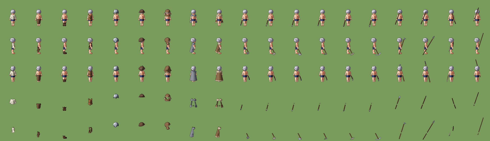

Наряды в клипах (все 8 направлений):

| | |
|---|---|
| 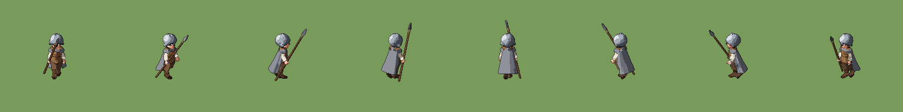 | 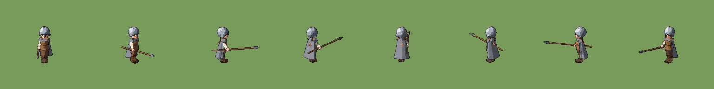 |
| 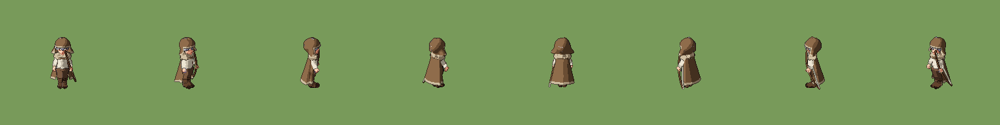 | 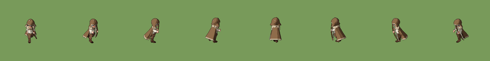 |
| 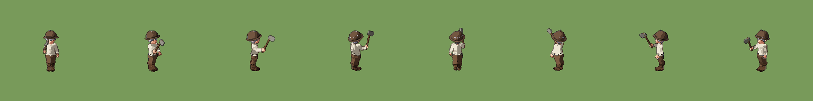 | 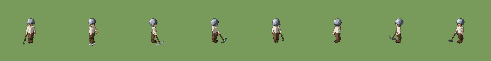 |
| 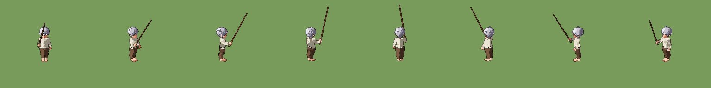 | 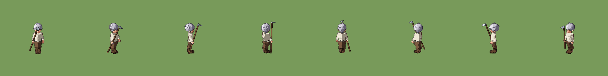 |
| 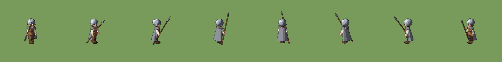 | |

Известные ограничения:
- шапки подогнаны под пробную причёску; у причёсок этапа 5 волосы могут торчать
  сквозь шапку: им понадобится вариант «под шапкой» или обрезка, как в RO;
- плащ — жёсткое полотно на двух костях, а не ткань: в сидячей и лежачей позе его
  низ срезается землёй, а не ложится на неё;
- в игре слои удобнее накладывать по порядку, а не по глубине: на этапе 6 из карт
  глубины получится порядок слоёв на каждый кадр.

## В игре

`build.sh` в конце кладёт слои в игру (`export_game.py`): по атласу на слой в
`content/base/art/ro/` (кадры обрезаны по общей рамке слоя, восемь рядов направлений,
клипы друг за другом; всего около 3 МБ) и визуал тела `base:human_ro_m` в
`content/base/ro_visuals.json`. В визуале записан порядок слоёв в каждом кадре:
он посчитан по картам глубины, тело всегда первое, остальное поверх. Карты глубины
в игру не идут.

Игра рисует такого персонажа классом `RoSprite`
(`src/presentation/ro_sprite.gd`):
- восемь настоящих направлений, без отражения;
- клипы ходьбы, бега и стойки;
- удары своими клипами;
- инструменты и оружие отдельными слоями.

Что не нарисовано своими кадрами (доска, факел), держится картинкой у руки. В 3D-виде
этот же спрайт рендерится в билборд, так что там ничего отдельного не нужно.

Поиграть: в редакторе персонажа «Пол» → «Мужской · RO» или «Женский · RO»
(восемь причёсок и «Без волос», цвет волос — цветовым кругом), или для разработки

```bash
tools/run_game.sh -- --body=base:human_ro_m   # или base:human_ro_f
```

(персонаж с этим телом создаётся в профиле, если его там нет).

| 2D | 3D |
|---|---|
| 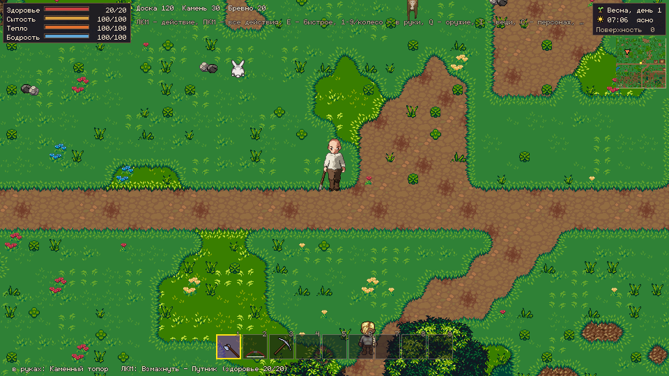 | 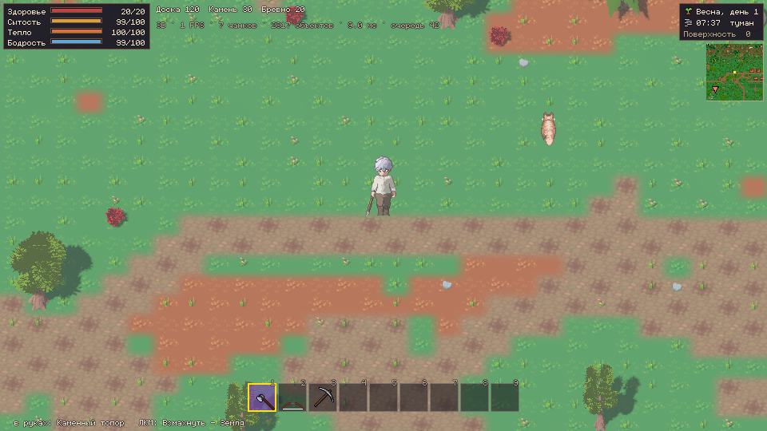 |

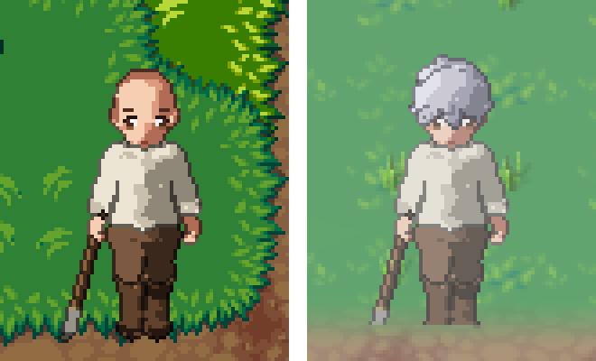

Масштаб (так было до 27.10, см. «Масштаб» ниже): 58 px на метр, полпикселя мира
на тексель, персонаж около 75 текселей — в полтора раза выше LPC-жителей.

Кожа тоже снимается оттенками серого и красится в цвет из редактора
(`ro_skin.gdshader`): игра перекрашивает только серые пиксели тела ниже белого, так
что бельё, глаза (с белым бликом) и рот остаются своих цветов.

Пока нет:
- кадров sit в игре: в игре нет действия «сесть». Остальные играются один раз поверх
  стойки и ходьбы (`RoSprite.react`): hurt — при ране, dead — при гибели (лежит две
  секунды), pickup — когда поднимаешь вещь.

В 3D кукла смотрит в камеру, и раньше вся она лежала на глубине стоп: то, что
нарисовано ниже точки опоры (носки сапог), уходило под землю, а склон позади
закрывал голову. Теперь каждая точка куклы получает глубину как в мире: выше
стоп — как стоящая, ниже — как лежащая на земле перед персонажем
(`paper_doll.gdshader`).

## Топор: ношение и рубка

По замечаниям: всё, что в руке, носится головкой вверх — топор обухом вверх и лезвием
вперёд, копьё и удочка стоймя — и при ходьбе и беге не болтается.

Рубка (`chop`, топоры) — теперь не колка полена сверху вниз, а удар по стволу:
двумя руками (левая на топорище под правой), замах назад и вверх над правым плечом с
разворотом корпуса, затем по диагонали вниз и поперёк тела, удар перед собой на уровне
пояса, лезвие почти горизонтально. Такой удар задаётся не углами суставов, а самим
инструментом: каналы `R_tool_*` в `rig.py` (где хват, куда смотрит топорище, куда
лезвие — в системе груди, так что разворот корпуса сам ведёт топор по дуге), рука
дотягивается до хвата через IK.

Листы с подписями (`review_sheet.py`, ровно то, что рисует игра): рубка и бег с топором,
направления N, S, E, NE, SE, кадры по порядку.

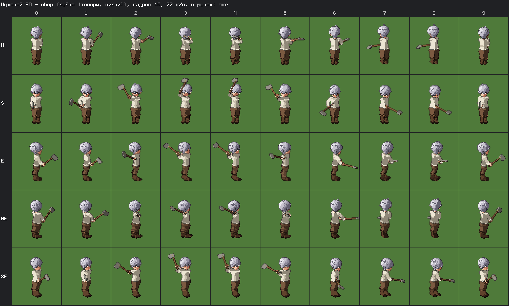

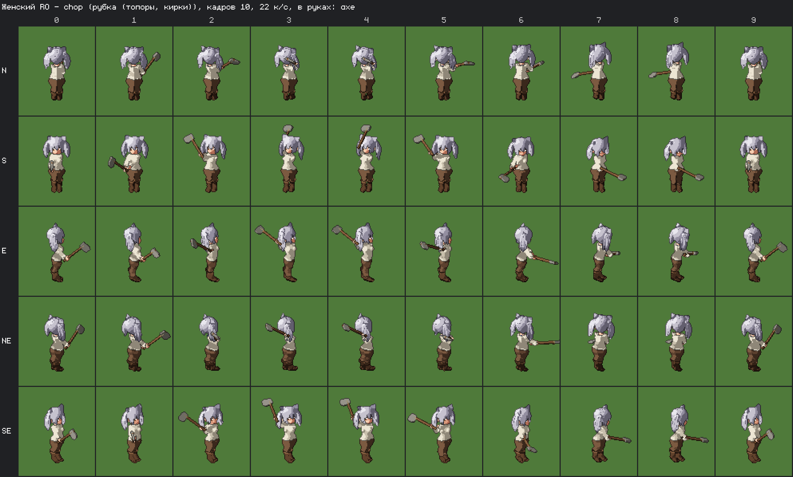

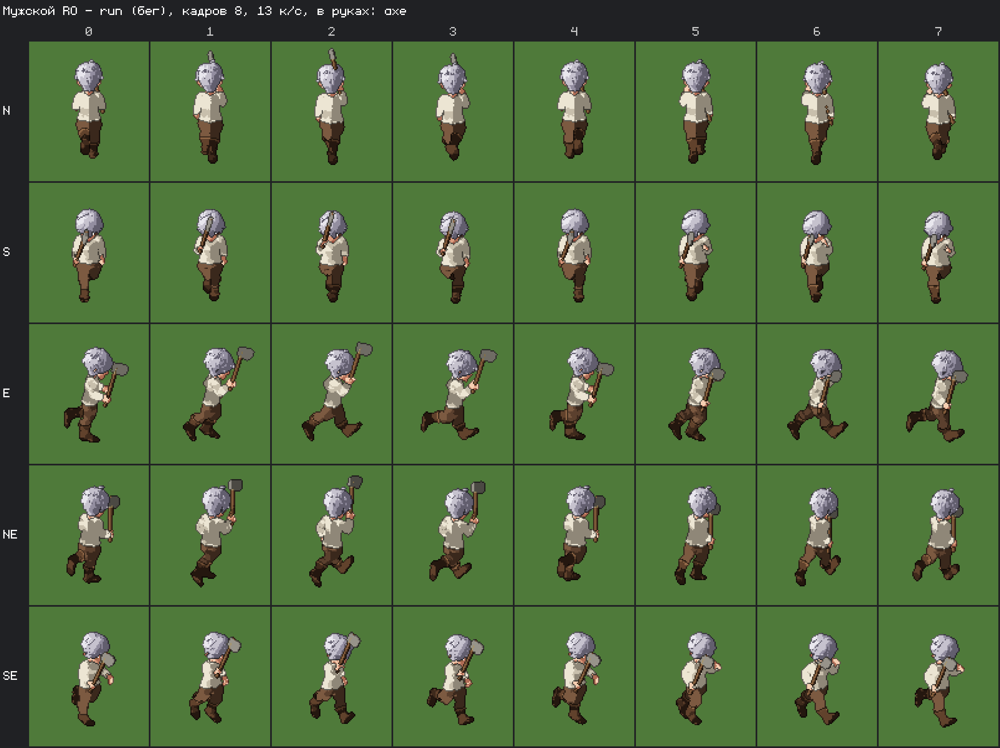

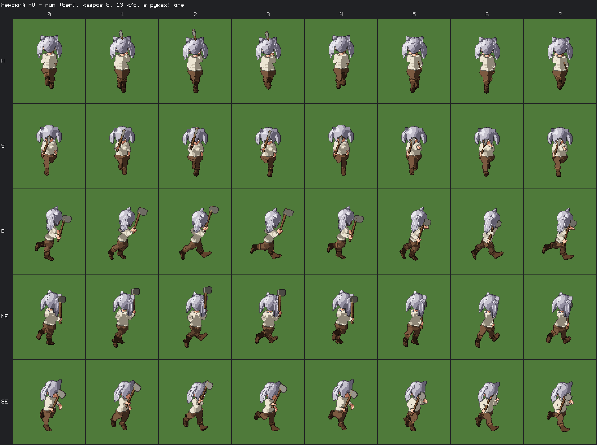

Те же позы в самой игре (3D-вид, `--poses`): стойка, ходьба, бег и все кадры рубки.

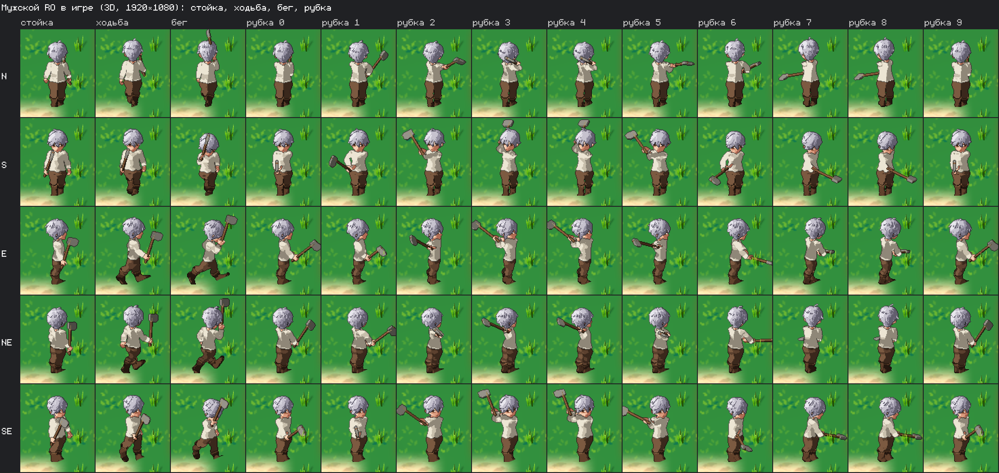

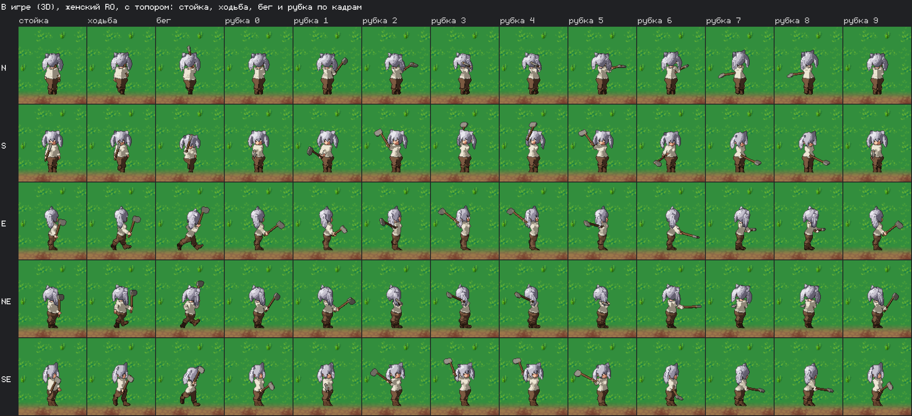

## Кирка

У кирки свой удар (`mine`; в игре у кирок `"swing": "mine"`, 2D- и LPC-персонажи
играют его как рубку): двумя руками над головой, корпус откинут назад, затем вниз
перед собой — корпус наклоняется в удар, колени пружинят, остриё уходит в камень
перед ногами.

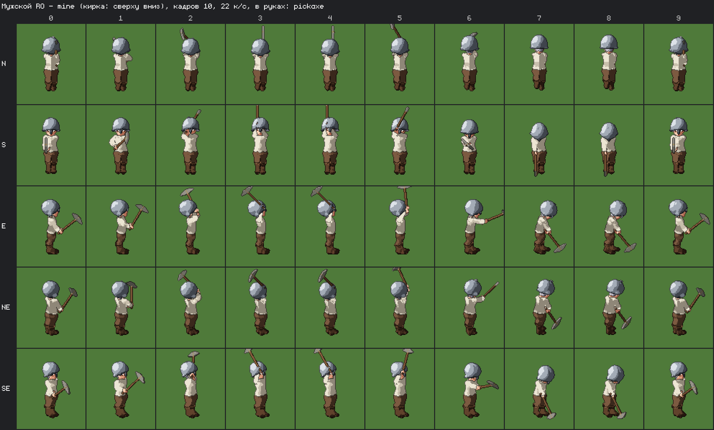

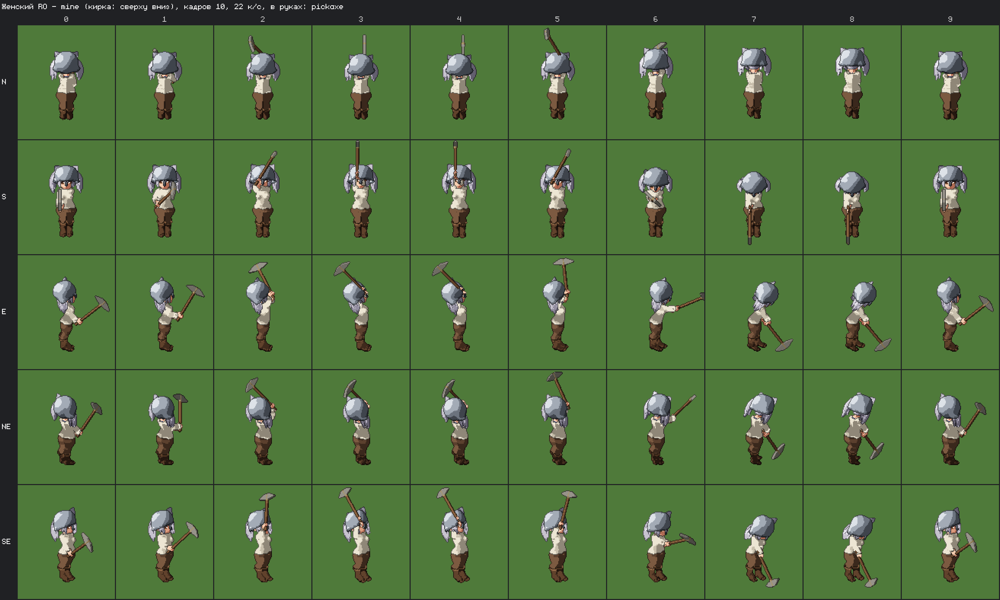

## Масштаб

Персонаж был в полтора раза выше LPC-жителей, а уменьшать его значило терять
детали (голова сжалась бы до 14 пикселей). Поэтому решено наоборот (ADR-0058):
мир относительно персонажа «вырос» вдвое, а сам персонаж снимается крупнее —
77 px на метр вместо 58. Его тексель теперь четверть пикселя мира
(`pixel_scale` 0,25), рост около 100 текселей — как у LPC-жителя (48 текселей LPC
по два пикселя экрана). Игра рисуется в разрешении экрана при той же разметке
960×540: интерфейс, мир и обзор прежнего размера, а на 1920×1080 один тексель
персонажа — один пиксель экрана. Глаза под голову в 27 пикселей стали шаблоном 5×6.

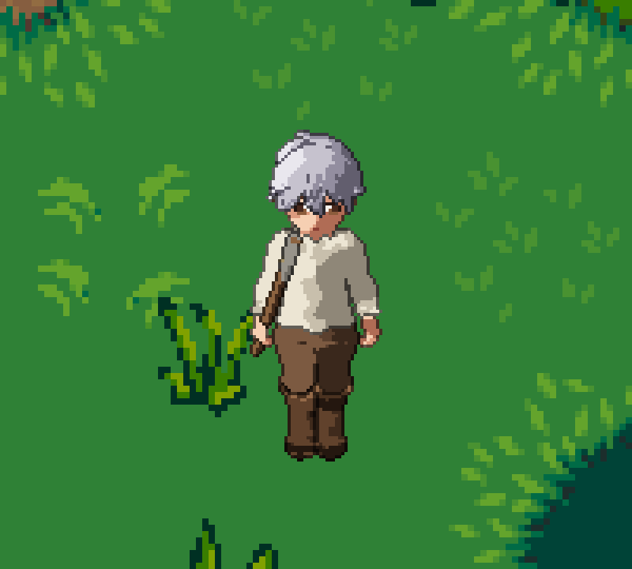

## Причёски

Причёски сняты с моделей VRoid под CC0 (pixiv: HairSample_Male, HairSample_Female,
Sendagaya Shibu, Sendagaya Shino, Sakurada Fumiriya, Victoria Rubin, Vita, Vivi;
`fetch_base.sh` скачивает их с проверкой sha256). `build_hair.py` переносит сетку волос
каждой модели на наше тело: подгоняет по коже головы (ширина и глубина, макушка на
макушку) и вешает на те же кости. Вес костей, которых у нас нет (пружинные кости волос),
переходит к ближайшему предку. Каждая причёска есть у обоих тел:

| Стиль | Модель | Название в игре |
|---|---|---|
| `tousled` | HairSample_Male | Взъерошенная |
| `twintails` | HairSample_Female | Два хвоста |
| `bob` | Sendagaya Shibu | Каре |
| `fluffy_bob` | Vivi | Пышное каре |
| `fringe` | Sakurada Fumiriya | С чёлкой |
| `long` | Sendagaya Shino | Длинные |
| `side_tail` | Victoria Rubin | Хвост набок |
| `cat_ears` | Vita | С ушками (кибер-ушки модели) |

У альфа-версий тех же моделей (AvatarSample D–G на OpenGameArt) причёски такие же.
AvatarSample A–C не подходят: их условия не CC0 и запрещают переносить данные модели в
сервисы создания персонажей.

**Цвет.** Волосы снимаются оттенками серого (`palette.HAIR`). Игра красит их в любой
цвет (`ro_hair.gdshader`, то же на Python — `hair.py`): средний серый становится
выбранным цветом, тёмные — его тенями, светлые — бликами к белому. В редакторе у тел RO
вместо списка цветов — цветовой круг.

**Срез под убором** (ADR-0059). У каждого убора есть «запретный объём»: вертикальный
цилиндр радиусом 45 см вокруг головы выше края убора. Он снимается для каждого кадра
только в глубину, ближней и дальней стороной. Пиксель волос, глубина которого лежит
между ними, внутри объёма и не рисуется; пряди ниже края остаются, даже если на экране
они рядом. Глубина пикселя волос лежит в его атласе (серый — красный канал, байт
глубины — зелёный), глубины объёма — в атласе убора. Пар «причёска под убором» нет:
каждая причёска и каждый убор снимаются один раз.

Все причёски в разных цветах волос и кожи (собраны из игровых атласов так же, как в `review_sheet.py`):
стойка, направления S, SE, E, N.

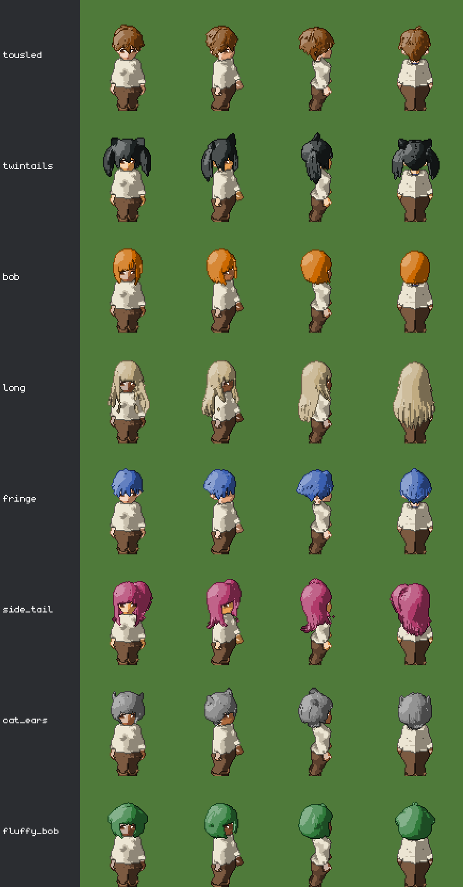

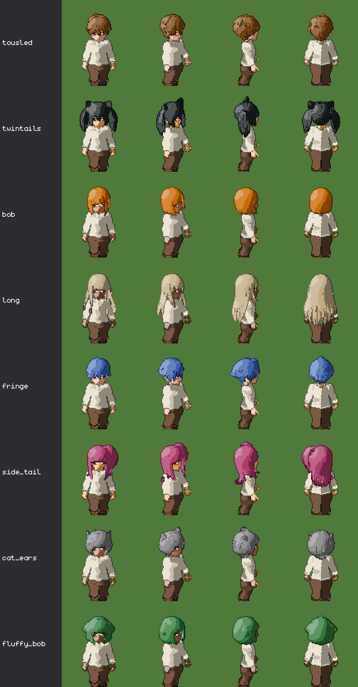

Под уборами (направления S и NE): без убора, фетровая шляпа, железный шлем, меховой
капюшон.

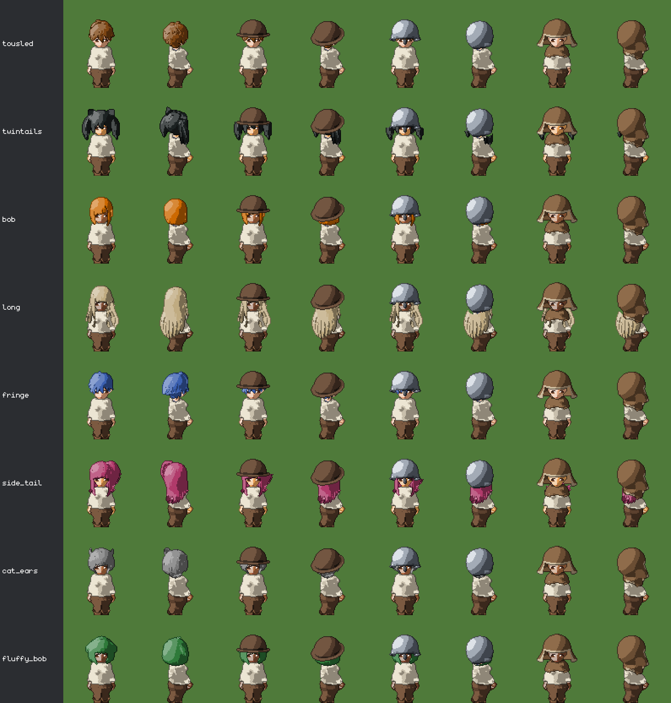

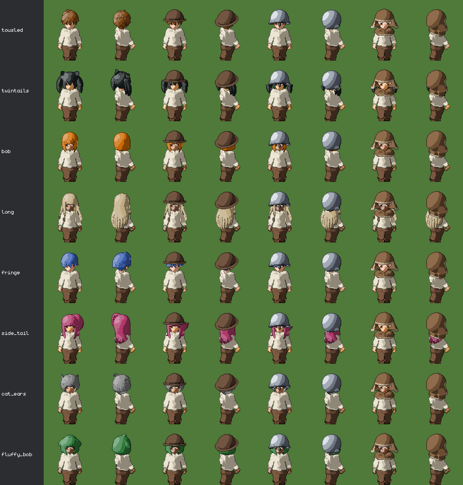

В самой игре: длинные волосы под фетровой шляпой (3D) и два хвоста под железным шлемом
(2D, ночь, дождь); направления S, SE, NE, N (`--hair=… --wear=…`, см. «Запуск»).

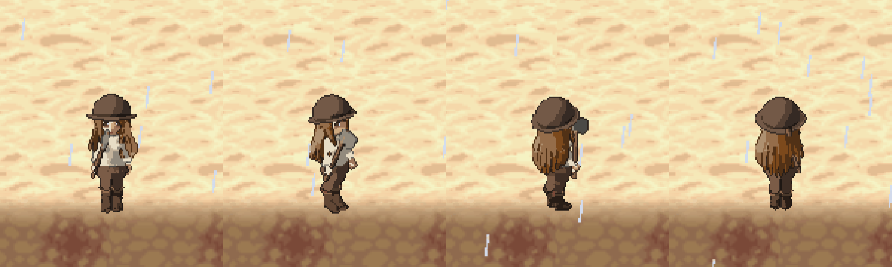

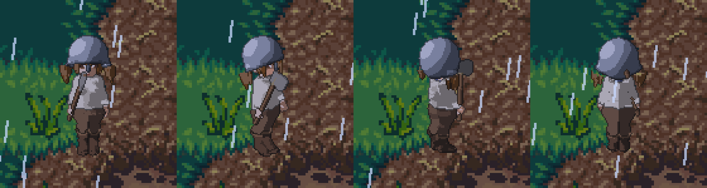

**Примерка (этап 6).** В редакторе персонажа под куклой есть выбор «Примерить»:
шляпа, шлем, «Стражник» (доспех, шлем, плащ), «Охотник» (капюшон, меховой плащ). Это
только для просмотра: персонаж начинает в одежде мира.

## Дальше

- Этап 6: конструктор персонажа.
