# Конвейер 2D-персонажей в стиле Ragnarok Online (8 направлений)

Ветка: `experiment/ro-sprite-pipeline` (от `experiment/3d-world`). Скрипты лежат в
`tools/art/ro_sprites/`, исходники и результаты в git не входят
(`art_src/ro_sprites/`, `build/ro_sprites/`).

Цель: генератор спрайтов тела, одежды и причёски для любой анимации в любом из 8
направлений и конструктор персонажа, который накладывает эти слои друг на друга.

| Этап | Что делает | Состояние |
|---|---|---|
| 1 | Базовая модель (мужская, затем женская) в пропорциях RO | мужская принята |
| 2 | Анимации базовой модели | 12 клипов, на оценке |
| 3 | Съёмка анимаций и idle в 8 направлениях | все клипы × 8 направлений |
| 4 | Одежда и амуниция: съёмка на невидимой модели | — |
| 5 | Причёски: съёмка так же, как одежды | — |
| 6 | Послойное наложение на базовую модель | — |

## Запуск

```bash
tools/art/ro_sprites/build.sh            # все клипы
tools/art/ro_sprites/build.sh walk chop  # только эти, остальные кадры остаются
PROPS=1 OUT=build/ro_sprites_props tools/art/ro_sprites/build.sh   # с палками-заглушками в руках
```

Нужны Blender 5.2 (`BLENDER=/путь/к/blender`, иначе `blender` из PATH или
`~/bin/blender-5.2.2-linux-x64/blender`) и Python 3 с Pillow и numpy. Рендер идёт
без окна (`blender -b`) и ничего не открывает на рабочем столе. Полная сборка
(664 кадра, два варианта) занимает около 3 минут.

Результат в `build/ro_sprites/`:
- `base_male.blend`: базовая модель с арматурой, её можно открыть в Blender;
- `pixels/<вариант>/` — тело без лица, `face/<вариант>/` — слой лица,
  `sprites/<вариант>/` — оба вместе; вариант `body` без волос, `hair` с пробной
  причёской из исходной модели (только для просмотра);
- кадры называются `<клип>_<направление>_<кадр>.png`, направления s, se, e, ne, n, nw, w, sw;
  клетка 128×128, точка опоры (земля под ногами) — столбец 64, строка 100, рост около 75 px;
- `preview/<вариант>/<клип>.gif`: клип во всех 8 направлениях; `<клип>.png` — все кадры листом.

## Этап 1: базовая мужская модель

Исходник: VRoid **HairSample_Male** (CC0, лицензия записана и в метаданных VRM)
из [madjin/vrm-samples](https://github.com/madjin/vrm-samples). Его скачивает
`fetch_base.sh` и проверяет по SHA-256.

`build_base.py`:
- убирает одежду, 3D-брови, ресницы, веки и рот; белки и радужки остаются кожей и
  закрывают глазницы, а зона глаз и рта выравнивается по гладкой поверхности лица;
- меняет пропорции масштабом костей и затем применяет позу как исходную:
  голова ×1,45, ноги по длине ×0,47 (и толще на 15 %), руки ×0,65, торс ×0,77.
  Получается рост 1,28 м и около 3,6 головы: голова с волосами, торс и ноги
  примерно равны, как в спрайтах RO;
- рисует облегающие тёмно-синие плавки атрибутом граней тела (без отдельной сетки);
- сглаживает нормали затенения, чтобы рельеф мышц VRoid не дробил заливку на пятна;
- ставит на кость головы метки `eye_r`, `eye_l`, `mouth`.

Материалы (`toon.py`, цвета в `palette.py`) дают три плоских тона на материал:
свет, полутень и тень. Цвет берётся из рампы по освещённости и выводится через
emission, поэтому в рендере нет промежуточных цветов.

`render.py`: ортографическая камера смотрит сверху под 22°, свет закреплён
слева сверху относительно экрана, поэтому все направления освещены одинаково,
как в RO. Поворачивается персонаж, а не камера. Кадр рендерится в 8 раз
крупнее спрайта (58 px на метр). В `anchors.json` записываются экранные точки глаз и рта:
насколько каждая точка повёрнута к зрителю и не закрыта ли телом.

`pixelate.py`: каждый блок 8×8 становится пикселем самого частого цвета в блоке.
Тёмные линии весят вчетверо больше, поэтому тонкие детали не теряются. Вокруг
силуэта рисуется контур в 1 px затемнённым цветом соседнего пикселя.

`face2d.py`: лицо рисуется пикселями, как в RO, а не лежит текстурой на 3D-голове.
В точках глаз ставится шаблон: полный для глаза, повёрнутого к зрителю, узкий
для глаза вполоборота, и никакого для отвёрнутого. Рот — 1–2 px. Лицо ложится
только на пиксели кожи, поэтому чёлка причёски остаётся поверх глаз. Лицо
выводится отдельным слоем, так что цвет глаз и выражение потом можно менять,
не перерендеривая тело.

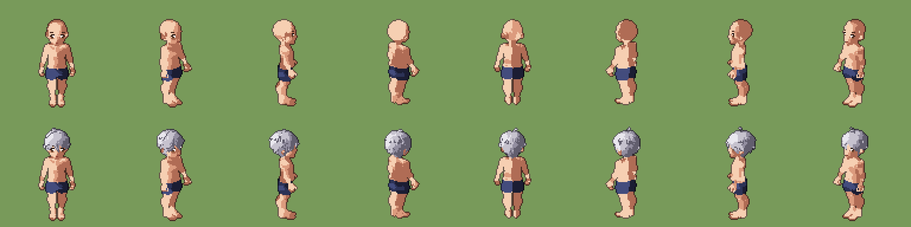

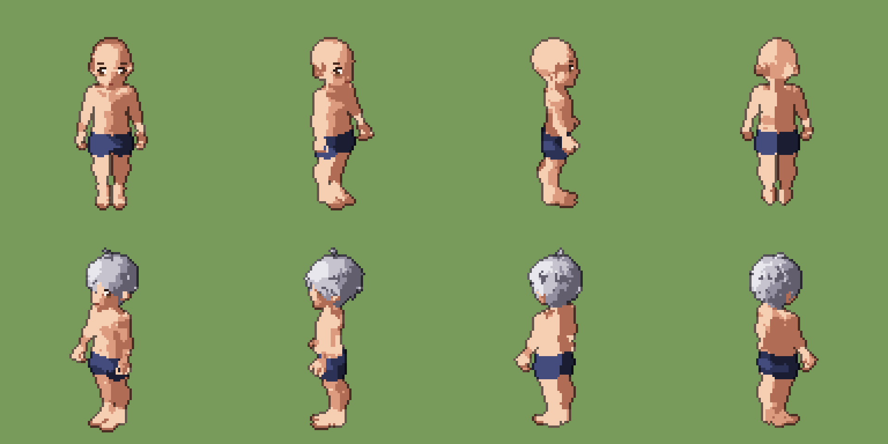

### Почему лицо не текстура

Первый вариант рисовал лицо текстурой на 3D-голове. При голове шириной около
20 px глаза размывались или пропадали при уменьшении, а сверху их закрывало
надбровье. Нарисованные пиксельные шаблоны в спроецированных точках дают
чёткие глаза в любом направлении и в любом кадре анимации.

## Этап 2: анимации

Позы задаются каналами (`rig.py`): каждый канал — одно анатомическое движение,
и плюс всегда означает естественное направление («локоть сгибается», «бедро
вперёд», «рука опускается из T-позы»). Поворот задан вокруг оси исходной позы и
переносится вместе с родительской частью тела: рука ходит в системе груди,
предплечье сгибается вокруг шарнира плеча. Поэтому поза читается одинаково при
любом повороте корпуса, и локоть или колено с плюсом не выгнутся назад.
После позы тело опускается или поднимается, пока нижняя вершина не коснётся
земли, так что шаги и приседания сами стоят на полу.

Клипы (`clips.py`): циклы заданы функциями фазы, действия — ключевыми позами
со сглаженными переходами. Оружие в правой руке, как в RO. Кадры и fps совпадают
с нынешними анимациями людей в игре.

| Клип | Кадры, fps | Что |
|---|---|---|
| idle | 4, 3 (цикл) | дыхание |
| walk | 8, 11 (цикл) | ходьба |
| run | 8, 13 (цикл) | бег |
| sit | 1 | сидит на земле, руки на коленях |
| pickup | 6, 12 | присесть и поднять с земли |
| hurt | 4, 12 | отшатнуться от удара |
| dead | 6, 10 | упасть на спину (последний кадр держится) |
| slash | 6, 16 | меч одной рукой: из-за плеча вниз наискось |
| chop | 10, 22 | топор, кирка, мотыга: над головой и вниз |
| thrust | 8, 18 | копьё: отвести и уколоть на прямой руке |
| shoot | 12, 22 | лук в левой руке: развернуться, натянуть, выстрелить |
| cast | 10, 18 | удочка или заклинание: замах назад и вперёд |

В кулаках есть точки хвата `grip_r`, `grip_l`. Ось предмета идёт через кулак
наискось (на 22° к пальцам), как рукоять лежит в ладони, поэтому в ударе
предмет продолжает линию руки, а не торчит вверх. Палки в превью — только
заглушки для проверки хвата, в слои тела они не входят.

Превью (с пробной причёской и заглушками):

| | |
|---|---|
| 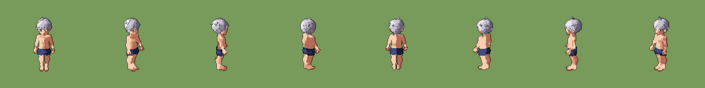 | 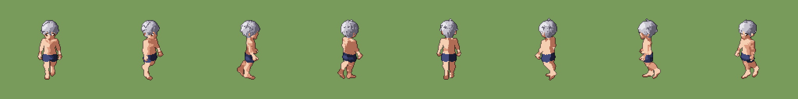 |
| 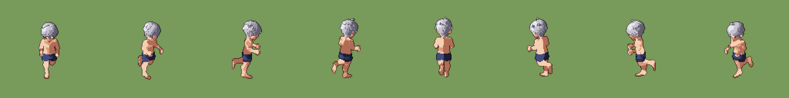 | 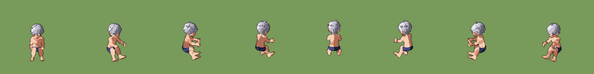 |
|  |  |
|  | 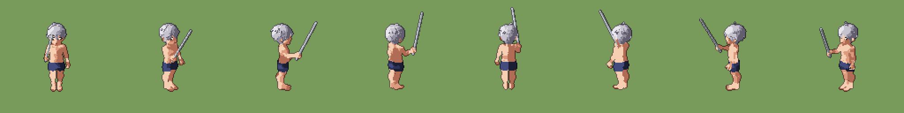 |
| 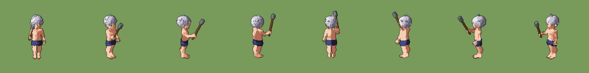 | 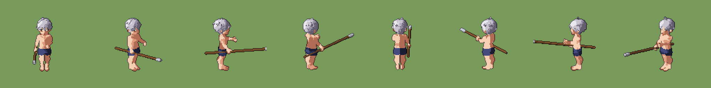 |
| 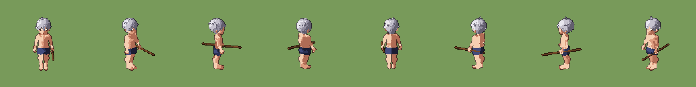 | 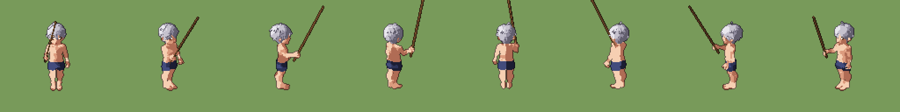 |

Известные ограничения:
- левая рука не держит древко копья и тетиву: двуручных хватов (IK) пока нет;
- длинные предметы (копьё, удочка) выходят за клетку 128: на этапе 4 у оружия
  будет своя клетка или своё смещение;
- плавки сделаны раскраской граней, поэтому край у них ступенькой по сетке.

## Дальше

- Женская модель на основе VRoid HairSample_Female (тоже CC0).
- Этап 4: одежда рендерится с телом в режиме holdout. Тело невидимо, но
  закрывает то, что за ним, поэтому слои потом совпадают пиксель в пиксель.
