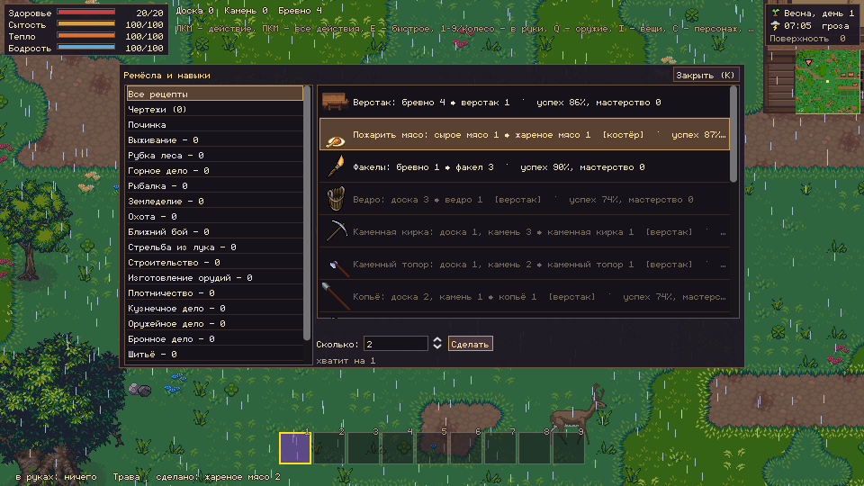
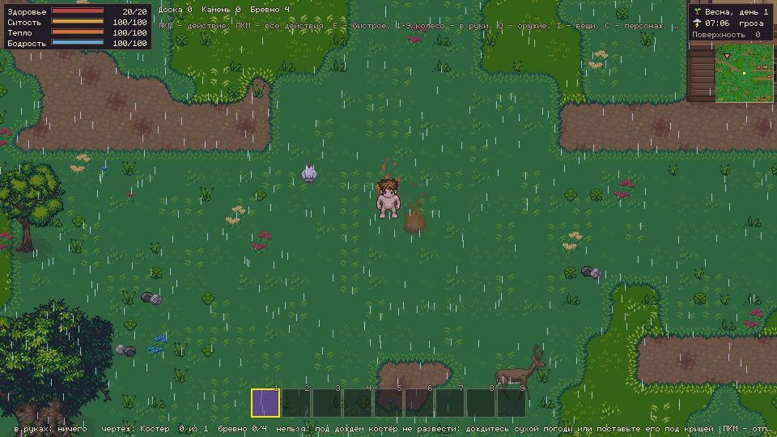
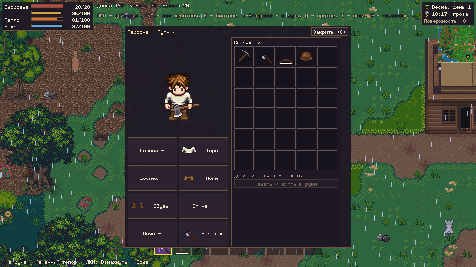

# Проверка замечаний, 24.10.2026

Исправления текущей версии собраны как **0.11.1**. Этап 0.12.0 приостановлен до отдельного указания автора.

## Костёр и дождь

Причина подтверждена в `ServerWorld.station_near`: погода исключала уже стоящий костёр из доступных станков. Прежние тесты готовки обходили это правилом `fires_douse = false`.

Теперь существующий костёр продолжает готовить, греть и светить в дождь. Новый открытый огонь без крыши или перекрытия не ставится под видимым дождём. Сервер возвращает `rain` до расхода материалов; чертёж клиента показывает ту же причину и текст для игрока.

Проверено в собранном Linux-клиенте обычными нажатиями мыши и клавиатуры, отдельно от тестового раннера. В изолированном сохранении был заранее поставлен костёр; сила дождя при подготовке — 0.814. В окне ремёсел приготовлены две порции мяса из трёх. Затем через каталог выбран новый костёр: красный чертёж и сообщение объяснили отказ, четыре оставшихся бревна не потратились.

## Остальные исправления

- `WorldView` не освобождал три заранее созданных слоя карты, если `setup()` не вызывался. На тех же `test_actions` до исправления было 33 предупреждения об утечках, после — ноль. В полном прогоне также исчезли прежние 729 предупреждений `CanvasItem/ObjectDB`.
- В `test_mastery` фиксированный ID персонажа не делал испытание воспроизводимым: бросок включал случайный UUID запроса. Теперь ID запросов фиксированы в пределах каждого теста. Полный набор мастерства и два отдельных повтора проблемного случая прошли.
- `project.godot` и пакет контента имеют версию 0.11.1. Диагностическая версия `GameInfo.VERSION` берётся из настроек проекта, включая сборочную подстановку упаковщика.
- `build/release` пересобран: Linux, Windows portable, Windows setup, Debian package, SHA256SUMS. Контрольные суммы, целостность ZIP и версия Debian package проверены.
- EXE из установщика извлечён и сравнен с исходным EXE Windows-сборки: SHA-256 совпадает, `eabb0f72586a77943e4194072510ae55812e5f06032d50f07e9377ac49b6232b`.

## Сетевая графика — не закрыто

Автор уточнил условия: второй ПК — **Windows 11**, клиент из установщика. Доступа к этому компьютеру в текущем подключении нет.

Выполнены реальные запуски экспортированных Linux-приложений с новыми профилями:

1. Отдельный выделенный сервер и два клиента через ENet, адрес сервера `192.168.1.100`.
2. Опубликованный архив GitHub `v0.11.0`, проверенный по SHA256SUMS; режим «Создать сервер и играть» и второй отдельный клиент через LAN-адрес. Проверены мир, деревья, растения, вещи и голова в окне персонажа; движение второго игрока видно у первого.

Это **процессы на одном Linux-хосте**, а не проверка второго физического ПК. Захваты сделаны из окон X11 в Xvfb, renderer — Mesa llvmpipe. Они подтверждают работу приложения и настоящего ENet-соединения в этих условиях, но не работу Windows 11 или аппаратного Windows-драйвера.

Попытка дополнительного запуска Windows EXE в временном Wine не дала графического прогона: среда совместимости не смогла завершить инициализацию. Это не считается ошибкой игры и не является проверкой Windows 11.

Причина Windows-сбоя пока не установлена; графика и сетевой протокол на основании догадок не изменялись. Для продолжения нужен лог именно проблемного Windows-клиента или доступ к нему. В `build/release/diagnose-windows.cmd` подготовлен запуск существующего EXE с подробным логом (исходник — `tools/diagnose_windows.cmd`). Он использует обычный профиль клиента и не переписывает файлы игры; игра сохраняет свои данные как при обычном запуске. Лог, версия Windows и SHA-256 EXE сохраняются в `%TEMP%`. Скрипт на Windows 11 здесь не исполнялся; используемые флаги `--verbose` и `--log-file` поддерживаются экспортированной игрой и подтверждены её `--help`.

## Проверки

- `tools/run_tests.sh`: **373 tests, 0 failed checks, 453.1s**, exit 0. Две ошибки создания ENet host предусмотрены отрицательными сценариями. Предупреждений об утечках нет.
- `tools/run_tests.sh --only=test_local_weather`: 6 тестов, 0 проваленных проверок.
- `tools/run_tests.sh --only=test_play --test=campfire`: 2 теста, 0 проваленных проверок.
- `tools/run_tests.sh --only=server/test_crafts`: 12 тестов, 0 проваленных проверок.
- `tools/run_tests.sh --only=server/test_mastery`: 7 тестов, 0 проваленных проверок; проблемный случай отдельно повторён дважды.
- `tools/run_tests.sh --only=persistence/test_world_store`: 7 тестов, 0 проваленных проверок.
- `sha256sum -c SHA256SUMS`, `unzip -t`, `dpkg-deb -f ... Version`: успешно.
- [GitHub CI коммита 8e644f5](https://github.com/mirivlad/noheroneeds/actions/runs/40094289228): success.

Бинарники собраны локально. Релиз 0.11.1 на GitHub не публиковался.
