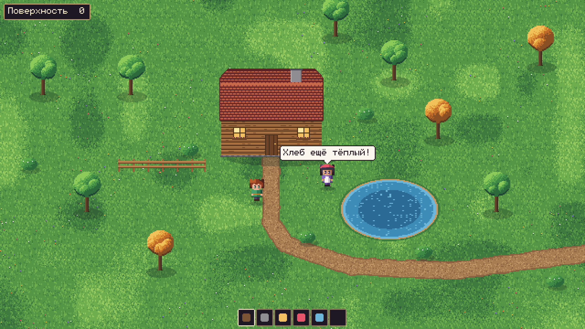
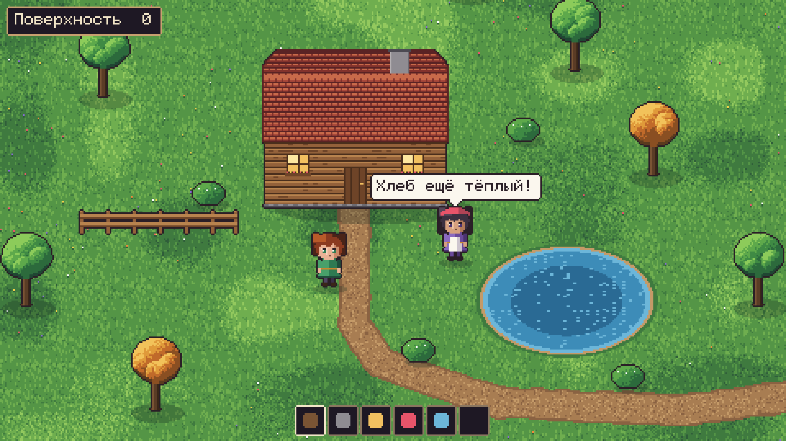
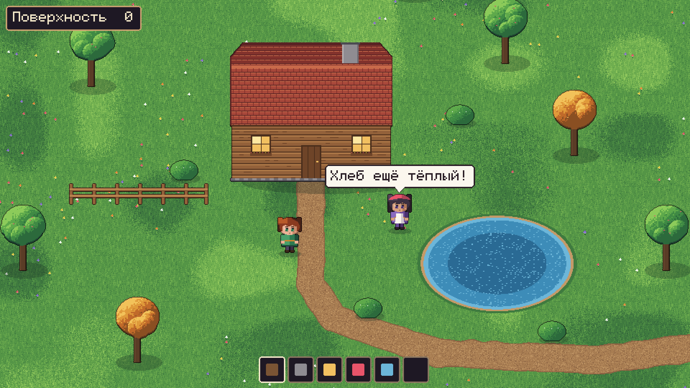
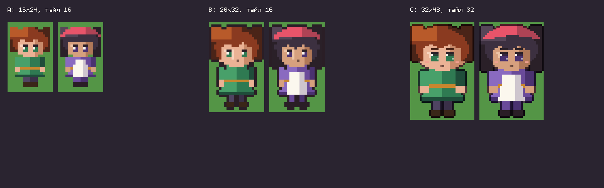

# Предложение 001 — фундамент нового 2D-проекта

**Дата:** 14 октября 2026 · **Статус:** на согласовании с автором.
Ничто здесь не принято, пока автор не подтвердит. Принятое переносится в `docs/design/GDD.md` и в журнал решений (`docs/adr/`), отклонённое — вычёркивается отсюда с причиной.

Документ отвечает на задание `docs/design/CLAUDE_BRIEF.md`, пункты 1–7.

---

## 1. Принятые инварианты, которые я держу

1. **Настоящее 2D, пиксель, вид сверху-спереди**, чиби/аниме-персонажи с анимацией, богатая сезонная палитра. Не изометрия и не 3D под пиксельным фильтром. От прежней 3D-версии ничего не берём.
2. **Без MVP и без финала.** Мир растёт направлениями годами; каждая рабочая версия играбельна; «готово» относится только к отдельному изменению, проверенному сохранением, перезапуском и сетью.
3. **Сервер авторитетен всегда**, и в одиночной игре тоже (там он локальный). Клиент — ввод, отображение, допустимое предсказание своего движения.
4. **Мультиплеер и выделенный сервер — с первого дня.** 10–20 игроков — ориентир, который подтверждается только замерами.
5. **Одна бесшовная поверхность Z=0** из чанков. Первый этаж, двор, улица, открытая крепость — её часть; вход в дом скрывает кровлю на месте, без телепорта.
6. **Верхние этажи и подземелья — отдельные локации** с постоянным `location_id`; номер `+2`/`−1` — только метка в интерфейсе. Переходы — явные порталы (лестница, люк, вход в пещеру).
7. **Стены не создают этаж, создаёт перекрытие.** Перекрытие и кровля — разные свойства. Огороженный двор остаётся открытой поверхностью.
8. **Крыши, настилы, мосты — наружные позиции с высотой:** с них видна и простреливается поверхность, их видят снизу. Закрытый этаж без проёмов наружу не видит. Бой между крышей и улицей идёт в едином серверном контексте.
9. **Честное восприятие:** видимость считает сервер; NPC помнит последнюю известную позицию цели, а не знает текущую.
10. **Нет свободного копания вниз и нет Z-слоёв Dwarf Fortress.**
11. **Подземелье генерируется один раз** при первом входе и дальше хранится как каноническое состояние, не зависящее от генератора. Обновление генератора не трогает посещённое и изменённое — ни пещеры, ни чанки поверхности.
12. **Редактор персонажа — фундамент:** один формат внешности для создания, предпросмотра и последующих изменений; стабильные ID стилей, а не индексы массивов и пути к текстурам.
13. **Переносимый персонаж отдельно от мира:** `PortableCharacter` ≠ `WorldCharacterState` ≠ мировая собственность ≠ аккаунт. Персонаж не хранится только внутри файла мира. Принимающий сервер сам проверяет импорт; семантика переноса (переезд/копия) **не выбрана**.
14. **Контент — данными** со стабильными ID с пространством имён (`base:oak_log`); никакой логики по имени конкретного предмета. Пакеты объявляют ID, версию, зависимости.
15. **Сохранения — ценность:** версия схемы в каждом файле, миграции, бэкап перед опасным преобразованием, идемпотентные операции (повторный пакет не даёт второй стены или второго предмета).

---

## 2. Что действительно блокирует начало

Большинство открытых вопросов (`OPEN_QUESTIONS.md`) можно не решать сейчас — архитектура оставляет их открытыми. Блокирует только один, частично — ещё два.

### Блокирует сейчас: Q-04 — пиксельный масштаб и технология анимации

От него зависят формат слоёв персонажа, редактор, все ассеты. Не зависят: сервер, сохранения, контент, сеть — их можно начинать параллельно.

**Масштаб** — см. раздел 5, там три пробы.

**Технология анимации**, варианты и последствия:

| Вариант | Плюсы | Минусы |
|---|---|---|
| Покадровая, одним листом | Максимум выразительности чиби | Каждая одежда × каждая анимация × каждое направление рисуется заново; редактор почти невозможен |
| 2D-кости (cutout, `Skeleton2D`) | Новая одежда дешёвая | Поворот пиксельных частей даёт «лесенки» и мыло, пиксельный чиби-язык страдает |
| **Слоистые кадры («бумажная кукла»)** | Тело — покадровое; волосы, одежда, броня, предмет в руке — отдельные листы на той же сетке кадров; редактор = выбор и перекраска слоёв | Каждый новый предмет одежды всё равно рисуется на все кадры, но только его слой |

**Моя рекомендация — слоистые кадры.** Цвета волос/кожи/одежды — палитровой подменой (shader с рампами), а не отдельными листами.

Попутный вопрос, тоже художественный: **4 или 8 направлений** движения. 8 почти удваивает стоимость каждого слоя. Рекомендую 4.

### Частично: Q-13 — идентификация игроков на частных серверах

Для первого сетевого шага нужно, чтобы клиент как-то назывался серверу. Предлагаю **временную dev-идентичность**: имя + локально сгенерированный ключ, явно помеченная «недоверенная», без политики. Поле `ownership` профиля остаётся открытым. **Решение понадобится до первого публичного сервера**, не раньше.

### Частично: Q-05 — высота построек и опоры

Нужен к шагу «перекрытие и верхний этаж» (раздел 6, шаг 9), не раньше. Тогда я принесу конкретный вопрос с вариантами. Временное правило для тестов будет помечено как временное.

### Не блокируют сейчас
- **Q-01/Q-02/Q-03 (перенос, владение, чужой контент)** — формат профиля держит секции `transfer` и `ownership` открытыми; импорт в тестах — «тестовая копия» с явным флагом; неизвестный контент пока отвергается с понятным отчётом (самый безопасный вариант, ничего не закрепляет).
- **Q-09 (масштаб поверхности)** — при хранении каждого чанка целиком после первой генерации (см. 4в) все варианты остаются открытыми.
- **Q-06, Q-07, Q-08, Q-10, Q-11, Q-12** — понадобятся позже, на своих направлениях.

### Инженерные решения, которые я предлагаю принять сам (можно возразить)

| Решение | Почему | Альтернатива |
|---|---|---|
| **Godot 4.7.2** (как в Dust City) | Стабильная версия, уже установлена с шаблонами экспорта | 4.6.2 — незачем |
| **GDScript со статической типизацией** | Как в Dust City; быстрая итерация; горячие места позже — в GDExtension | C# — тяжелее сборка/экспорт, отдельный рантайм |
| **Своя симуляция на обычных объектах, вне дерева сцен** | Тестируется headless без сцен; сервер не рисует; локации не требуют отдельных физических миров Godot | Узлы и физика Godot на сервере — сложно держать много локаций и детерминированные тики |
| **Свой протокол поверх ENet**, без `MultiplayerSynchronizer` для мира | Интерес-менеджмент «крыша → улица», постоянные ID и идемпотентность нужны под нашим контролем | Встроенная репликация — проще старт, но упрётся в межлокационную видимость |
| **Сохранения: каталог мира, JSON с `schema_version`, атомарная запись (tmp + rename), журнал подтверждённых операций** | Читаемо, легко мигрировать и проверять глазами первые годы; формат прячется за интерфейсом `persistence` | SQLite через GDExtension — транзакции даром, но зависимость; можно перейти позже за тем же интерфейсом |

---

## 3. Структура проекта

Главная идея: **игровой мир живёт в доменной симуляции на сервере, сцены Godot только показывают его.**

```
project.godot
src/
  core/            ID (UUID, ContentId), часы симуляции и тики, потоки RNG, общие типы событий
  content/         загрузка пакетов, реестры определений (материалы, предметы, постройки, биомы)
  world/           мир (seed, версии генерации), чанки поверхности, генераторы поверхности
  locations/       Location, сетка локации, Portal, генераторы подземелий, generated_once
  building/        части построек, связность здания, области перекрытий, создание уровней
  perception/      модель заслонения по высоте, линия видимости, знания NPC о целях
  sim/             сущности и их свойства, действия, системы тика (движение, позже бой и природа)
  characters/      PortableCharacter, схема внешности, навыки, инвентарь; экспорт/импорт и проверка
  world_characters/ WorldCharacterState: положение, права, репутация в конкретном мире
  persistence/     хранилище мира, журнал, снимки, версии схем, миграции, бэкапы
  network/         транспорт (в памяти / ENet), протокол сообщений, сессии, интерес-менеджмент
  server/          GameServer: собирает системы, тик, приём запросов с ключами идемпотентности
  client/          GameClient: соединение, зеркало состояния, предсказание своего движения
  presentation/    сцены: мир (TileMapLayer), слоистый персонаж, скрытие кровли, облачка, UI, редактор
content/base/      пакет базового контента: pack.json, определения, спрайты
tests/             headless-раннер, модульные и сценарные тесты (несколько клиентов в памяти)
tools/             run_tests.sh, run_server.sh, пробы арта
docs/              design/ (GDD), adr/ (решения), proposals/ (предложения)
```

**Как это запускается:**
- **Одиночная игра** — в одном процессе `GameServer` и `GameClient`, соединённые транспортом в памяти. Тот же код, что и в сети.
- **Выделенный сервер** — тот же проект с `--headless` и серверной точкой входа.
- **Тесты** — сервер и N клиентов в одном процессе через транспорт в памяти: быстро и детерминированно. Отдельный тест — настоящий ENet на localhost.

**Две сквозные идеи модели пространства:**
- **Уровни здания живут в той же сетке XY, что и поверхность.** Клетка `(x, y)` этажа `+1` находится ровно над клеткой `(x, y)` улицы. Тогда прыжок из окна приземляется в понятную точку, а обзор с крыши проецируется на поверхность без пересчётов. У подземелий своя сетка.
- **Модель заслонения «столбы по высоте»:** для каждой клетки XY известны занятые по высоте участки — стена первого этажа `0..3 м`, перекрытие, стена второго этажа, парапет крыши. Линия видимости — отрезок между двумя точками с высотой, проверяемый по клеткам под ним. Одна дешёвая модель покрывает закрытый этаж (стены по всей высоте), окно и бойницу (разрыв в стене), стену двора (низкая — с крыши видно поверх) и крышу. Это не свободная 3D-геометрия: высота — свойство клетки и уровня.

**Что из этого вытекает для правил:** клетка считается *крытой*, если над ней есть перекрытие или кровля. Крытые клетки поверхности — интерьер (кровля скрывается, когда игрок внутри). Некрытые клетки любого уровня — *наружные* (двор, терраса, крыша). Это и даёт «стена без потолка не делает этаж».

Каталоги создаются по мере появления реального кода, а не все сразу.

---

## 4. Потоки данных

### (а) Перекрытие и появление верхнего этажа

```
Клиент: BuildRequest{request_id, part: base:wood_ceiling, location: surface, cells}
  → Сервер, building:
      если request_id уже обработан → вернуть прежний результат (без второго списания)
      проверить права на участок, материалы в инвентаре, занятость клеток,
      опору (временное правило до Q-05)
  → одна транзакция: списать материалы + поставить части + запомнить request_id
  → persistence: запись в журнал (до ответа клиенту)
  → building: пересчитать области перекрытий здания
      нет уровня +1 → создать Location{type: building_level, building_id, z_label: +1,
                       та же сетка XY, buildable = клетки перекрытия}
      есть → расширить buildable
  → perception: обновить столбы заслонения затронутых клеток
  → presentation-данные: клетки под перекрытием стали крытыми (интерьер/кровля)
  → network: разослать изменения клиентам, у которых эта область в интересе
Лестница позже: пара Portal (клетка улицы ↔ клетка +1).
```

Проверки: стена вокруг двора без перекрытия не создаёт уровень; повтор пакета не списывает материалы дважды; после перезапуска уровень +1 тот же (`location_id` сохранён).

### (б) Выстрел с крыши по врагу на поверхности

```
Клиент на крыше: AttackRequest{request_id, weapon, target: entity_id | точка}
  → Сервер, combat (в sim):
      стрелок на наружной клетке? (крыша/настил, а не закрытый этаж)
      цель видима? perception: отрезок (стрелок, высота крыши + рост)
                   → (цель, высота земли + рост) по столбам заслонения
      дальность с учётом высоты; оружие готово
  → результат (попадание/промах/урон) применяется на сервере
  → событие ShotFired / DamageDealt
  → network: клиентам с интересом к поверхности в этой области и к этой крыше
  → враг (ИИ) получает знание «меня обстреляли отсюда»: позиция стрелка, если она видна ему
```

Интерес клиента на крыше = его уровень + область поверхности в радиусе обзора. Интерес клиента на улице включает наружных игроков на крышах рядом — иначе враг-игрок их не увидит. Содержимое закрытых этажей посторонним не рассылается. Ушёл с крыши — у врага остаётся последняя известная позиция.

### (в) Сохранение посещённой процедурной пещеры

```
Игрок входит в Portal пещеры. У портала target = null и
  generator_spec{generator: base:cave, version: 3, seed: f(seed мира, portal_id)}
  → Сервер, locations: локации ещё нет
      сгенерировать генератором v3
      сериализовать ЦЕЛИКОМ: сетка, порталы, сущности, сундуки
        + generated_by{base:cave, 3} — только для справки
      persistence: атомарно записать locations/<uuid>.json, привязать target портала
      — и только потом впустить игрока
  → изменения (сундук, дверь, добытая руда) → журнал → периодический снимок локации
Перезапуск сервера: локация читается с диска, генератор не вызывается.
Генератор обновлён до v4: старые пещеры не меняются; новые входы получают v4.
```

То же правило для поверхности: чанк сохраняется целиком после первой генерации. Тогда смена генератора не сдвигает посещённые места. Цена — диск; чанк 32×32 клетки — единицы килобайт. Шов между старыми и новыми чанками — вопрос к Q-09, когда до него дойдём.

Тест: сгенерировать v1 → изменить → сохранить → подменить генератор на v2 → загрузить → геометрия и изменения совпадают байт в байт.

### (г) Экспорт и проверка импортируемого профиля персонажа

```
Экспорт (сервер или локальное хранилище профилей):
  PortableCharacter → канонический JSON {format: nhn.character, schema_version,
    character_id, identity, appearance{style_id, parameters}, progression,
    inventory[{content_id, count, state, item_uuid}], equipment, known_recipes,
    content_manifest{packs + версии}, ownership: ОТКРЫТО, transfer: ОТКРЫТО}
  → файл .nhnchar

Импорт — только на принимающем сервере, клиент лишь передаёт байты:
  1. лимит размера → разбор → format/schema_version известны?
  2. миграция схемы до текущей версии (старые версии — через цепочку миграций)
  3. структурная проверка: типы, диапазоны, длины строк, уникальность item_uuid
  4. контент: каждый content_id и style_id есть в пакетах сервера?
     нет → пока отказ с отчётом, что именно отсутствует (Q-03 открыт)
  5. правила сервера: допустимые навыки, уровни, предметы
  6. владение (Q-02) и семантика переноса (Q-01) — заглушки «тестовая копия»
  7. создать новый WorldCharacterState у точки появления;
     дома, участки, сундуки мира и репутация в профиль не входят и из него не берутся
```

Тесты: корректный, повреждённый, слишком большой, с будущей версией схемы, с неизвестным предметом, с «подкрученными» навыками сверх правил сервера.

---

## 5. Художественные пробы: масштаб и стиль

Одна и та же сцена в трёх масштабах, показанная так, как она выглядит на экране 1920×1080 при целочисленном увеличении. **Это процедурные эскизы для выбора масштаба, а не арт игры:** деревья, дом и персонажи нарисованы кодом (`tools/art_probes/make_probes.py`), чтобы честно сравнить размеры, читаемость и обзор. Настоящий стиль рисуется после выбора.

| | **A** | **B** | **C** |
|---|---|---|---|
| Тайл | 16 px | 16 px | 32 px |
| Чиби | 16×24 | 20×32 | 32×48 |
| Внутреннее разрешение | 640×360, ×3 | 480×270, ×4 | 960×540, ×2 |
| Видно тайлов | 40×22 | 30×17 | 30×17 |
| Контур | без контура (ближе к Dust City) | тёмный контур | цветной контур, больше деталей |
| Лицо | глаза 2×3, эмоции почти не читаются | глаза 2×3 крупнее на экране, читаются | глаза 4×5 с бликом, брови, румянец, рот |
| Стоимость ассета | 1× | 1× (те же тайлы, что A) | ≈4× пикселей на тайл и персонажа |






**Что важно для выбора:**
- **Обзор нужен игре:** осады, стрельба с крыш, обзор подходов. При A по каждой оси видно на треть больше, по площади — почти вдвое (900 тайлов против 510).
- **Эмоции несут портреты визуальной новеллы**, а не спрайт в мире. Поэтому спрайту в мире не обязательно быть крупным, чтобы диалоги были выразительными.
- **Редактор персонажа** (волосы, уши, хвосты, аксессуары) просит пикселей: при 16×24 звериные уши — это 2 пикселя.
- **A и B используют одни и те же тайлы.** Значит, у масштаба 16 есть бонус: камера может переключаться ×4 ↔ ×3 (например, отдаление на крыше или в осаде) без новых ассетов.

**Моя рекомендация: B** — тайл 16, чиби около 20×32, обычный вид ×4 и отдаление ×3. Это компромисс между обзором, ценой ассетов и читаемостью персонажа. Если для вас важнее детальный персонаж и редактор, чем стоимость каждого ассета, — C.

---

## 6. Первая серия проверяемых шагов

Каждый шаг заканчивается рабочей веткой, тестами и обновлёнными документами. Номера — порядок зависимостей, а не этапы «готовности»; после шага 5 направления можно вести параллельно.

1. **Каркас.** Проект Godot 4.7.2, headless-раннер тестов, `tools/run_tests.sh`, CI на GitHub Actions, первый ADR (эта архитектура после согласования).
2. **Контент.** Стабильные ID, манифест пакета, реестры. Тест: новое дерево, предмет и рецепт добавляются только данными (сценарий 18).
3. **Сохранения.** Каталог мира, `schema_version` в каждом файле, атомарная запись, журнал, миграции, бэкап перед миграцией. Тесты: круговая запись/чтение, повреждённый файл, миграция v0→v1 по фикстуре (сценарий 19).
4. **Переносимый персонаж.** `PortableCharacter` + схема внешности v1 + экспорт/импорт с проверками на сервере. Тесты: сценарии 15, 16 и весь список из 4г.
5. **Сервер и клиент.** Тик, транспорт в памяти, вход с персонажем, движение с предсказанием, репликация снимками, ключи идемпотентности. Затем ENet и `run_server.sh`; одиночная игра = локальный сервер. Тесты: два клиента видят друг друга; повтор пакетов; обрыв и переподключение.
6. **Поверхность.** Чанки, генератор v1 с парой биомов, сохранение чанка после первой генерации, подгрузка по интересу. Тесты: детерминизм по seed, сохранность после смены генератора, проход между чанками (сценарий 4).
7. **Персонаж на экране** — после решения по Q-04. Слоистый спрайт, редактор внешности v0 на стабильных `style_id`. Тесты: сценарии 1 и 2.
8. **Предметы и взаимодействие.** Подобрать, положить, контейнер — всё через сервер. Тесты гонок на дублирование (сценарии 3, 17).
9. **Строительство.** Стена, дверь, перекрытие, лестница, уровень +1, скрытие кровли, столбы заслонения. Здесь понадобится Q-05. Тесты: сценарии 5–7, 11.
10. **Восприятие и выстрел** между крышей и улицей, память NPC о цели. Тесты: сценарии 8–10, 12.
11. **Постоянное подземелье.** Портал, генерация один раз, сохранение, смена версии генератора. Тесты: сценарии 13, 14.
12. **Нагрузочный стенд.** N имитированных клиентов с замерами (сценарий 20).

Арт-направление (шаг 7) не откладывается «на потом»: выбор масштаба нужен до массового рисования, а шаги 1–6 его не ждут.

---

## 7. Что нужно от автора

1. **Масштаб:** A, B, C или иное — и нравится ли контур (B) или без контура (A).
2. **Анимация:** слоистые кадры («бумажная кукла») — да/нет; **4 или 8 направлений**.
3. **Кто и чем рисует производственный арт** — вы сами, генерация с доработкой (как в Dust City), смешанно? От этого зависит конвейер ассетов (форматы исходников, сетки, палитры).
4. **Инженерные решения из таблицы раздела 2** — есть ли возражения (Godot 4.7.2, GDScript, симуляция вне дерева сцен, свой протокол поверх ENet, JSON-сохранения с журналом).
5. Устраивает ли временная dev-идентичность игрока (Q-13) до решения о публичных серверах.

После ответов: фиксирую решения в ADR и GDD и начинаю с шагов 1–3.
