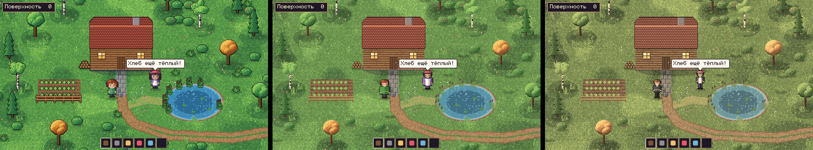
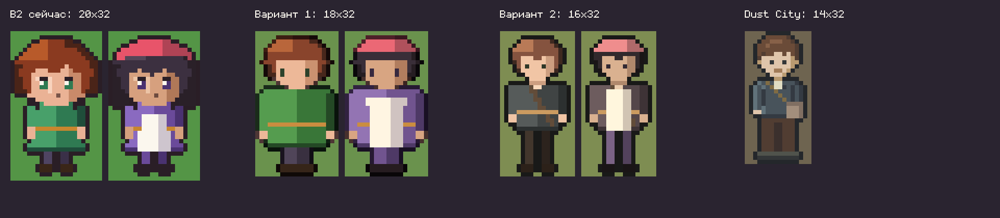
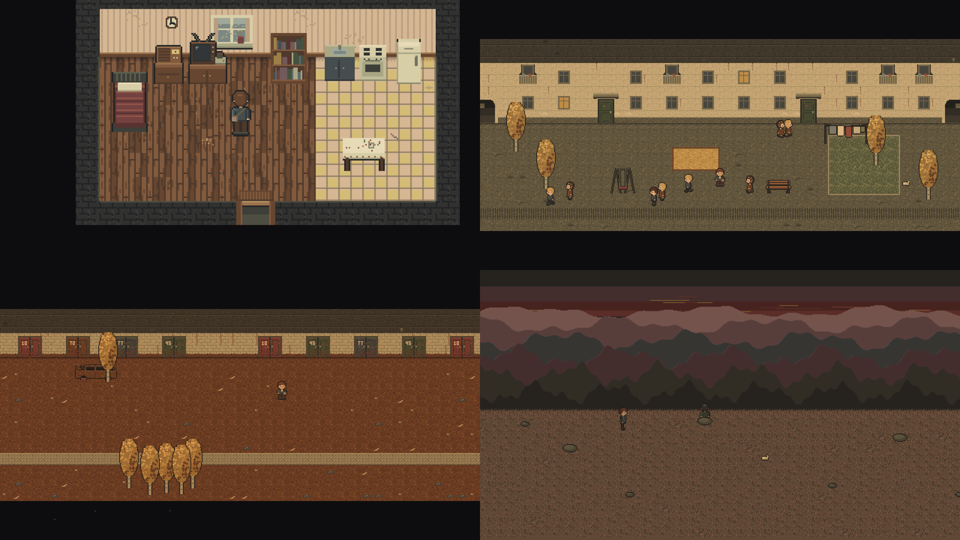

# Предложение 003 — сравнение манеры: чиби или ближе к Dust City

**Дата:** 14.10.2026 · **Статус:** на выборе автора. До выбора генерация по брифам 001–003 приостановлена: в них образцом стиля указана B2.

**Повод:** первый плейтест. Текущая временная графика (B2) кажется слишком детской, а атмосфера и вид персонажей Dust City нравятся больше. Автор готов отойти от чиби, записанного в GDD и ADR-0001, но сначала хочет увидеть сравнение.

## Что сравниваем

Одна и та же сцена в трёх манерах. Масштаб везде одинаковый: тайл 16, 480×270 ×4.

| | **B2 (сейчас)** | **Вариант 1 — «чиби, но взрослее»** | **Вариант 2 — «как Dust City, но светлее»** |
|---|---|---|---|
| Персонаж | 20×32, голова ~45% роста | 18×32, ~2,8 головы, маленькие глаза | 16×32, ~3,2 головы, стройный (Dust City — 14×32) |
| Одежда | яркая | та же, приглушённая | будничная, тёмная, с деталями (ремень сумки, ворот) |
| Контур окружения | цветной | нет | нет |
| Контур персонажей | тёмный | тонкий цветной | тёмный серо-синий, как в Dust City |
| Палитра | насыщенная | приглушённая природная | тёплая, оливково-землистая |
| Фактура | гладкая | лёгкое зерно | плотное зерно, как в Dust City |

Полноразмерные кадры: `art/scene_b2.png`, `art/scene_v1.png`, `art/scene_v2.png`.

## Как читать пробу

- **Это процедурные эскизы,** а не арт. Фигуры собраны кодом и угловаты. Они показывают пропорции, тон и фактуру, а не уровень рисунка. Производственный арт по брифам будет тоньше.
- **Формы окружения** (круглые кроны, игрушечный дом) одинаковы во всех трёх вариантах. Атмосфера Dust City держится и на формах: высокие фасады, плотная застройка, вытянутые деревья. Это меняется уже в брифах, после выбора манеры.
- **Палитра, контур, фактура и пропорции** — независимые ручки. Можно взять, например, пропорции варианта 2 и палитру варианта 1.

## После выбора

Обновлю ADR-0001 (пропорции, контур), ART_STANDARD (палитра, фактура, контур, план тела гуманоида), мастер-палитру и брифы 001–003. Перерисую временную графику игры в выбранной манере.
