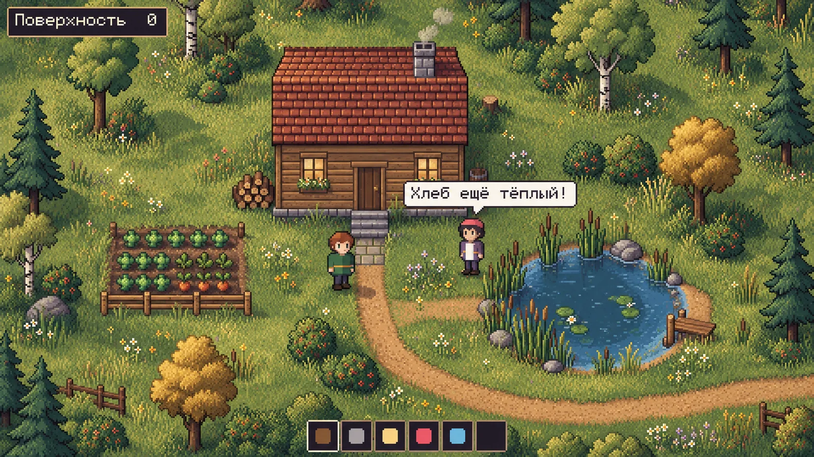
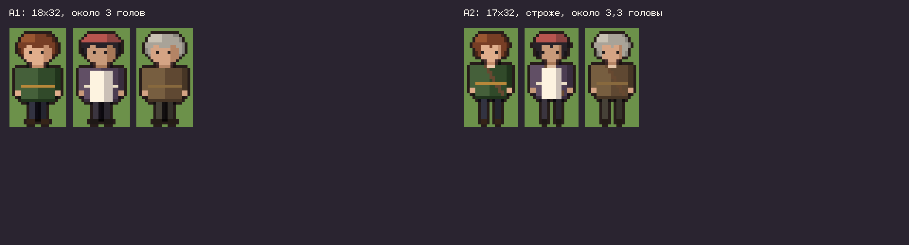
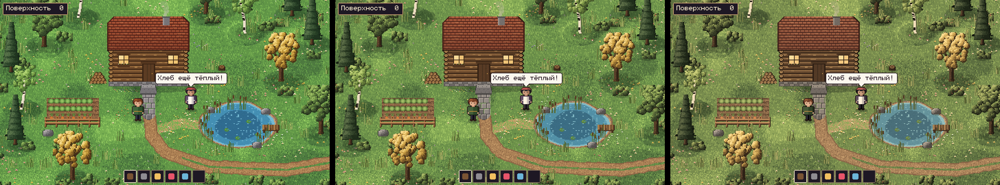

# Предложение 004 — художественный проход по брифу автора

**Дата:** 14.10.2026 · **Статус:** на выборе автора.

**Основание:** бриф автора «следующий визуальный проход» и референс `art/reference.png`. Цель: не так игрушечно и ярко, как B2; люди взрослее и с меньшей головой; палитра природная, приглушённая, тёплая; формы окружения менее круглые и сказочные; по настроению ближе к Dust City, но светлее, богаче и без копирования.

## Что изменено против B2/B3

- **Деревья** собраны из множества листовых гроздей, а не из шаров. Породы отличаются силуэтом:
  - дуб — неровная крона;
  - осенний дуб — охра;
  - берёза — наклонный белый ствол, рыхлая крона;
  - ель — высокая, ярусная, тёмная.
- **Кусты** неровные, часть с ягодами. Высокая трава пучками, цветы россыпями (белые, жёлтые, розовые).
- **Дом** строже:
  - высокий бревенчатый фасад, торцы брёвен по углам;
  - окна в рамах с наличниками, ящик с цветами;
  - дверь в раме, каменный фундамент;
  - черепица рядами с выносом, каменная труба с дымком;
  - каменные ступени к дорожке.
- **Пруд** с неровным берегом, камнями, камышом и мостками.
- **Огород** с капустой и морковью, поленница, бочка, пень, валуны.
- **Контур по ролям:** у людей один тёмно-коричневый контур, у окружения только мягкая тень по нижней и правой стороне, без сплошной обводки.
- **Фактура** — лёгкое зерно, без грязи.

## Тесты

**A. Люди.** Две пропорции, три внешности: житель, пекарша, старик. Обе с тёмным контуром.

| A1 | A2 |
|---|---|
| 18×32, около 3 голов | 17×32, строже, около 3,3 головы, с ремнём сумки |

**B и C. Окружение и палитры.** Один и тот же рисунок в трёх палитрах: светлая, средняя, землистая.

Полные кадры:
- `art/scene_middle_A1.png` — средняя палитра, люди A1;
- `art/scene_middle_A2.png` — средняя палитра, люди A2, житель и старик;
- `art/scene_light_A1.png`, `art/scene_earthy_A1.png` — светлая и землистая палитры.

**Комбинации разрешены:** пропорции из одного теста, палитра из другого, контур из третьего.

## Важно про уровень рисунка

Пробы нарисованы кодом и задают **параметры**: пропорции, палитру, формы, роль контура, плотность деталей. До уровня референса процедурный рисунок не дотянется — это задача генерации.

**После выбора:**
1. Референс автора становится образцом стиля во всех брифах вместо B2.
2. Обновляю ADR-0001 (пропорции гуманоида, контур по ролям), ART_STANDARD (палитра, формы, фактура), мастер-палитру и брифы 001–003.
3. Перерисовываю временную графику игры в выбранной манере.
